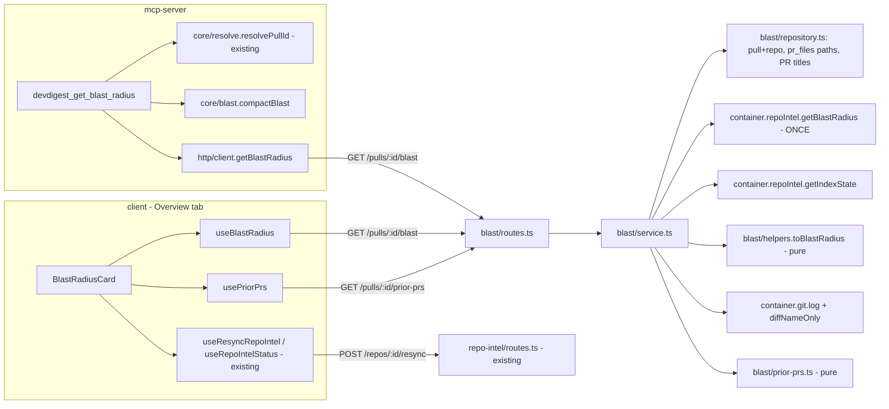
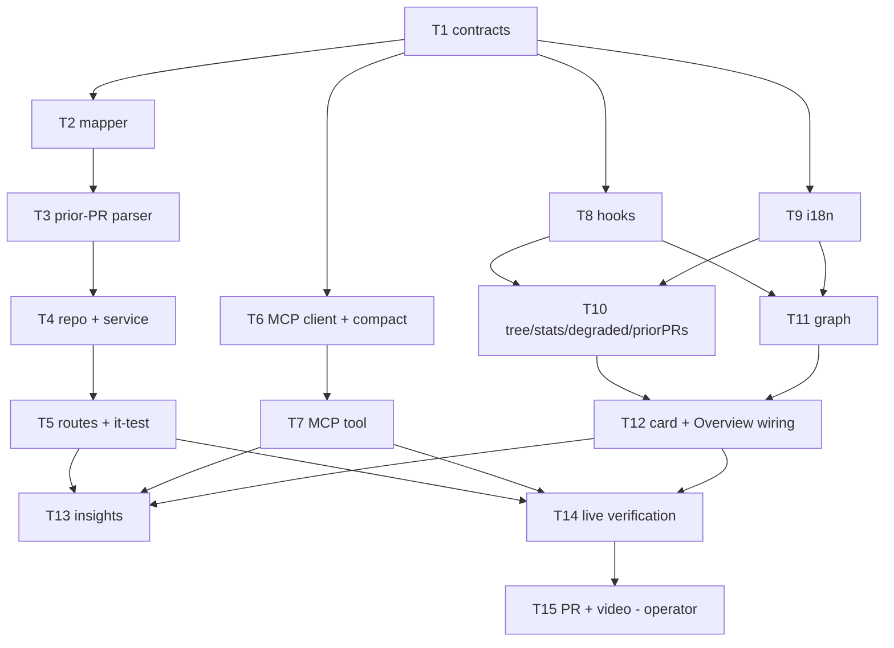

# Development Plan: Blast Radius (HW L04)

## Overview

Show reviewers **what else a PR can break**: a `Blast radius` block on the PR **Overview** tab and a
working `devdigest_get_blast_radius` MCP tool, both fed by ONE new read-only route
`GET /pulls/:id/blast`. The route reads the prebuilt repo-intel index through the existing facade
`container.repoIntel.getBlastRadius(repoId, changedFiles)` (called exactly once per request), maps the
flat `BlastResult` into the `BlastRadius` contract (grouped `downstream[]`), and passes `degraded`/
`reason` through honestly. No LLM call, no re-parse, no index rebuild. P3 extras: collapsible Tree,
SVG Graph view with a Tree/Graph toggle, crons separated from endpoints, rank ordering, a resync button
next to the degraded marker, i18n from `client/messages/en/blast.json`, and a "Prior PRs touching these
files" block served by a second read-only route `GET /pulls/:id/prior-prs` built from the local clone's
git history (works without a GitHub token).

Branch: `hw-4/blast-radius` (Lesson-4 lab `a3ea46d` + Anthropic adapter fix `427a1dc`). Source of truth
for the homework: `/home/ai/work/dev-digest-demo/hw4/task.md` + the 4 design screenshots in the same dir.

### Locked decisions (do NOT re-open during implementation)

- **One route, two consumers.** UI and MCP both read `GET /pulls/:id/blast`. MCP only compacts the
  response; it computes nothing.
- **Facade is consumed, not changed.** `server/src/modules/repo-intel/**` is read-only for this plan.
- **Additive contract file** `contracts/blast.ts` (both vendor copies) that `.extend()`s the existing
  `BlastRadius` / `PrHistory` schemas. `brief.ts` is NOT edited. A `BlastRadiusResponse` value always
  passes `BlastRadius.safeParse` (superset; zod strips unknown keys).
- **Prior PRs = local git history** (`container.git.log` + `container.git.diffNameOnly`), LLM-free,
  token-free. GitHub API enrichment is out of scope (no token in this environment; unverifiable).
- **Graph view = hand-rolled inline SVG** (pure layout helper + component). No new npm dependency.

## Requirements

P1 (blocks acceptance):
- R1: Overview tab of a PR shows a `Blast radius` block.
- R2: Summary row at the top: N symbols changed, N callers, N endpoints, N crons.
- R3: Under each changed symbol: its callers as `file:line`, and below them the endpoints that depend
  on that symbol.
- R4: On test PR #6 (`demo/hw4-blast-radius-fixture`) the map shows ≥2 real callers and ≥1 HTTP endpoint.
- R5: Clicking `file:line` opens exactly that line on GitHub.
- R6: No callers → a clear text instead of an empty block. Incomplete index → a separate marker with the reason.
- R7: `devdigest_get_blast_radius` in `mcp-server/` is a working tool (stub replaced) that returns the
  same map as the UI block when asked from Claude Code.
- R8: Open PR on the fork with an implementation description and a 1–3 min demo video.

P2 (mentor-reviewed):
- R9: Request-time logs show the ready index being read; AST/import graph are not rebuilt.
- R10: The route response validates against the `BlastRadius` contract.
- R11: Flat `callers` → grouped `downstream` mapping is unit-tested.
- R12: The main scenario makes zero LLM calls (no optional text summary is built — summary is a
  deterministic string).
- R13: The file where a symbol is declared never appears among that symbol's callers.
- R14: Limits (20 callers/symbol, BFS depth 2) come from `server/src/modules/repo-intel/constants.ts`,
  never hardcoded in a component.
- R15: `degraded` + `reason` from the facade reach the UI.
- R16: `get_blast_radius` follows the lab tool rules: short "when to call" description, clear arg schema,
  concise response, useful error for unknown PR, `readOnlyHint: true`.
- R17: PR description states which subagent did what.

P3 (operator scope: ALL of them are in scope):
- R18: Symbols collapse/expand like the tree screenshot.
- R19: Second view = Graph, with a Tree/Graph toggle (`view.tree` / `view.graph`).
- R20: "Prior PRs touching these files" block validated by the `PrHistory` schema; data source works
  without a GitHub token.
- R21: Crons shown separately from HTTP endpoints.
- R22: Symbols sorted by `rank` (most important first).
- R23: Next to the incomplete-index marker, a button calls `POST /repos/:id/resync`.
- R24: UI strings come from `client/messages/en/blast.json` (next-intl), none hardcoded.

## Baseline (verified on this branch, 2026-10-11)

| Check | Command (from repo root) | Baseline result |
|---|---|---|
| server typecheck | `cd server && npx -y pnpm@10 typecheck` | exit 2, **9** errors, all `TS18048` in `src/modules/reviews/repository/run.repo.severity.test.ts` (pre-existing) |
| server unit | `cd server && npx -y pnpm@10 exec vitest run --exclude '**/*.it.test.ts'` | **18 files / 107 tests** passed |
| server integration | `cd server && npx -y pnpm@10 exec vitest run .it.test` | **7 files / 52 tests** passed (Docker available) |
| client typecheck | `cd client && npx -y pnpm@10 typecheck` | exit 0, 0 errors |
| client tests | `cd client && npx -y pnpm@10 test` | **11 files / 32 tests** passed |
| mcp-server typecheck | `cd mcp-server && npx -y pnpm@10 typecheck` | exit 0 |
| mcp-server tests | — | no test script exists yet (added by T6) |

Rule for every task: server typecheck must stay at exactly 9 errors, all in
`run.repo.severity.test.ts`; every other package stays at 0. Test counts may only go up.

Verified runtime facts (live DB `devdigest_hw3`, API on :3001, read-only probes):
- Repo `stasexx/dev-digest` = `8135a9ed-f2bd-46c5-82d9-82e46e5bf09f`, index `full`, 312 files,
  `last_indexed_sha = c6af1e452969dcad9f451e29c0a4e461a41405ae`, clone at
  `server/clones/stasexx/dev-digest` (shallow, depth 1 → 1 commit visible until a resync, which fetches depth 50).
- PR #6 `3d7d6ef5-a412-430c-98af-f065d0753769`, `pr_files` = `server/src/modules/reviews/helpers.ts`,
  `server/src/modules/settings/helpers.ts`. Index rows for those files: 7 symbols
  (`ReviewDtoFinding`, `ReviewDto`, `findingRowToDto`, `reviewToDto`, `taskLine`, `SettingsRow`,
  `rowsToSettings`); 9 resolved reference rows that the facade dedups (by `file|enclosing|symbol`) to
  **6 callers**; `file_facts` only for `settings/routes.ts` → 3 endpoints, 0 crons.
  Expected mapped result (see T2): stats `{symbols:7, callers:6, endpoints:3, crons:0}`, downstream order
  by rank-sum: `rowsToSettings` (2 callers: `settings/routes.ts:65|34 (settingsRoutes)`,
  `settings/feature-models.ts:45 (getFeatureModelOverride)`; endpoints `GET /settings`,
  `GET /settings/secrets-status`, `PUT /settings`) → `taskLine` (2) → `reviewToDto` (1) →
  `findingRowToDto` (1). Line `65` at the indexed sha is `return rowsToSettings(rows);` (verified in the clone).
- PR #4 `e83a7ab5-f970-4986-b629-a6a14e8464a3` is **NOT** a no-callers case: it also changes
  `server/src/platform/resilience.ts` whose `withRetry`/`withTimeout` have 36 resolved reference rows across
  ~10 files → the facade is expected to hit its 20-caller cap after dedup (`truncated: true` demo; confirm in V8). The new file `server/src/platform/backoff.ts`
  is not in the main-branch index and contributes no symbols.
- A genuine no-callers case does not exist yet → operator fixture PR #7 (see **Demo data prep**). Indexed
  leaf files with zero resolved callers include `server/src/server.ts` (`main`).
- Seed repo `acme/payments-api` (`0a293902-60ff-4e26-9640-af91fbf30804`, PR #482 `ea10acfd-72ce-4fcf-b89b-a06a1dd578dd`)
  has no clone and no `repo_index_state` row → facade returns `degraded: true, reason: 'no_data'`,
  empty arrays; `GET /repos/:id/index-state` → `status: degraded`.
- No GitHub token (`secrets-status github:false`). The fork is public, so `github.com/.../blob/<sha>/...` links work.

## Affected modules & contracts

- **server** — NEW module `server/src/modules/blast/` (constants, pure mapper, pure prior-PR parser,
  repository, service, routes); one import + one key in `server/src/modules/index.ts`; route rows added to
  `server/docs/api-contracts.md`.
- **client** — NEW `BlastRadiusCard` feature folder under the Overview tab; NEW hook file
  `client/src/lib/hooks/blast.ts` (+ one barrel line); `blast.json` keys added; `OverviewTab.tsx`,
  `OverviewTab/styles.ts` and the PR `page.tsx` get small wiring edits.
- **mcp-server** — `get_blast_radius` stub replaced by a real tool; HTTP client gains `getBlastRadius`;
  new pure compaction in `src/core/blast.ts`; first tests + `test` script (Node built-in test runner via
  `tsx`, no new dependency); README rows.
- **reviewer-core / e2e** — untouched.
- **Contracts:**
  - **NEW file (additive)** `server/src/vendor/shared/contracts/blast.ts` and its client twin
    `client/src/vendor/shared/contracts/blast.ts` (identical except relative import extension).
  - **Additive one-line edit (explicit callout)** to BOTH barrels:
    `server/src/vendor/shared/index.ts` (`export * from './contracts/blast.js';`) and
    `client/src/vendor/shared/index.ts` (`export * from './contracts/blast';`). No existing export changes.
  - `brief.ts` (`BlastRadius`, `PrHistory`) is consumed, **not edited**.

## Architecture changes

### Data flow



### Layer map (onion-architecture)

- **Domain** — `contracts/blast.ts` (zod schemas, no framework imports beyond `zod`).
- **Application** — `blast/service.ts` (`BlastService`): orchestration only, no SQL, no Fastify. Reaches the
  facade via `container.repoIntel`, git via `container.git` (ports), its own reads via `BlastRepository`.
  Pure helpers it calls: `blast/helpers.ts` (mapper) and `blast/prior-prs.ts` (subject parsing / item building).
- **Infrastructure** — `blast/repository.ts` (`BlastRepository`): Drizzle reads only, returns plain DTOs
  (no `$inferSelect` leaks). Does NOT import another module's repository (server insight 2026-06-20).
- **Presentation** — `blast/routes.ts`: `getContext` → one service call → reply, with
  `schema: { params: IdParams, response: { 200: <schema> } }` so `serializerCompiler`
  (`fastify-type-provider-zod` 4.0.2 → `schema.safeParse`, 500 on mismatch) enforces the contract.
- Cross-module imports allowed by the facade contract: `import type { BlastResult, IndexState, DegradedReason } from '../repo-intel/types.js'`
  and `import { MAX_CALLERS_PER_SYMBOL, BFS_DEPTH } from '../repo-intel/constants.js'` (the repo-intel barrel
  is the declared feature-facing API). `Logger` type from `../reviews/run-executor.js` (server insight 2026-06-22).

### Client RSC boundary

`OverviewTab` is already `"use client"`; every new component under it is a client component
(interactive collapse / toggle / mutations). Data via TanStack Query hooks in `client/src/lib/hooks/blast.ts`.
Presentational sub-components are prop-driven (no fetching) so they are testable without a QueryClient.

## Contract design (T1) — exact shapes

`server/src/vendor/shared/contracts/blast.ts` (client twin imports `'./brief'` without `.js`):

```ts
import { z } from 'zod';
import { BlastRadius, BlastCaller, DownstreamImpact, PrHistory } from './brief.js';

export const BlastDegradedReason = z.enum(['flag_off', 'index_failed', 'index_partial', 'repo_too_large', 'no_data']);
export const BlastIndexStatus = z.enum(['full', 'partial', 'degraded', 'failed']);   // NOT "IndexStatus" — that name exists in platform.ts
export const RankedBlastCaller = BlastCaller.extend({ rank: z.number() });            // file_rank of the caller file
export const RankedDownstreamImpact = DownstreamImpact.extend({
  callers: z.array(RankedBlastCaller),
  rank: z.number(),                                   // sort key = sum of caller ranks
});
export const BlastStats = z.object({
  symbols: z.number().int().nonnegative(), callers: z.number().int().nonnegative(),
  endpoints: z.number().int().nonnegative(), crons: z.number().int().nonnegative(),
});
export const BlastFileFacts = z.object({ endpoints: z.array(z.string()), crons: z.array(z.string()) });
export const BlastLimits = z.object({
  max_callers_per_symbol: z.number().int().positive(), bfs_depth: z.number().int().positive(),
});
export const BlastRadiusResponse = BlastRadius.extend({
  downstream: z.array(RankedDownstreamImpact),        // only symbols with >=1 caller, rank-sorted
  stats: BlastStats,
  impacted_endpoints: z.array(z.string()),            // facade flat union (kept for the ripgrep path)
  facts_by_file: z.record(z.string(), BlastFileFacts),// caller files only; {} on the degraded path
  degraded: z.boolean(),
  reason: BlastDegradedReason.nullable(),
  index_status: BlastIndexStatus,
  commit_sha: z.string().nullable(),                  // sha the caller lines refer to (index last_indexed_sha)
  limits: BlastLimits,                                // straight from repo-intel/constants.ts
  truncated: z.boolean(),                             // facade hit MAX_CALLERS_PER_SYMBOL — more callers may exist
});
export const PriorPrsResponse = PrHistory.extend({
  source: z.literal('git'),
  clone_available: z.boolean(),
  commits_scanned: z.number().int().nonnegative(),
});
// + `export type X = z.infer<typeof X>` for every schema above.
```

## Contract mapping (T2) — facade `BlastResult` → `BlastRadiusResponse`

Pure function `toBlastRadius(result: BlastResult, ctx: { indexState: IndexState }): BlastRadiusResponse`
in `server/src/modules/blast/helpers.ts`:

| Contract field | Source / rule |
|---|---|
| `changed_symbols[]` | `result.changedSymbols` → `{ name, file, kind }`, dedup by `name+file`, facade order kept. |
| `downstream[]` | Group `result.callers` by `viaSymbol`. Within a group keep facade order (already rank-desc). **Drop** any caller whose `file` equals a file that declares a changed symbol with that same name (R13 — defensive; the facade's persistent SQL does not filter `from_path = decl_file`). Cap each group at `MAX_CALLERS_PER_SYMBOL` (imported). Symbols with 0 callers after filtering are NOT in `downstream`. |
| `downstream[].callers[]` | `{ name: row.symbol, file: row.file, line: row.line, rank: row.rank }`. |
| `downstream[].endpoints_affected` | Sorted, deduped union of `result.factsByFile?.[caller.file]?.endpoints` over the group's callers. |
| `downstream[].crons_affected` | Same, from `.crons` (kept separate from endpoints — R21). |
| `downstream[].rank` | Sum of the group's caller ranks. **Sort**: `rank` desc → callers count desc → symbol asc (R22). On the ripgrep path all ranks are 0, so callers count decides. |
| `stats` | `symbols = changed_symbols.length`; `callers = Σ downstream callers`; `endpoints = |∪ endpoints_affected ∪ impacted_endpoints|`; `crons = |∪ crons_affected|`. |
| `impacted_endpoints` | `result.impactedEndpoints` (sorted). |
| `facts_by_file` | `result.factsByFile` restricted to files that appear in `downstream` callers; `{}` when absent. |
| `degraded` / `reason` | `degraded = result.degraded === true OR indexState.status === 'partial'`; `reason = result.reason ?? (indexState.status === 'partial' ? 'index_partial' : null)`. The facade value is passed through untouched; the only addition is surfacing a `partial` index (the facade's persistent path returns `degraded:false` for `partial`, which would otherwise hide R6's "incomplete index"). |
| `index_status` | `indexState.status`. |
| `commit_sha` | `indexState.lastIndexedSha` or `null` when empty (UI falls back to the PR head sha). |
| `limits` | `{ max_callers_per_symbol: MAX_CALLERS_PER_SYMBOL, bfs_depth: BFS_DEPTH }` (R14). Note: the facade's blast walk is 1-hop (direct resolved references); `BFS_DEPTH` drives `getCriticalPaths`. We pass it through but never re-implement a BFS ("не рахувати заново"). |
| `truncated` | `result.callers.length >= MAX_CALLERS_PER_SYMBOL` (the facade slices the rank-sorted caller list to that cap — total, not per symbol). |
| `summary` | Deterministic English string, no model (R12): `` `${s} changed symbol(s), ${d} with callers: ${c} caller(s), ${e} endpoint(s), ${k} cron(s) affected.` `` + (degraded ? `` ` Index ${index_status} (${reason}) — map may be incomplete.` `` : ``). For the PR #6 fixture: `7 changed symbol(s), 4 with callers: 6 caller(s), 3 endpoint(s), 0 cron(s) affected.` |

## Degraded handling (end-to-end)

- Server never throws for missing index data: facade returns empty arrays + `degraded`; mapper passes it on.
  Unknown/foreign PR id → `NotFoundError` → 404 `{ error: { code: 'not_found' } }`.
- UI: `degraded === true` → `DegradedNotice` (warn colors, AlertTriangle icon) above the map:
  label `degraded.label` + reason text `degraded.reason.<reason>` + `index_status` + **Resync** button
  (`useResyncRepoIntel(repoId)` → `POST /repos/:id/resync`, 202). After a successful resync, poll
  `useRepoIntelStatus(repoId, true)` until `updatedAt`/`lastIndexedSha` changes, then invalidate
  `["blast", prId]` and `["prior-prs", prId]`; stop polling after 60 s max.
- Empty states (independent of degraded): `stats.symbols === 0` → `noSymbols`;
  `symbols > 0 && downstream.length === 0` → `noDownstream` (`{count}` = symbols).
- MCP: degraded is a normal result (not `isError`) carrying `degraded`, `reason`, `index_status` and a
  `hint` telling the agent the map may be incomplete and that a resync is available in the UI.

## Prior PRs data source (T3/T4) — decision and justification

**Source: the repo's local clone git history, via existing `GitClient` port methods only.**

Algorithm (service orchestrates I/O, `prior-prs.ts` is pure):
1. `clone_available = repo.clonePath != null`. If false → `{ history: [], source: 'git', clone_available: false, commits_scanned: 0 }`.
2. `commits = await container.git.log(ref)` (no path → all commits reachable from the clone HEAD = main),
   take the newest `MAX_HISTORY_COMMITS` (200). `commits_scanned = commits.length`.
3. Candidates = commits whose **subject** matches a PR pattern, excluding the current PR number, newest
   first, capped at `MAX_PRIOR_PR_CANDIDATES` (50):
   - merge: `^Merge pull request #(\d+) from ([^\s/]+)/(\S+)` → number, head owner (= PR author), head ref;
   - squash: `^(.*\S)\s+\(#(\d+)\)$` → title, number (`Revert "… (#12)"` does not match — ends with `)"`).
4. For each candidate: `files = await container.git.diffNameOnly(ref, `${sha}^1`, sha)` in try/catch
   (shallow boundary → parent missing → skip). `files_overlap = files ∩ PR changed files`; keep if non-empty.
5. Build `PrHistoryItem` = `{ pr_number, title, merged_at: commit.date, author, files_overlap, notes }`:
   title = local `pull_requests.title` for that number if DevDigest knows the PR (one `inArray` read),
   else squash title, else `<headOwner>/<headRef>`; author = local row author, else merge head owner,
   else commit author; notes = `"merge commit <sha7>"` / `"squash commit <sha7>"`. Dedup by `pr_number`,
   sort `merged_at` desc, take `MAX_PRIOR_PRS` (10). Validate with `PriorPrsResponse` (route response schema).

Why this source:
- **Works with no GitHub token** (this environment), no rate limits, no network on Overview open.
- **Honest and deterministic**: every item is backed by a real merge/squash commit on the default branch;
  `merged_at` is the commit date, `files_overlap` is the actual file intersection. No LLM, no guessing.
- **Zero new ports**: `GitClient.log(repo)` + `GitClient.diffNameOnly(repo, base, head)` already exist.
  Using `git log -- <path>` per file was rejected: git's default history simplification prunes GitHub merge
  commits (TREESAME to the PR-branch parent), so the PR number would be lost.
- Local `pull_requests`+`pr_files` alone was rejected as the primary source: it has no `merged_at` column
  and only holds PRs DevDigest imported (here: #4, #6, no overlap). It is used for title/author enrichment only.
- Known limit (surfaced, not hidden): the clone is shallow (`CLONE_DEPTH = 1`; a resync fetches depth 50),
  so only recent history is visible; the UI prints `commits_scanned`. For PR #6 the expected result today is
  an honest empty list (no PR-numbered commit in reach touched those two files) — see Open questions.
- Kept on a **separate route** so the blast route stays index-only (R9) and the MCP payload stays the blast map.

## MCP tool spec (T6/T7) — verbatim copy

Registered name: `devdigest_get_blast_radius` (Claude Code exposes it as
`mcp__devdigest__devdigest_get_blast_radius`, server name `devdigest` from `.mcp.json`).

- **description:** `Map the blast radius of a pull request: the symbols its changed files declare, who calls them (file:line, caller name), and which HTTP endpoints and cron jobs depend on those callers. Call this before reviewing or approving a PR to see what else the diff can break. Read-only; served from the prebuilt code index (no LLM, no re-parse) and identical to the Blast radius block on the PR Overview tab. If 'degraded' is true the index is incomplete — say so instead of claiming there is no impact.`
- **fields:**
  - `repo`: `Repository as 'owner/name' (e.g. 'stasexx/dev-digest'), or just the name if unambiguous.`
  - `pr`: `Pull request number (e.g. 6), not an internal id.`  (`z.number().int().positive()`, required)
- **annotations:** `readOnlyHint: true, destructiveHint: false, idempotentHint: true, openWorldHint: true`.
- **result (concise, `toolOk`)** — produced by pure `compactBlast(resp, { repo, pr })`:

```json
{
  "repo": "stasexx/dev-digest", "pr": 6,
  "summary": "7 changed symbol(s), 4 with callers: 6 caller(s), 3 endpoint(s), 0 cron(s) affected.",
  "stats": { "symbols": 7, "callers": 6, "endpoints": 3, "crons": 0 },
  "index_status": "full", "degraded": false, "reason": null,
  "symbols": [
    { "symbol": "rowsToSettings",
      "callers": ["server/src/modules/settings/routes.ts:65 (settingsRoutes)",
                  "server/src/modules/settings/feature-models.ts:45 (getFeatureModelOverride)"],
      "endpoints": ["GET /settings", "GET /settings/secrets-status", "PUT /settings"],
      "crons": [] }
  ],
  "without_callers": ["ReviewDtoFinding", "ReviewDto", "SettingsRow"],
  "truncated": false
}
```
  `symbols` preserves `downstream` order and caller order exactly (parity with the UI). `hint` is added only
  when `degraded`: `"Index is <index_status> (<reason>): this map may be incomplete. A resync can be started from the Blast radius block in the DevDigest UI."`
  `facts_by_file`, ranks, `commit_sha`, `limits` are dropped (token economy).
- **errors (`toolError`, forward-leading, verbatim):**
  - unknown repo / unknown PR number → the existing `resolvePullId` messages (they already list available repos /
    open PR numbers, e.g. `PR #999 not found in 'stasexx/dev-digest'. Open PRs: #4, #6.`);
  - blast route 404 (PR row vanished between resolve and fetch) →
    `PR #<n> not found in '<repo>' anymore — call devdigest_get_blast_radius again with a current PR number.`;
  - network failure (`ApiError.status === 0`) → `DevDigest API unreachable at <url> — start it with ./scripts/dev.sh.`;
  - any other HTTP error → `DevDigest API error <status> for PR #<n> in '<repo>' — retry, or check the API log.`

## UI spec (T9–T12)

Feature folder (alias **BRC** = `client/src/app/repos/[repoId]/pulls/[number]/_components/OverviewTab/_components/BlastRadiusCard`):

```
BRC/
  BlastRadiusCard.tsx        container: hooks, view state, states, composition (T12)
  BlastRadiusCard.test.tsx   (T12)
  index.ts                   (T12)
  hooks/useBlastResync.ts    resync mutation + index-state poll + query invalidation (T12)
  helpers.ts                 callerHref, formatLocation, withoutCallers (T10)
  constants.ts               VIEW_MODES = ["tree","graph"] as const (T10)
  styles.ts                  card/chip/row styles (T10)
  _components/BlastStatRow/      stats + Tree|Graph segmented toggle (T10)
  _components/BlastTree/         collapsible symbol rows, caller links, endpoint chips, cron chips (T10)
  _components/DegradedNotice/    reason + Resync button (presentational) (T10)
  _components/PriorPrsSection/   collapsible "Prior PRs touching these files (N)" (T10)
  _components/BlastGraph/        layout.ts (pure) + SVG component + legend (T11)
```

- Header: `SectionLabel icon="Workflow"` with `t("title")` ("Blast radius").
- Stat row (screenshot 2): `Code` N `stat.symbols` · `CornerDownRight` N `stat.callers` · `Globe` N
  `stat.endpoints` · `Clock` N `stat.crons`, then a two-button segmented toggle (`aria-pressed`,
  group `aria-label={t("toggle.ariaLabel")}`) labelled `view.tree` / `view.graph`.
- Tree: per downstream entry a row `[chevron] <> name()  · callerCount` (chevron button has
  `aria-expanded` + `aria-label` `expand`/`collapse` with `{symbol}`); default all expanded. Expanded body:
  caller rows `↳ file:line` (a `MonoLink href` = `githubBlobUrl(repoFullName, commit_sha ?? headSha, file, line)`,
  `target=_blank rel=noopener noreferrer`; plain text when `repoFullName` is null) + muted caller name on the
  right (screenshot 4); then an endpoints list (`data-testid="blast-endpoints"`, `--info`/`--info-bg` chips,
  `Globe` icon) and a separate crons list (`data-testid="blast-crons"`, `--warn`/`--warn-bg` chips, `Clock` icon).
  Under the tree: muted `withoutCallers` line listing changed symbols that have no callers (parity with MCP
  `without_callers`), and an `unattributedEndpoints` chip row for `impacted_endpoints` not attributed to any
  symbol (ripgrep path only). `truncated` → muted `truncated` hint using `limits.max_callers_per_symbol`.
- Graph (screenshot 3): 3 columns — changed symbols (accent border) → caller nodes (unique by
  `file#name`, label = caller name, `<title>` = `file:line`, wrapped in `<a href>` to GitHub) → endpoint
  nodes (info) / cron nodes (warn); cubic-bezier edges `M x1 y1 C mx y1, mx y2, x2 y2`; columns vertically
  centred; long labels truncated with `…` + `<title>`; legend dots `graph.legend.*`; `role="img"` +
  `aria-label={t("graph.ariaLabel")}`; horizontal scroll container for narrow widths; empty →
  `graph.empty`. Edges caller→endpoint use `facts_by_file[caller.file]`.
- Prior PRs: collapsible bottom section (collapsed by default) `History` icon + `priorPrs.title` + count
  badge (`…` while loading); body rows `#N` (link `githubPrUrl(repoFullName, N)`), title, `by {author}`,
  date (`merged_at` → `YYYY-MM-DD`), overlap files (mono). Footer `priorPrs.source` with `commits_scanned`.
  Empty → `priorPrs.empty`; `clone_available:false` → `priorPrs.noClone`; error → `priorPrs.error`.
- Overview layout: Intent card + Blast card in a responsive grid
  (`gridTemplateColumns: "repeat(auto-fit, minmax(440px, 1fr))"`, gap 20), description below — matches
  screenshot 1 at desktop width, single column when narrow. No sticky elements inside the card (the PR header
  `PrDetailHeader/styles.ts` is `position: sticky`; there is no `data-pr-sticky-header` attribute on this branch —
  do not reference it).

`client/messages/en/blast.json` — final key set (T9 writes all; others only read):

```json
{
  "title": "Blast radius",
  "stat": { "symbols": "symbols", "callers": "callers", "endpoints": "endpoints", "crons": "cron/jobs" },
  "view": { "tree": "Tree", "graph": "Graph" },
  "toggle": { "ariaLabel": "Blast radius view" },
  "callerCount": "{count, plural, one {# caller} other {# callers}}",
  "noDownstream": "{count} changed symbol(s), no downstream callers found.",
  "noSymbols": "No indexed symbols in the changed files.",
  "withoutCallers": "No callers: {names}",
  "unattributedEndpoints": "Other affected endpoints",
  "truncated": "Showing up to {max} callers per symbol (index limit).",
  "expand": "Expand {symbol}",
  "collapse": "Collapse {symbol}",
  "openOnGithub": "Open {location} on GitHub",
  "error": "Couldn't load the blast radius.",
  "degraded": {
    "label": "Index incomplete",
    "status": "index status: {status}",
    "resync": "Resync",
    "resyncStarted": "Resync started — the map refreshes when indexing finishes.",
    "reason": {
      "flag_off": "Repo intelligence is turned off (REPO_INTEL_ENABLED=false).",
      "index_failed": "The last indexing run failed.",
      "index_partial": "The index is partial — some files were skipped.",
      "repo_too_large": "The repository is too large to index fully.",
      "no_data": "This repository has not been indexed yet."
    }
  },
  "graph": {
    "empty": "No downstream callers to graph.",
    "ariaLabel": "Blast radius graph",
    "legend": { "symbol": "changed symbol", "callers": "callers", "endpoints": "endpoints affected", "crons": "crons affected" }
  },
  "priorPrs": {
    "title": "Prior PRs touching these files",
    "by": "by {author}",
    "overlap": "{count, plural, one {# overlapping file} other {# overlapping files}}",
    "empty": "No merged PRs in the last {commits} local commit(s) touched these files.",
    "noClone": "No local clone — PR history is unavailable.",
    "source": "From local git history ({commits} commits scanned).",
    "error": "Couldn't load prior PRs."
  }
}
```
(Existing keys `stat.*`, `view.*`, `callerCount`, `noDownstream`, `graph.empty`, `graph.ariaLabel` are kept;
`view.*` values capitalised and `callerCount` made plural-aware — both are value edits of an unused file.)

## Phased tasks

Parallel lanes after T1: **Lane S** (server: T2→T3→T4→T5), **Lane M** (mcp-server: T6→T7),
**Lane U** (client: T8 ∥ T9 → T10 ∥ T11 → T12). Then T13 (docs/insights), T14 (live verification + demo
capture), T15 (operator delivery). Up to 3 implementers can run S, M, U concurrently — owned paths are disjoint.

### Phase 0 — Contracts

- **T1** — shared contract `blast.ts` (both vendor copies) + barrels + contract test
  - **Action:** Create `server/src/vendor/shared/contracts/blast.ts` with exactly the schemas in
    **Contract design** (+ `export type` for each). Create the client twin with `import { … } from './brief';`
    (no `.js`). Append `export * from './contracts/blast.js';` to the server barrel and
    `export * from './contracts/blast';` to the client barrel; update the barrel doc comment line list.
    Add `server/test/blast-contract.test.ts`: (a) a full `BlastRadiusResponse` fixture (PR #6 shape) parses;
    (b) `BlastRadius.safeParse(fixture).success === true` (superset guarantee, R10);
    (c) `PrHistory.safeParse(priorPrsFixture).success === true`; (d) `BlastRadiusResponse` rejects
    `reason: 'bogus'`; (e) a type-level check that repo-intel `DegradedReason` is assignable to
    `z.infer<typeof BlastDegradedReason>` (e.g. `const _r: BlastDegradedReason = '' as DegradedReason;`).
  - **Module:** server (+ client mirror) · **Type:** core
  - **Skills to use:** zod, typescript-expert, onion-architecture (contract = domain), engineering-insights
  - **Owned paths:** `server/src/vendor/shared/contracts/blast.ts`, `client/src/vendor/shared/contracts/blast.ts`, `server/src/vendor/shared/index.ts`, `client/src/vendor/shared/index.ts`, `server/test/blast-contract.test.ts`
  - **Depends-on:** none
  - **Risk:** medium (shared barrel edit ripples to 3 packages)
  - **Known gotchas:** Dual vendor copies — the client resolves `@devdigest/shared` to its OWN copy
    (client insight 2026-06-17); both must be added. Client vendor files must NOT use `.js` in relative imports
    (client insight 2026-06-18) — server files MUST. `IndexStatus` already exists in `platform.ts` → use
    `BlastIndexStatus`. Curly-quote corruption risk when editing contract files with tools (server insight
    2026-06-22) — keep ASCII quotes; check with `grep -nP "[\x{2018}\x{2019}\x{201C}\x{201D}]" <file>` (no output).
    `brief.ts` must stay byte-identical (`git diff --quiet -- server/src/vendor/shared/contracts/brief.ts client/src/vendor/shared/contracts/brief.ts`).
  - **Acceptance:** `cd server && npx -y pnpm@10 exec vitest run test/blast-contract.test.ts` → all pass;
    server typecheck still exactly 9 errors (all in `run.repo.severity.test.ts`); `cd client && npx -y pnpm@10 typecheck`
    exit 0; `cd mcp-server && npx -y pnpm@10 typecheck` exit 0;
    `diff <(sed 's/\.js//' server/src/vendor/shared/contracts/blast.ts) client/src/vendor/shared/contracts/blast.ts` → no output.

### Phase 1 — Server (Lane S)

- **T2** — blast constants + pure mapper `toBlastRadius` + unit tests
  - **Action:** `server/src/modules/blast/constants.ts`: `MAX_HISTORY_COMMITS = 200`,
    `MAX_PRIOR_PR_CANDIDATES = 50`, `MAX_PRIOR_PRS = 10`, `MERGE_PR_SUBJECT` and `SQUASH_PR_SUBJECT` regexes
    (see Prior PRs). Do NOT redefine 20/2 here. `server/src/modules/blast/helpers.ts`: export
    `toBlastRadius(result: BlastResult, ctx: { indexState: IndexState }): BlastRadiusResponse` implementing
    the **Contract mapping** table exactly, plus small exported pure helpers it uses
    (`groupCallers`, `rankDownstream`, `buildSummary`). Import `MAX_CALLERS_PER_SYMBOL`, `BFS_DEPTH` from
    `../repo-intel/constants.js`. `server/test/blast-helpers.test.ts` with a PR #6 fixture (the 7 symbols,
    the 6 deduped callers with the real ranks from **Baseline**, `factsByFile` for `settings/routes.ts`) asserting:
    (1) grouping → 4 downstream entries; (2) order `rowsToSettings, taskLine, reviewToDto, findingRowToDto`;
    (3) `rowsToSettings.endpoints_affected` = the 3 endpoints, `crons_affected = []`, other groups' endpoints `[]`;
    (4) stats `{7,6,3,0}`; (5) exact summary string; (6) a caller row whose `file` is the declaring file is
    dropped (R13); (7) `degraded`/`reason` passthrough for `{degraded:true, reason:'no_data'}`;
    (8) `indexState.status='partial'` + facade `degraded:false` → `degraded:true, reason:'index_partial'`;
    (9) crons from `factsByFile` land in `crons_affected` only (R21); (10) per-group cap at
    `MAX_CALLERS_PER_SYMBOL` and `truncated` when `callers.length >= MAX_CALLERS_PER_SYMBOL`;
    (11) `limits` equals the imported constants; (12) ripgrep-path input (no `factsByFile`, rank 0,
    `impactedEndpoints` non-empty) → `facts_by_file = {}`, `impacted_endpoints` kept, `stats.endpoints` counts them;
    (13) `BlastRadiusResponse.parse(out)` and `BlastRadius.safeParse(out).success`.
  - **Module:** server · **Type:** backend
  - **Skills to use:** typescript-expert, zod, onion-architecture (pure helper, no I/O)
  - **Owned paths:** `server/src/modules/blast/constants.ts`, `server/src/modules/blast/helpers.ts`, `server/test/blast-helpers.test.ts`
  - **Depends-on:** T1
  - **Risk:** medium (core of the homework)
  - **Known gotchas:** `noUncheckedIndexedAccess`-style guards on map lookups; regex captures typed
    `string | undefined` → use `match[N] ?? …` (server insight 2026-06-22). The facade dedups callers by
    `file|enclosing|symbol` without `ORDER BY`, so the representative `line` (e.g. `routes.ts:65` vs `:34`) is
    whatever Postgres returns first — tests use fixtures, not live DB. No imports from `db/`, `fastify`, or
    `container` in `helpers.ts`.
  - **Acceptance:** `cd server && npx -y pnpm@10 exec vitest run test/blast-helpers.test.ts` → ≥13 tests pass;
    `grep -n "from '../repo-intel/constants.js'" server/src/modules/blast/helpers.ts` matches;
    `grep -nE "\b(20|llm|fastify|drizzle)\b" server/src/modules/blast/helpers.ts` → no matches; typecheck baseline unchanged.

- **T3** — pure Prior-PR builder + unit tests
  - **Action:** `server/src/modules/blast/prior-prs.ts` exporting pure functions:
    `parsePrSubject(subject: string): { number: number; kind: 'merge' | 'squash'; title?: string; headOwner?: string; headRef?: string } | null`,
    `selectCandidates(commits: GitCommit[], opts: { excludeNumber: number; max: number })`,
    `buildPriorPrs(input: { candidates: Array<{ commit: GitCommit; parsed: ParsedPr; files: string[] }>; changedFiles: string[]; localPulls: Map<number, { title: string; author: string }>; limit: number }): PrHistoryItem[]`
    (rules in **Prior PRs data source**). `server/test/blast-prior-prs.test.ts`: merge subject parses number +
    head owner; squash `Add x (#12)` parses; `Revert "Add x (#12)"` and `fix #12 later` → null; current PR
    excluded; non-overlapping candidate dropped; `files_overlap` is the intersection; local title/author win
    over fallbacks; dedup by number; date-desc sort; `limit` respected; output passes `PrHistory.parse`.
  - **Module:** server · **Type:** backend
  - **Skills to use:** typescript-expert, zod, security (treat commit subjects as untrusted text — no eval, no shell)
  - **Owned paths:** `server/src/modules/blast/prior-prs.ts`, `server/test/blast-prior-prs.test.ts`
  - **Depends-on:** T1, T2 (regexes live in `constants.ts`)
  - **Risk:** low
  - **Known gotchas:** `GitCommit` (`@devdigest/shared` adapters) has only `sha, message, author, date`;
    simple-git's `message` is the subject line. Strict regex-capture guards (server insight 2026-06-22).
  - **Acceptance:** `cd server && npx -y pnpm@10 exec vitest run test/blast-prior-prs.test.ts` → ≥9 tests pass; typecheck baseline unchanged.

- **T4** — repository + service (+ hermetic service test)
  - **Action:** `server/src/modules/blast/repository.ts` — `class BlastRepository { constructor(private db: Db) }` with
    `getPullWithRepo(workspaceId, prId): Promise<{ pull: { id; number; repoId; headSha }; repo: { id; owner; name; fullName; clonePath: string | null } } | null>`
    (workspace-scoped), `listChangedFiles(prId): Promise<string[]>` (`pr_files.path`, deduped, sorted),
    `getPullsByNumbers(repoId, numbers): Promise<Map<number, { title; author }>>`. Plain DTOs only.
    `server/src/modules/blast/service.ts` — `class BlastService { constructor(container: Container, logger?: Logger, repo = new BlastRepository(container.db)) }`:
    `getBlastRadius(workspaceId, prId): Promise<BlastRadiusResponse>` → pull/repo (else `NotFoundError`) →
    changed files → `container.repoIntel.getBlastRadius(repoId, files)` **once** →
    `container.repoIntel.getIndexState(repoId)` → `toBlastRadius` → one `logger?.info({ prId, repoId,
    changedFiles: n, served: result.factsByFile && !result.degraded ? 'persistent-index' : 'fallback',
    indexStatus, indexedSha, degraded, reason, stats, ms }, 'blast: served from <served> (index read only, no re-parse)')`.
    `getPriorPrs(workspaceId, prId): Promise<PriorPrsResponse>` → algorithm in **Prior PRs data source**
    (I/O via `container.git.log` / `container.git.diffNameOnly`, each wrapped in try/catch; pure parts from
    `prior-prs.ts`; titles via `getPullsByNumbers`). `server/test/blast-service.test.ts` (hermetic, like
    `repo-intel-facade-degraded.test.ts`): fake container `{ config, db: {} as never, repoIntel, git }` + fake
    repo object; assert `getBlastRadius` calls the facade exactly once with the `pr_files` paths, never calls
    `indexRepo`/`refreshIndex`, logs one info line with `served: 'persistent-index'`; unknown PR → `NotFoundError`;
    `getPriorPrs` with no clone → `clone_available:false`; with a fake git (merge commit #3 touching a changed
    file, squash #5 not touching, a commit whose parent is missing → throws) → exactly PR #3 returned and
    `commits_scanned` = fake log length.
  - **Module:** server · **Type:** backend
  - **Skills to use:** onion-architecture, drizzle-orm-patterns, typescript-expert, security, engineering-insights
  - **Owned paths:** `server/src/modules/blast/repository.ts`, `server/src/modules/blast/service.ts`, `server/test/blast-service.test.ts`
  - **Depends-on:** T2, T3
  - **Risk:** medium
  - **Known gotchas:** A service must never import another module's `repository.ts` (server insight 2026-06-20) —
    own the reads in `BlastRepository`. `Logger` type is `import type { Logger } from '../reviews/run-executor.js'`
    (server insight 2026-06-22); it is pino-style `(obj, msg)` (unlike `RunLogger`). Never touch `container.llm`
    (R12). `git.diffNameOnly(ref, base, head)` runs `git diff --name-only base..head`; pass `${sha}^1` as base.
    Pass paths only as git args (simple-git, no shell). `pr_files` is the changed-file source (persisted even
    with no GitHub token — that is how PR #4/#6 were imported).
  - **Acceptance:** `cd server && npx -y pnpm@10 exec vitest run test/blast-service.test.ts` → ≥6 tests pass;
    `grep -rnE "llm|completeStructured|indexRepo|refreshIndex|runFullIndex" server/src/modules/blast` → no matches;
    full unit suite ≥ 107 + new tests, 0 failures; typecheck baseline unchanged.

- **T5** — routes + module registration + integration test + API docs
  - **Action:** `server/src/modules/blast/routes.ts` (default export plugin, `withTypeProvider<ZodTypeProvider>()`):
    `GET /pulls/:id/blast` with `schema: { params: IdParams, response: { 200: BlastRadiusResponse } }` and
    `GET /pulls/:id/prior-prs` with `response: { 200: PriorPrsResponse }`; each handler =
    `getContext(app.container, req)` → `new BlastService(app.container, req.log)` → one call. Register in
    `server/src/modules/index.ts` (one import `import blast from "./blast/routes.js";` + one key `blast`).
    `server/test/blast.it.test.ts` (Docker-gated like `pulls-comments.it.test.ts`): seed repo + PR + 2 `pr_files`
    rows; `buildApp({ config, db, overrides: { repoIntel: fakeFacade, git: fakeGit } })` where `fakeFacade`
    returns the PR #6-shaped `BlastResult` + a `full` `IndexState` and counts calls; assert: 200;
    `BlastRadius.safeParse(body).success`; `BlastRadiusResponse.safeParse(body).success`;
    `downstream[0].symbol === 'rowsToSettings'`; `getBlastRadius` called once with the 2 paths; `indexRepo`/
    `refreshIndex` call count 0; random uuid → 404 `not_found`; `GET /pulls/:id/prior-prs` → 200 and
    `PrHistory.safeParse` ok. Add a `### Blast` table to `server/docs/api-contracts.md` (both routes + the
    existing `GET /repos/:id/index-state`, `POST /repos/:id/resync`).
  - **Module:** server · **Type:** backend
  - **Skills to use:** fastify-best-practices, onion-architecture, zod, security
  - **Owned paths:** `server/src/modules/blast/routes.ts`, `server/src/modules/index.ts`, `server/test/blast.it.test.ts`, `server/docs/api-contracts.md`
  - **Depends-on:** T4
  - **Risk:** medium
  - **Known gotchas:** `getContext` is the mandatory first call (server insight 2026-06-20). Response schemas
    are new to this codebase — `fastify-type-provider-zod` 4.0.2 (`peer zod ^3`) uses `schema.safeParse` in the
    serializer and the app maps `ResponseSerializationError` to a 500 `internal_error`; a mismatch is a bug,
    not a degraded state. `ContainerOverrides.repoIntel` / `.git` are the injection points (server insight
    2026-06-20) — no `vi.mock`. The API runs under `tsx watch`, so the live server reloads on save.
  - **Acceptance:** `cd server && npx -y pnpm@10 exec vitest run test/blast.it.test.ts` → all pass;
    `cd server && npx -y pnpm@10 exec vitest run .it.test` → 8 files, ≥52 + new tests, 0 failures; unit suite green;
    typecheck baseline unchanged; live: `curl -s http://localhost:3001/pulls/3d7d6ef5-a412-430c-98af-f065d0753769/blast | python3 -c "import json,sys;d=json.load(sys.stdin);print(d['stats'],[x['symbol'] for x in d['downstream']],d['degraded'],d['index_status'])"`
    prints `{'symbols': 7, 'callers': 6, 'endpoints': 3, 'crons': 0} ['rowsToSettings', 'taskLine', 'reviewToDto', 'findingRowToDto'] False full`.

### Phase 1 — MCP (Lane M)

- **T6** — HTTP client method + pure compaction + test runner
  - **Action:** In `mcp-server/src/http/client.ts` add `getBlastRadius(pullId): Promise<BlastRadiusResponse>`
    (`GET /pulls/:id/blast`, type from `@devdigest/shared`) and add it to `DevDigestClient` + `createClient()`.
    New `mcp-server/src/core/blast.ts`: pure `compactBlast(resp: BlastRadiusResponse, ctx: { repo: string; pr: number })`
    producing the **MCP tool spec** result shape (caller string = `` `${file}:${line} (${name})` ``,
    `without_callers` = changed symbol names not in `downstream`, deduped, in `changed_symbols` order; `hint`
    only when degraded). Add `"test": "node --import tsx --test \"src/**/*.test.ts\""` to
    `mcp-server/package.json` (no new dependency — Node 22 built-in runner + existing `tsx`).
    `mcp-server/src/core/blast.test.ts` (`node:test` + `node:assert/strict`): order/parity with `downstream`,
    caller string format, `without_callers`, stats copied, `hint` present iff degraded, dropped fields absent.
  - **Module:** mcp-server · **Type:** backend
  - **Skills to use:** typescript-expert, zod, onion-architecture (core = application, no MCP SDK import)
  - **Owned paths:** `mcp-server/src/http/client.ts`, `mcp-server/src/core/blast.ts`, `mcp-server/src/core/blast.test.ts`, `mcp-server/package.json`
  - **Depends-on:** T1
  - **Risk:** low
  - **Known gotchas:** Never `console.log` under `src/` (stdout = JSON-RPC; mcp insight). API returns bare
    shapes (no `{data}` envelope). `noUncheckedIndexedAccess` guards. tsx honours tsconfig `paths` at runtime.
    If `node --import tsx --test` with a quoted glob misbehaves, fall back to `tsx --test src/core/blast.test.ts src/tools/get-blast-radius.test.ts` and record it in the task report.
  - **Acceptance:** `cd mcp-server && npx -y pnpm@10 typecheck` exit 0; `cd mcp-server && npx -y pnpm@10 test` →
    `# fail 0`, ≥6 passing; `! grep -rn "console.log(" mcp-server/src`.

- **T7** — real `devdigest_get_blast_radius` tool + wiring + tool test + README
  - **Action:** Rewrite `mcp-server/src/tools/get-blast-radius.ts` as
    `registerGetBlastRadius(server, client, deps: { resolvePullId; compactBlast })` using the **verbatim**
    description/field copy and annotations from **MCP tool spec**; handler: `resolvePullId(client, repo, pr)` →
    `client.getBlastRadius(pullId)` → `toolOk(compactBlast(resp, { repo, pr }))`; map `ApiError` 404 → the
    not-found `toolError`, status 0 → API-unreachable `toolError`; whole body in try/catch (never throws).
    Update `mcp-server/src/index.ts` to pass `client` + `{ resolvePullId, compactBlast }`.
    `mcp-server/src/tools/get-blast-radius.test.ts`: `McpServer` + SDK `Client` linked with
    `InMemoryTransport.createLinkedPair()` (`@modelcontextprotocol/sdk/inMemory.js`, present in SDK 1.29.0);
    fake `DevDigestClient` + fake `resolvePullId`; assert `tools/list` shows the tool with
    `annotations.readOnlyHint === true` and required `repo`,`pr`; happy path returns the compact JSON;
    unknown PR (resolver error) → `isError: true` with text containing `not found`; fake 404 → `isError`;
    fake network error → `isError` mentioning `./scripts/dev.sh`; degraded response → not `isError`, has `hint`.
    Update `mcp-server/README.md`: architecture node label (no "STUB"), tools table row
    (`repo: string`, `pr: number` → concise map; readOnly, idempotent, openWorld), Inspector/CLI verification
    lines (`node scripts/call.mjs devdigest_get_blast_radius '{"repo":"stasexx/dev-digest","pr":6}'`).
  - **Module:** mcp-server · **Type:** backend
  - **Skills to use:** zod, typescript-expert, security
  - **Owned paths:** `mcp-server/src/tools/get-blast-radius.ts`, `mcp-server/src/tools/get-blast-radius.test.ts`, `mcp-server/src/index.ts`, `mcp-server/README.md`
  - **Depends-on:** T6
  - **Risk:** low
  - **Known gotchas:** Use `server.registerTool(name, { description, inputSchema, annotations }, handler)`;
    `inputSchema` is a raw Zod shape, not `z.object()` (mcp insight 2026-06-26). Logging before `connect` is fine,
    stdout never. Keep exactly 5 tools.
  - **Acceptance:** `cd mcp-server && npx -y pnpm@10 typecheck` exit 0; `npx -y pnpm@10 test` → `# fail 0`, ≥12 passing in total;
    `cd mcp-server && npx -y pnpm@10 start </dev/null 2>/dev/null | wc -c` → `0`;
    `grep -c "STUB" mcp-server/src/tools/get-blast-radius.ts` → `0`; live (after T5):
    `cd mcp-server && node scripts/call.mjs devdigest_get_blast_radius '{"repo":"stasexx/dev-digest","pr":6}'` →
    `isError: false` and `"symbols":[{"symbol":"rowsToSettings"` …; `'{"repo":"stasexx/dev-digest","pr":999}'` →
    `isError: true` with `PR #999 not found` and `Open PRs: #…`.

### Phase 1 — Client (Lane U)

- **T8** — React Query hooks
  - **Action:** `client/src/lib/hooks/blast.ts` (`"use client"`): `useBlastRadius(prId)` →
    `api.get<BlastRadiusResponse>(`/pulls/${prId}/blast`)`, key `["blast", prId]`, `enabled: !!prId`;
    `usePriorPrs(prId)` → `/pulls/${prId}/prior-prs`, key `["prior-prs", prId]`. Types via `import type` from
    `@devdigest/shared`. Add `export * from "./blast";` to `client/src/lib/hooks/index.ts`. Reuse existing
    `useRepoIntelStatus` / `useResyncRepoIntel` from `hooks/repo-intel.ts` — do NOT duplicate them.
  - **Module:** client · **Type:** ui
  - **Skills to use:** react-best-practices, frontend-architecture, typescript-expert
  - **Owned paths:** `client/src/lib/hooks/blast.ts`, `client/src/lib/hooks/index.ts`
  - **Depends-on:** T1
  - **Risk:** low
  - **Known gotchas:** Lazy-enable with an `undefined` id (client insight 2026-06-17). Barrel/type imports
    only — no value import from the vendor barrel needed.
  - **Acceptance:** `cd client && npx -y pnpm@10 typecheck` exit 0; `grep -n "./blast" client/src/lib/hooks/index.ts` matches.

- **T9** — i18n keys
  - **Action:** Replace `client/messages/en/blast.json` with the **final key set** above (keeps every existing key).
  - **Module:** client · **Type:** ui
  - **Skills to use:** next-best-practices, frontend-architecture
  - **Owned paths:** `client/messages/en/blast.json`
  - **Depends-on:** T1
  - **Risk:** low
  - **Known gotchas:** Messages auto-load per file (`src/i18n/request.ts`), namespace = `blast`. Missing keys
    render as the key string, not an error — tests must assert real copy. ICU plural syntax is supported by next-intl.
  - **Acceptance:** `python3 -m json.tool client/messages/en/blast.json >/dev/null` exit 0;
    `python3 -c "import json;d=json.load(open('client/messages/en/blast.json'));assert all(k in d for k in ['stat','view','callerCount','noDownstream','graph','degraded','priorPrs','truncated','withoutCallers'])"` exit 0.

- **T10** — presentational Tree, stat row, degraded notice, Prior PRs section (+ tests)
  - **Action:** Create under BRC: `constants.ts` (`VIEW_MODES`), `styles.ts`, `helpers.ts`
    (`callerHref(repoFullName, sha, file, line) → string | null` via `githubBlobUrl`; `formatLocation(file, line)`;
    `withoutCallers(changed_symbols, downstream) → string[]`), and prop-driven components
    `_components/BlastStatRow` (stats + toggle; props `stats`, `view`, `onViewChange`),
    `_components/BlastTree` (props `downstream`, `withoutCallerNames`, `impactedEndpoints`, `repoFullName`, `sha`,
    `truncatedMax?: number`; collapse state local `Set<string>`), `_components/DegradedNotice` (props `reason`,
    `indexStatus`, `onResync`, `resyncPending`, `resyncStarted`), `_components/PriorPrsSection` (props `data?`,
    `isLoading`, `isError`, `repoFullName`; collapsed by default) — each with `index.ts`. All strings via
    `useTranslations("blast")`. Tests (colocated, `NextIntlClientProvider` with `{ blast: messages }`):
    `BlastTree.test.tsx` — symbols render in given order; `2 callers` text; caller link text
    `server/src/modules/settings/routes.ts:65` with `href` `https://github.com/stasexx/dev-digest/blob/<sha>/server/src/modules/settings/routes.ts#L65`
    and `target="_blank"`; endpoints inside `[data-testid="blast-endpoints"]`, crons inside
    `[data-testid="blast-crons"]` (separate containers); clicking the chevron hides the callers and flips
    `aria-expanded`; `truncatedMax={7}` renders `Showing up to 7 callers per symbol`; no link when `repoFullName` is null.
    `DegradedNotice.test.tsx` — `no_data` renders the reason copy; clicking `Resync` calls `onResync`.
    `PriorPrsSection.test.tsx` — header count `1`, expand shows `#3`, author, overlap file; empty copy with
    `commits_scanned`; `clone_available:false` copy.
  - **Module:** client · **Type:** ui
  - **Skills to use:** react-best-practices, frontend-architecture, react-testing-library, security (links: `rel="noopener noreferrer"`), engineering-insights
  - **Owned paths:** `client/src/app/repos/[repoId]/pulls/[number]/_components/OverviewTab/_components/BlastRadiusCard/constants.ts`, `client/src/app/repos/[repoId]/pulls/[number]/_components/OverviewTab/_components/BlastRadiusCard/styles.ts`, `client/src/app/repos/[repoId]/pulls/[number]/_components/OverviewTab/_components/BlastRadiusCard/helpers.ts`, `client/src/app/repos/[repoId]/pulls/[number]/_components/OverviewTab/_components/BlastRadiusCard/_components/BlastStatRow/`, `client/src/app/repos/[repoId]/pulls/[number]/_components/OverviewTab/_components/BlastRadiusCard/_components/BlastTree/`, `client/src/app/repos/[repoId]/pulls/[number]/_components/OverviewTab/_components/BlastRadiusCard/_components/DegradedNotice/`, `client/src/app/repos/[repoId]/pulls/[number]/_components/OverviewTab/_components/BlastRadiusCard/_components/PriorPrsSection/`
  - **Depends-on:** T8, T9
  - **Risk:** medium
  - **Known gotchas:** Never guess icon names — available: `Code`, `CornerDownRight`, `Globe`, `Clock`,
    `History`, `ChevronRight`, `ChevronDown`, `AlertTriangle`, `RefreshCw`, `Workflow` (client insight 2026-06-17).
    Color tokens: `--info/--info-bg` (endpoints), `--warn/--warn-bg` (crons), `--accent` (symbol), `--ok` exists,
    `--success` does not. `Button loading` already swaps in a spinner (client insight 2026-06-22). `@/` alias
    for deep imports (client insight 2026-06-20). No hardcoded English in JSX (R24). The limit number shown
    comes only from props (`limits.max_callers_per_symbol`) — never the literal 20 (R14). Quote bracket paths in shell.
  - **Acceptance:** `cd client && npx -y pnpm@10 exec vitest run BlastTree DegradedNotice PriorPrsSection` → all pass (≥10 tests);
    `cd client && npx -y pnpm@10 typecheck` exit 0;
    `grep -rnE "MAX_CALLERS|callers per symbol|\b20 callers" "client/src/app/repos/[repoId]/pulls/[number]/_components/OverviewTab/_components/BlastRadiusCard" --include=*.tsx | grep -v test` → no matches.

- **T11** — Graph view (pure SVG layout + component + tests)
  - **Action:** Under `BRC/_components/BlastGraph/`: `constants.ts` (viewBox width 640, column x, node w/h,
    row gap, label max chars), `layout.ts` pure `buildBlastGraph(downstream, factsByFile) → { nodes: GraphNode[]; edges: GraphEdge[]; width; height }`
    (node kinds `symbol|caller|endpoint|cron`; caller id `file#name`; endpoint id `ep:<v>`; cron id `cron:<v>`;
    edges symbol→caller per caller row, caller→endpoint/cron from `factsByFile[caller.file]`; columns centred
    vertically; deterministic), `BlastGraph.tsx` (props `downstream`, `factsByFile`, `repoFullName`, `sha`;
    SVG `role="img"` + `aria-label`, bezier paths, truncated labels + `<title>`, caller nodes in `<a href>`
    when a link can be built (inline `githubBlobUrl` from `@/lib/utils/githubUrls`), legend from
    `graph.legend.*`, `graph.empty` when no downstream), `index.ts`. Tests: `layout.test.ts` (PR #6 fixture →
    4 symbol, 6 caller, 3 endpoint, 0 cron nodes; 6 symbol→caller + 3 caller→endpoint edges; no two nodes in a
    column share a y; deterministic across two calls) and `BlastGraph.test.tsx` (renders `img` role with
    `Blast radius graph` label, legend copy, a caller `<a>` with the GitHub href, empty copy for `[]`).
  - **Module:** client · **Type:** ui
  - **Skills to use:** react-best-practices, frontend-architecture, react-testing-library, typescript-expert
  - **Owned paths:** `client/src/app/repos/[repoId]/pulls/[number]/_components/OverviewTab/_components/BlastRadiusCard/_components/BlastGraph/`
  - **Depends-on:** T8, T9
  - **Risk:** medium (hand-rolled layout)
  - **Known gotchas:** No new npm dependency (no d3/reactflow) — inline SVG only. Do not import from
    T10's `helpers.ts` (parallel task) — build links via `githubBlobUrl` directly. jsdom has no layout engine:
    measure nothing at runtime; widths come from constants + char-count truncation.
  - **Acceptance:** `cd client && npx -y pnpm@10 exec vitest run BlastGraph layout` → all pass (≥7 tests);
    `cd client && npx -y pnpm@10 typecheck` exit 0; `git diff --quiet -- client/package.json` (no new deps).

- **T12** — Card container + Overview wiring + page props (+ test)
  - **Action:** `BRC/BlastRadiusCard.tsx` (props `prId`, `repoId`, `repoFullName`, `headSha`): `useBlastRadius`,
    `usePriorPrs`, local `view` state (`"tree"` default); renders `Card` + header + `BlastStatRow` + (degraded →
    `DegradedNotice` wired to `hooks/useBlastResync.ts`) + body (loading skeletons | `error` | `noSymbols` |
    `noDownstream` | `BlastTree` or `BlastGraph`) + `PriorPrsSection`; sha for links = `data.commit_sha ?? headSha`;
    `truncatedMax = data.truncated ? data.limits.max_callers_per_symbol : undefined`. `hooks/useBlastResync.ts`:
    `useResyncRepoIntel(repoId)` + `useRepoIntelStatus(repoId, polling)`; on success remember
    `updatedAt`, poll until it changes (max 60 s), then `invalidateQueries(["blast", prId])` and
    `(["prior-prs", prId])`. `BRC/index.ts`. Edit `OverviewTab.tsx` (new props `repoId`, `repoFullName`,
    `headSha`; grid of `IntentCard` + `BlastRadiusCard` above the description) and `OverviewTab/styles.ts`
    (`cardsGrid`). Edit `page.tsx` line rendering `OverviewTab` to pass `repoId={repoId}
    repoFullName={repoFullName} headSha={pr.head_sha}`. `BlastRadiusCard.test.tsx`: stub `globalThis.fetch`
    (`vi.fn` routing by URL) inside `QueryClientProvider` + `NextIntlClientProvider({ blast })`: (a) PR #6 payload →
    `7`, `6`, `3`, `0` stats and `rowsToSettings()` visible, Tree active; (b) clicking `Graph` renders the
    graph `img`; (c) degraded `no_data` payload → `Index incomplete` + reason copy, clicking `Resync` issues
    `POST …/repos/<repoId>/resync`; (d) `symbols>0, downstream=[]` → `noDownstream` copy; (e) `symbols=0` → `noSymbols`.
  - **Module:** client · **Type:** ui
  - **Skills to use:** react-best-practices, next-best-practices, frontend-architecture, react-testing-library, engineering-insights
  - **Owned paths:** `client/src/app/repos/[repoId]/pulls/[number]/_components/OverviewTab/_components/BlastRadiusCard/BlastRadiusCard.tsx`, `client/src/app/repos/[repoId]/pulls/[number]/_components/OverviewTab/_components/BlastRadiusCard/BlastRadiusCard.test.tsx`, `client/src/app/repos/[repoId]/pulls/[number]/_components/OverviewTab/_components/BlastRadiusCard/index.ts`, `client/src/app/repos/[repoId]/pulls/[number]/_components/OverviewTab/_components/BlastRadiusCard/hooks/useBlastResync.ts`, `client/src/app/repos/[repoId]/pulls/[number]/_components/OverviewTab/OverviewTab.tsx`, `client/src/app/repos/[repoId]/pulls/[number]/_components/OverviewTab/styles.ts`, `client/src/app/repos/[repoId]/pulls/[number]/page.tsx`
  - **Depends-on:** T10, T11
  - **Risk:** medium
  - **Known gotchas:** `OverviewTab` already renders `IntentCard` and uses `t("overview.descriptionLabel")` —
    keep both (client insight 2026-06-22). `IntentCard.tsx` is NOT owned here — do not edit it. The client test
    setup does NOT mock `fetch` globally (despite `gotchas.md`) — stub it per test and restore. Lazy hooks with
    `undefined` ids. `repoFullName` is `null` until the active repo loads → links degrade to text. `page.tsx` keeps
    its existing deep relative imports (do not refactor).
  - **Acceptance:** `cd client && npx -y pnpm@10 exec vitest run BlastRadiusCard` → ≥5 tests pass;
    `cd client && npx -y pnpm@10 test` → ≥ 32 + all new tests, 0 failures; `cd client && npx -y pnpm@10 typecheck` exit 0;
    in the browser, `http://localhost:3000/repos/8135a9ed-f2bd-46c5-82d9-82e46e5bf09f/pulls/6` → Overview shows the
    Blast radius block with `7 symbols · 6 callers · 3 endpoints · 0 cron/jobs`.

### Phase 2 — Docs & insights (single owner, after all lanes)

- **T13** — engineering insights consolidation
  - **Action:** Collect the discoveries reported by T1–T12 and append dated, `ref:`-anchored entries to
    `server/insights/INSIGHTS.md`, `client/insights/INSIGHTS.md`, `mcp-server/insights/INSIGHTS.md` (at minimum:
    first route-level `response` schema in the server; facade caps callers in total not per symbol and returns
    `degraded:false` for `partial`; prior-PR source via merge/squash subjects + `diffNameOnly(sha^1, sha)`;
    `git log -- path` hides merge commits; client tests stub `fetch` per test; MCP tool tests via
    `InMemoryTransport`; `node --import tsx --test` works/doesn't). Also correct the stale
    `client/insights/gotchas.md` "fetch is mocked globally" claim with a one-line note.
  - **Module:** server, client, mcp-server · **Type:** core
  - **Skills to use:** engineering-insights
  - **Owned paths:** `server/insights/INSIGHTS.md`, `client/insights/INSIGHTS.md`, `client/insights/gotchas.md`, `mcp-server/insights/INSIGHTS.md`
  - **Depends-on:** T5, T7, T12
  - **Risk:** low
  - **Known gotchas:** Implementers in T1–T12 must NOT edit insight files (parallel-write conflicts) — they
    report findings in their task summary; T13 is the only writer.
  - **Acceptance:** each of the 3 INSIGHTS files has ≥2 new entries dated 2026-10-1x with a `ref:` path that exists
    (`grep -c "2026-10-1" <file>` ≥ 2).

### Phase 3 — Live verification & demo capture (no product code)

- **T14** — run the full verification section and capture demo evidence
  - **Action:** With the stack running (`./scripts/dev.sh` against `devdigest_hw3`), execute every command in
    **Verification** and **Manual checklist** below; save raw outputs to the session scratchpad (never into the
    repo); record results (pass/fail + numbers) in the task report. Includes the Claude Code demo run.
  - **Module:** server, client, mcp-server · **Type:** e2e (manual)
  - **Skills to use:** security (no secrets in captured output), engineering-insights
  - **Owned paths:** none (read-only; outputs go to the scratchpad)
  - **Depends-on:** T5, T7, T12, operator step D1 (fixture PR #7) if available
  - **Risk:** low
  - **Known gotchas:** Do not read `.env*` or `~/.devdigest/`. Do not run `./scripts/dev.sh --seed` against
    `devdigest_hw3` blindly (seed is idempotent, but don't reset data). `tsx watch` reloads the API on save;
    `next dev` hot-reloads the UI.
  - **Acceptance:** every line of the **Verification** table reports its expected result; the Claude Code
    stream-json capture contains ≥1 `"name":"mcp__devdigest__devdigest_get_blast_radius"` tool_use; the parity
    script prints `PARITY OK`.

### Phase 4 — Delivery (operator / orchestrator, not an implementer task)

- **T15** — PR + video
  - **Action:** Commit per task (feature branch `hw-4/blast-radius`, never `main`), push the branch to the fork,
    open a PR against the fork's `main` with sections: What changed (route, mapping, UI, MCP, prior PRs),
    Why, How tested (commands + counts from T14), Risks, **Subagent pipeline** — `planner` (this plan) →
    `implementer` ×N (which lane did T1–T13) → `architecture-reviewer` ∥ `plan-verifier` (their verdicts/fixes),
    and the 1–3 min video following the **Manual checklist** order. One sentence on "why no model / no re-parse".
  - **Owned paths:** none (git/GitHub)
  - **Depends-on:** T14
  - **Acceptance:** PR URL exists, description contains the words `planner`, `implementer`,
    `architecture-reviewer`, `plan-verifier`, and links/attaches the video.

### Dependency DAG



Concurrency: after T1 → {T2, T6, T8, T9} in parallel; {T10, T11} in parallel; S/M/U lanes never share a file.
T5 alone touches `server/src/modules/index.ts`; T8 alone touches `client/src/lib/hooks/index.ts`; T12 alone touches
`page.tsx`/`OverviewTab.tsx`; T1 alone touches the vendor barrels; T6 alone touches `mcp-server/package.json`.

## Testing strategy

- **server unit (hermetic):** `cd server && npx -y pnpm@10 exec vitest run --exclude '**/*.it.test.ts'` —
  `blast-contract`, `blast-helpers` (mapping, R10/R11/R13/R14/R15/R21/R22), `blast-prior-prs`, `blast-service`
  (facade called once, no reindex, no LLM, log line).
- **server integration (Docker):** `cd server && npx -y pnpm@10 exec vitest run .it.test` — `blast.it.test.ts`
  (real Fastify + Postgres, response schema enforced, 404, prior-prs route).
- **mcp-server:** `cd mcp-server && npx -y pnpm@10 test` (pure compaction + in-memory MCP client/server tool test)
  and `npx -y pnpm@10 typecheck`.
- **client:** `cd client && npx -y pnpm@10 test` (Tree, Graph layout + render, DegradedNotice, PriorPrsSection,
  container states incl. resync POST) and `npx -y pnpm@10 typecheck`.
- **typecheck gates:** server = exactly 9 baseline errors in `run.repo.severity.test.ts`; client 0; mcp-server 0;
  reviewer-core untouched (`cd reviewer-core && npm run typecheck` optional sanity).
- **e2e (agent-browser):** out of scope — covered by RTL + the recorded manual checklist.

## Verification (exact commands, run by T14 with the API on :3001)

Variables: `PR6=3d7d6ef5-a412-430c-98af-f065d0753769`, `PR4=e83a7ab5-f970-4986-b629-a6a14e8464a3`,
`PR482=ea10acfd-72ce-4fcf-b89b-a06a1dd578dd`, `REPO=8135a9ed-f2bd-46c5-82d9-82e46e5bf09f`,
`ACME=0a293902-60ff-4e26-9640-af91fbf30804`, `SCRATCH=<session scratchpad>`,
`PSQL="docker exec -i devdigest-postgres psql -U devdigest -d devdigest_hw3 -tAc"`.

| # | Check | Command | Expected |
|---|---|---|---|
| V1 | Index ready | `curl -s localhost:3001/repos/$REPO/index-state -o $SCRATCH/is.json; python3 -c "import json;print(json.load(open('$SCRATCH/is.json'))['status'])"` | `full` |
| V2 | PR #6 map (R2–R4, R22) | `curl -s localhost:3001/pulls/$PR6/blast > $SCRATCH/pr6.json; python3 -c "import json;d=json.load(open('$SCRATCH/pr6.json'));print(d['stats'],[x['symbol'] for x in d['downstream']],d['downstream'][0]['endpoints_affected'])"` | `{'symbols': 7, 'callers': 6, 'endpoints': 3, 'crons': 0} ['rowsToSettings', 'taskLine', 'reviewToDto', 'findingRowToDto'] ['GET /settings', 'GET /settings/secrets-status', 'PUT /settings']` |
| V3 | Contract (R10) | `cd server && npx -y tsx -e "import {BlastRadius,BlastRadiusResponse} from './src/vendor/shared/index.ts';import {readFileSync} from 'node:fs';const d=JSON.parse(readFileSync('$SCRATCH/pr6.json','utf8'));console.log(BlastRadius.safeParse(d).success,BlastRadiusResponse.safeParse(d).success)"` | `true true` |
| V4 | No self-file callers (R13) | `python3 -c "import json;d=json.load(open('$SCRATCH/pr6.json'));decl={(s['name'],s['file']) for s in d['changed_symbols']};print(any((x['symbol'],c['file']) in decl for x in d['downstream'] for c in x['callers']))"` | `False` |
| V5 | Index not rebuilt (R9) | `B=$($PSQL "SELECT updated_at,last_indexed_sha FROM repo_index_state WHERE repo_id='$REPO'"); curl -s localhost:3001/pulls/$PR6/blast >/dev/null; A=$($PSQL "SELECT updated_at,last_indexed_sha FROM repo_index_state WHERE repo_id='$REPO'"); [ "$B" = "$A" ] && echo INDEX-UNCHANGED` | `INDEX-UNCHANGED`; API terminal shows one `blast: served from persistent-index (index read only, no re-parse)` line for the request |
| V6 | No LLM (R12) | `grep -rn -e llm -e completeStructured server/src/modules/blast; echo rc=$?` | no matches, `rc=1` |
| V7 | Limits from constants (R14) | `grep -n "repo-intel/constants" server/src/modules/blast/helpers.ts; python3 -c "import json;print(json.load(open('$SCRATCH/pr6.json'))['limits'])"` | import present; `{'max_callers_per_symbol': 20, 'bfs_depth': 2}` |
| V8 | Truncation path | `curl -s localhost:3001/pulls/$PR4/blast -o $SCRATCH/pr4.json; python3 -c "import json;d=json.load(open('$SCRATCH/pr4.json'));print(d['truncated'],d['stats']['callers'])"` | `True N` with N ≤ 20 (cap hit). `False N` with N < 20 only if the facade found < 20 distinct callers — record it; not a mapping failure |
| V9 | Degraded (R6, R15) | `curl -s localhost:3001/pulls/$PR482/blast -o $SCRATCH/pr482.json; python3 -c "import json;d=json.load(open('$SCRATCH/pr482.json'));print(d['degraded'],d['reason'],d['index_status'],d['stats'])"` | `True no_data degraded {'symbols': 0, ...}` |
| V10 | Unknown PR | `curl -s -o /dev/null -w '%{http_code}' localhost:3001/pulls/00000000-0000-4000-8000-000000000000/blast` | `404` |
| V11 | Prior PRs (R20) | `curl -s localhost:3001/pulls/$PR6/prior-prs` | 200, `"source":"git"`, `"clone_available":true`, `commits_scanned` ≥ 1, `history` (likely `[]` — honest) |
| V12 | Resync route (R23) | `curl -s -X POST localhost:3001/repos/$ACME/resync` | 202 body `{"status":"accepted",...}` |
| V13 | MCP live | `cd mcp-server && node scripts/call.mjs devdigest_get_blast_radius '{"repo":"stasexx/dev-digest","pr":6}' 2>/dev/null > $SCRATCH/mcp6.out; tail -n 1 $SCRATCH/mcp6.out > $SCRATCH/mcp6.json; head -n 1 $SCRATCH/mcp6.out` | prints `isError: false`; `mcp6.json` has `symbols[0].symbol == "rowsToSettings"` |
| V14 | MCP unknown PR (R16) | `cd mcp-server && node scripts/call.mjs devdigest_get_blast_radius '{"repo":"stasexx/dev-digest","pr":999}' 2>/dev/null` | `isError: true`, text contains `PR #999 not found` and `Open PRs:` |
| V15 | UI ↔ MCP parity (R7) | see script below | `PARITY OK {...}` |
| V16 | Claude Code uses the tool | see demo command below | ≥1 `mcp__devdigest__devdigest_get_blast_radius` tool_use in the capture; final answer lists `rowsToSettings` with `settings/routes.ts:65` (or `:34`) and the 3 endpoints |
| V17 | Gates | server/client/mcp typecheck + all test suites (Testing strategy) | baselines kept; 0 failures |

Parity script (V15):

```bash
python3 - "$SCRATCH/pr6.json" "$SCRATCH/mcp6.json" <<'EOF'
import json, sys
a = json.load(open(sys.argv[1])); m = json.load(open(sys.argv[2]))
ui = [(d['symbol'], [f"{c['file']}:{c['line']}" for c in d['callers']], d['endpoints_affected'], d['crons_affected']) for d in a['downstream']]
mc = [(s['symbol'], [c.split(' ')[0] for c in s['callers']], s['endpoints'], s['crons']) for s in m['symbols']]
assert ui == mc, (ui, mc)
assert a['stats'] == m['stats'], (a['stats'], m['stats'])
print('PARITY OK', a['stats'])
EOF
```

Claude Code demo command (V16, run from the repo root `/home/ai/work/dev-digest`):

```bash
claude -p "Use the devdigest MCP tools to show the blast radius (impact map) of PR #6 in stasexx/dev-digest: for each changed symbol list its callers as file:line and the HTTP endpoints and crons that depend on it." \
  --mcp-config .mcp.json --strict-mcp-config \
  --allowedTools "mcp__devdigest__devdigest_get_blast_radius" \
  --output-format stream-json --verbose > "$SCRATCH/claude-blast-pr6.jsonl"
grep -c '"name":"mcp__devdigest__devdigest_get_blast_radius"' "$SCRATCH/claude-blast-pr6.jsonl"   # >= 1
python3 -c "import json;[print(json.loads(l).get('result','')) for l in open('$SCRATCH/claude-blast-pr6.jsonl') if '\"type\":\"result\"' in l]"
```
For the video use interactive `claude` in the repo root: `/mcp` → `devdigest` connected (5 tools) → ask the same question.

## Demo data prep (operator, before T14 / the video)

- **D1 — no-callers fixture PR #7 (needs the human; see Open questions).** In the existing fixture worktree
  `/home/ai/work/dev-digest-hw4-fixture` (NOT the app clone, NOT this branch): branch
  `demo/hw4-no-callers-fixture` from the fork's `main`, change only a comment line in `server/src/server.ts`
  (symbol `main`, zero resolved callers in the index), push, `gh pr create --repo stasexx/dev-digest --base main`,
  then import it like #4/#6:
  `WS=$($PSQL "SELECT workspace_id FROM repos WHERE id='$REPO'"); python3 /home/ai/work/dev-digest-demo/hw4/import_pr.py 7 devdigest_hw3 $WS $REPO | docker exec -i devdigest-postgres psql -U devdigest -d devdigest_hw3`.
  Expected `GET /pulls/<id7>/blast`: `degraded:false`, `stats.symbols ≥ 1`, `downstream: []` → UI shows `noDownstream`.
- **D2 — incomplete index:** use seed repo `acme/payments-api` PR #482 (`/repos/0a293902-60ff-4e26-9640-af91fbf30804/pulls/482`)
  → `Index incomplete` + `This repository has not been indexed yet.` + Resync button (202; nothing changes because the seed repo has no clone — say so on camera).
- Do NOT resync `stasexx/dev-digest` right before recording: it advances `last_indexed_sha` (links stay valid,
  but caller lines may move if main changed).

## Manual checklist (mirrors the task's "Як перевірити" video script)

1. Open `http://localhost:3000/repos/8135a9ed-f2bd-46c5-82d9-82e46e5bf09f/pulls/6` → **Overview** → `BLAST RADIUS`
   block; point at the summary: `7 symbols · 6 callers · 3 endpoints · 0 cron/jobs`. (R1, R2)
2. Under `rowsToSettings()` (top, highest rank): `↳ server/src/modules/settings/routes.ts:65  settingsRoutes`,
   `↳ server/src/modules/settings/feature-models.ts:45  getFeatureModelOverride`, then blue chips `GET /settings`,
   `GET /settings/secrets-status`, `PUT /settings`; crons row absent/separate. Show `taskLine()` with
   `run-executor.ts:184 runOneAgent`. Collapse and expand a symbol. (R3, R4, R18, R21, R22)
3. Open one or two callers in the editor (`server/src/modules/settings/routes.ts:65` → `return rowsToSettings(rows);`,
   `feature-models.ts:45`) and show they CALL the changed function — not its own imports/dependencies. (R4, R13)
4. Click `server/src/modules/settings/routes.ts:65` → new tab
   `https://github.com/stasexx/dev-digest/blob/c6af1e452969dcad9f451e29c0a4e461a41405ae/server/src/modules/settings/routes.ts#L65`
   with that line highlighted. (R5)
5. Toggle **Graph** → symbols → caller functions → endpoints with curved edges + legend; toggle back to **Tree**. (R19)
6. Expand **Prior PRs touching these files** → count + list or the honest empty line with commits scanned. (R20)
7. No-callers state: PR #7 (D1) → `1 changed symbol(s), no downstream callers found.` Incomplete index: acme PR #482
   → `Index incomplete` + reason + **Resync** (click it; 202). (R6, R15, R23)
8. Claude Code (terminal, repo root): ask for the impact map of PR #6 → it calls `devdigest_get_blast_radius`;
   compare symbols/callers/endpoints with the UI block — identical. (R7)
9. Say it in one sentence: "The map only reads the code index repo-intel built when the repo was cloned (symbols,
   resolved references, file rank, per-file endpoint/cron facts) — no model call and no re-parse, so it is
   instant, deterministic and free." (R9, R12)

## Risks & mitigations

- **Facade caps callers in TOTAL (20), not per symbol** (`callers.slice(0, MAX_CALLERS_PER_SYMBOL)` after a rank
  sort) → low-rank symbols of a wide PR (e.g. PR #4) lose callers. → `truncated` flag + UI hint with the limit from
  the response; mapper also caps per group. Fixing the facade is out of scope (repo-intel read-only).
- **Representative caller line is DB-order dependent** (facade dedup without `ORDER BY`) → `routes.ts:65` vs `:34`.
  → Acceptance accepts either line; UI/MCP consistency is per response; parity script compares one API call with one
  MCP call made back-to-back (re-run once on a rare mismatch).
- **Facade reports `partial` index as `degraded:false`.** → service surfaces it as `degraded:true, reason:'index_partial'`
  (documented, tested). Everything else is passed through unchanged.
- **Symbols are keyed by name** (`viaSymbol` has no decl file) → two changed files exporting the same name merge
  into one group. → documented; acceptable for the homework scope.
- **Index is at the default-branch sha; PR-added symbols are invisible** (PR #4's new `backoff.ts`). → summary/stat
  counts reflect indexed symbols only; noted in the PR description.
- **Shallow clone limits Prior PRs** (depth 1 until a resync, then 50) → likely empty for PR #6. → UI shows
  `commits_scanned`; unit tests prove the non-empty path; optional demo fixture (Open questions).
- **First route with a `response` schema** → a mapper bug becomes a 500. → contract + mapper tests + it-test
  exercise the real serializer before any live run.
- **Client test setup does not mock `fetch`** (gotchas.md is stale) → T12 stubs per test; T13 corrects the doc.
- **Edit-tool curly-quote corruption** in `.ts`/`.json` → grep for U+2018/2019/201C/201D after edits (T1, T9, T10).
- **MCP test runner** (`node --import tsx --test` + glob) unproven in this package → fallback command in T6.
- **Parallel implementers on one branch** → disjoint owned paths; insight files written only by T13.

## Out of scope

- Any change to `server/src/modules/repo-intel/**` (facade, pipeline, per-symbol cap, BFS for blast).
- GitHub-API enrichment of Prior PRs (no token here; unverifiable) and caching blast results in the stub
  `blast_radius` table (reads are already index-backed and fast).
- An LLM-written narrative summary (P2 allows an optional one; we deliberately ship none).
- agent-browser e2e flow for the block; non-English locales.
- Editing `brief.ts`, `adapters.ts` (no new git port methods), `IntentCard.tsx`, or the lab plan `docs/plans/mcp-server.md`.

## Open questions (need the human)

1. **Fixture PR #7 for the no-callers state** — OK to push branch `demo/hw4-no-callers-fixture` (comment-only change
   in `server/src/server.ts`) to the fork and open PR #7? Default: **yes**; without it the video shows only the
   combined degraded+empty state on acme #482, and the healthy no-callers path is covered by tests only.
2. **Prior PRs will most likely be empty for PR #6** (no PR-numbered commit in the clone's reach touched those
   files). Accept the honest empty state in the video, or seed one merged fixture PR on the fork's `main` touching
   `server/src/modules/settings/helpers.ts` and resync? Default: **accept the honest empty state** (changing the
   fork's `main` for a demo is not worth it).

## Red-flags check

- [x] Every requirement maps to a task — R1→T12; R2→T2,T10,T12; R3→T2,T10; R4→T2,T5,T14(V2); R5→T10,T14(step 4);
      R6→T2,T10,T12,D1/D2; R7→T6,T7,T14(V13,V15,V16); R8→T15; R9→T4,T14(V5); R10→T1,T2,T5,V3; R11→T2; R12→T2,T4,V6;
      R13→T2,V4; R14→T2,T10,V7; R15→T2,T10,T12,V9; R16→T7,V14; R17→T15; R18→T10; R19→T11,T12; R20→T1,T3,T4,T5,T10,V11;
      R21→T2,T10; R22→T2,T10; R23→T10,T12,V12; R24→T9,T10,T11,T12.
- [x] Dependencies form a DAG (no cycles) — see the Dependency DAG; every `Depends-on` points to an earlier task.
- [x] Concurrent tasks have non-overlapping Owned paths — lanes S/M/U disjoint; T10 vs T11 split by folder
      (`BlastGraph/` only in T11); shared barrels/registries each have exactly one owner (T1, T5, T6, T8, T12, T13).
- [x] Every Acceptance is measurable — named test files with minimum counts, exact command outputs, grep gates,
      typecheck baselines (9/0/0), live curl/MCP/parity outputs.
- [x] No edits to existing shared contracts without an explicit callout — `brief.ts`/`adapters.ts` untouched; NEW
      `contracts/blast.ts` (additive) and a one-line additive export in both barrels, called out in
      **Affected modules & contracts** and T1.
