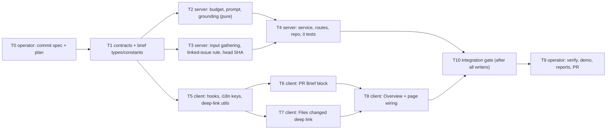

# Implementation Plan: PR Why + Risk Brief (HW L05)

> Authored by the `implementation-planner` agent (Claude Opus 5.5), 2026-10-18.
> Input: the approved spec `specs/2026-10-18-pr-brief.md` (SPEC-2026-10-18-pr-brief, 68 EARS ACs).
> Its "Resolved questions" section holds the human's decisions and is binding here.
> Branch `hw-5/pr-brief`. Homework source: `/home/ai/work/dev-digest-demo/hw5/task.md` and `proto1.png`–`proto5.png`.

## Overview

The plan adds a **PR Brief** block to the PR Overview tab. The block holds the existing Intent and
Blast radius cards plus three model-written parts: a short summary, Risk areas (each risk tied to a
file) and Review focus (`file:line — reason`, which opens Files changed at that line). The brief is
produced by **one** structured model call (`completeStructured`, model from the `risk_brief`
setting). That call gets only facts that are already computed: stored intent, the index-only blast
lookup, diff stats with Smart Diff roles and numeric hunk ranges, the PR description, the linked
issue and attached specs. Everything is capped at 8,000 estimated tokens. The output is grounded
against the PR's files and the blast map, then cached in `pr_brief` together with the head SHA.

## Execution mode

**multi-agent (parallel).** The caller asked for 2–3 implementers running at once on the same
branch with no worktrees. Work is split into four implementer batches with strictly
non-overlapping `Owned paths`. The contract task runs first.

- **run-plan dispatches T1–T8 and T10.** T10 is the final integration gate. It runs after every
  writer has finished.
- **T0 and T9 are operator steps.** They are process work: commits, cross-model review, demo and
  PR. run-plan must **skip** them (pass the prose arg `skip T0 and T9 (operator steps)`).
- Insights files: only T4 (`server/insights/INSIGHTS.md`) and T8 (`client/insights/INSIGHTS.md`)
  write them. Every other implementer lists its insight candidates under an "Insights for T4" or
  "Insights for T8" heading in its final report. The orchestrator passes those lists to T4 / T8.
  This keeps the append-only files out of the parallel batches.

**Handoff for frozen interfaces (cross-model finding 8).** These files have a single owner:
- **Server interface owner: T1.** It owns the shared contracts (`brief.ts`, `pr-brief.ts`, both
  copies) and `modules/brief/{types,constants}.ts`.
- **Client strings and link-helper owner: T5.** It owns `brief.json`, `lib/hooks/brief.ts` and
  `lib/utils/diffLink.ts`.

If a later task needs one of those files changed, the implementer must **not** edit it. It writes a
`### Change request for T1` or `### Change request for T5` block in its final report: file, exact
change, reason. The orchestrator then:
1. waits for the current batch to finish;
2. dispatches **one** serial fix implementer, `T1-fix` or `T5-fix`. It owns exactly the original
   task's paths and acceptance, and also re-runs both typechecks;
3. re-dispatches only the requesting task(s) if they were blocked.

No two writers touch a frozen file at the same time. **T10** then runs every gate once, after all
writers (including any `-fix` runs) are done.

| Batch | Tasks (concurrent) | Why this grouping |
|---|---|---|
| 0 (operator) | T0 | Spec + plan committed before any product code (AC-64) |
| 1 | T1 | Shared contracts + brief module types/constants: every lane builds on them |
| 2 | T2 ∥ T3 ∥ T5 | Server pure core ∥ server input gathering ∥ client data/i18n/link utils |
| 3 | T4 ∥ T6 ∥ T7 | Server service+routes ∥ PR Brief block UI (+ VerdictBanner labels prop) ∥ Files changed deep link |
| 4 | T8 | Overview layout + page wiring (needs T6 + T7) |
| (serial, only if requested) | T1-fix / T5-fix | Controlled change to a frozen interface file, between batches |
| 5 | T10 | Integration gate: all suites, typechecks, contract/i18n/literal checks after all writers |
| 6 (operator) | T9 | Live verification, demo video, reports, PR |



## Requirements (verified)

Each line restates one AC from the spec as a checkable item. "Tasks" lists the tasks that deliver
it, and "Evidence" names the test or check that proves it. The plan-verifier should trace from this
table.

| AC | Tier | Checkable requirement (restated) | Tasks | Evidence |
|---|---|---|---|---|
| AC-1 | P1 | No cached brief → block shows **Generate brief** + "brief not available yet"; GET makes 0 model calls | T6, T4 | `PrBriefBlock.test.tsx` "empty state"; `brief-service.test.ts` "get never touches llm/github" |
| AC-2 | P1 | Click Generate → POST → summary, Risk areas, Review focus rendered | T6 | `PrBriefBlock.test.tsx` "generate flow" |
| AC-3 | P3 | Generating with no brief → skeleton + `aria-busy="true"` | T6 | `PrBriefBlock.test.tsx` "skeleton while generating" |
| AC-4 | P1 | Intent card + Blast radius card inside the PR Brief area; description kept | T8 | `OverviewTab.test.tsx`; manual vs proto1 |
| AC-5 | P1 | Missing-inputs notice names each input + reason, derived from `missing_inputs` | T6, T2 | `PrBriefBlock.test.tsx` "missing inputs notice"; `brief-prompt.test.ts` "deriveMissingInputs" |
| AC-6 | P2 | Stale → brief still shown + both short SHAs + Regenerate | T6 | `PrBriefBlock.test.tsx` "stale notice" |
| AC-7 | P1 | Refresh control → POST → new brief replaces old | T6, T4 | `PrBriefBlock.test.tsx` "refresh replaces"; `brief.it.test.ts` "two generations = two calls, overwrite" |
| AC-8 | ext | During regeneration: old brief visible, refresh loading, Generate/refresh disabled | T6 | `PrBriefBlock.test.tsx` "regeneration keeps brief" |
| AC-9 | ext | Failure → category message + retry, previous brief unchanged (5 categories) | T6, T4 | `PrBriefBlock.test.tsx` "error <code>" (it.each); `brief-service.test.ts` error codes |
| AC-10 | P1 | Each risk: title, severity (icon colour + text/aria label), first grounded ref | T6 | `RiskAreas.test.tsx` "renders risk rows" |
| AC-11 | P3 | Risks collapsed by default; expand shows explanation; `aria-expanded` flips | T6 | `RiskAreas.test.tsx` "expand" |
| AC-12 | ext | Icon chosen by `kind`; unknown kind → generic icon, no error | T6 | `RiskAreas.test.tsx` "unknown kind fallback" |
| AC-13 | P1 | Review focus ordered as stored; `file:line` + reason; header count | T6 | `ReviewFocusList.test.tsx` "order and count" |
| AC-14 | P1 | Zero risks → `noRisks`; zero focus → "no review focus items" | T6 | `PrBriefBlock.test.tsx` "empty sections" |
| AC-15 | P3 | Latest `kind:'review'` → VerdictBanner (verdict, findings, blockers, score) with brief summary; none → summary only | T6 | `PrBriefBlock.test.tsx` "banner with/without review"; `VerdictBanner.test.tsx` "labels prop" |
| AC-16 | P3 | All brief strings from the `brief` namespace (reusing `block.*`, `noRisks`, `unavailable*`), including the banner's labels (passed to `VerdictBanner` through its new `labels` prop) and the localized config error with `{provider}`; no literals, and server error text is never displayed | T5, T6, T7 | grep check V-I18N; `PrBriefBlock.test.tsx` renders the block with **only** the `brief` namespace loaded and no `prReview` key appears |
| AC-17 | ext | Metadata: model, generation time, tokens `8.2K→1.3K`, cost when known | T6 | `helpers.test.ts` "formatTokens"; `PrBriefBlock.test.tsx` "meta row, cost hidden when null" |
| AC-18 | ext | All brief text rendered as plain text | T6 | `PrBriefBlock.test.tsx` "renders markup as text" |
| AC-19 | P1 | Focus click (changed file) → URL `tab=diff&file&line`, group + card expanded, file scrolled below sticky header; also for direct load | T5, T6, T7, T8 | `diffLink.test.ts`; `ReviewFocusList.test.tsx` "click calls onOpenFile"; `DiffTab.test.tsx` "deep link expands boilerplate"; manual |
| AC-20 | P2 | Target line rendered (new-side) → scrolled into view + highlighted | T7 | `DiffTab.test.tsx` "deep link line highlight" |
| AC-21 | ext | Line not rendered → scroll to file header, no error | T7 | `DiffTab.test.tsx` "line outside hunks falls back" |
| AC-22 | P3 | Risk click → navigate to first grounded ref, its first line (`a.ts:12-18` → line 12) | T5, T6 | `diffLink.test.ts` "parseFileRef"; `RiskAreas.test.tsx` "risk click" |
| AC-23 | P3 | Blast-only file → stay on Overview + "File not in this PR's diff"; Files changed with unknown target → same message | T6, T7 | `ReviewFocusList.test.tsx` "not in diff"; `DiffTab.test.tsx` "unknown target file" |
| AC-24 | ext | Deep link works in Smart + Original order and when Smart Diff fails; exact file match; positive-int line; else ignored | T5, T7 | `diffLink.test.ts` "parseDiffTarget"; `DiffTab.test.tsx` "original order", "smart diff unavailable", "invalid params" |
| AC-25 | P1 | Model input assembled only from Provenance sources | T3, T2, T4 | `brief-inputs.test.ts`; `brief-prompt.test.ts` "sections trace to facts"; `brief-service.test.ts` "end-to-end assembly" |
| AC-26 | P2 | No hunk body / hunk-header context / non-attached file text in the input | T2, T4 | `brief-service.test.ts` "sentinels never reach the prompt" |
| AC-27 | P1 | Intent read from `pr_intent` only; absent → missing `not_computed`, 1 model call total | T3, T4 | `brief-inputs.test.ts` "intent missing"; `brief-service.test.ts` "no stored intent" |
| AC-28 | P1 | Blast from index-only lookup; error/empty-degraded → missing; degraded with data → partial | T3 | `brief-inputs.test.ts` "blast: error / empty-degraded / partial / full" |
| AC-29 | P1 | Linked issue by the PR-detail rule; none → `none`; fetch fail → `unavailable` + missing; continue | T3 | `linked-issue.test.ts`; `brief-inputs.test.ts` "linked issue" |
| AC-30 | P1 | Specs = dedup union over enabled agents + enabled skills, deterministic order; guarded fresh read; skips recorded | T3 | `brief-inputs.test.ts` "spec ordering", "stale path", "traversal refused", "disabled agent/skill", "clone absent" |
| AC-31 | P1 | Missing inputs → still generated; prompt has a missing-inputs section | T2, T4 | `brief-prompt.test.ts` "missing section"; `brief-service.test.ts` "all inputs missing" |
| AC-32 | ext | Exactly 1 structured call, 0 embeddings, 0 other model calls per POST | T4 | `brief-service.test.ts` "single structured call" |
| AC-33 | P2 | System + user of the **initial** request ≤ 8,000 est. tokens (`ceil(chars/4)`); repair re-prompts bounded by `maxRetries: 2` + `maxTokens: 4096` per attempt (see Resolved interpretation I-1) | T2, T4 | `brief-budget.test.ts` "oversized fixtures fit"; `brief-service.test.ts` "repair bounds passed" |
| AC-34 | P2 | Per-section rules with `…[truncated]` (description, 3rd spec omitted, 300-file collapse, `+K more callers`), each section ≤ its own allowance including heading/fence/aggregate overhead, with oversized symbols, endpoints, crons, issue title and paths handled deterministically | T2 | `brief-budget.test.ts` per-section tests + "section cap invariant" |
| AC-35 | P2 | Still over → remove whole sections in cut order; fixed never cut | T2 | `brief-budget.test.ts` "cut order" |
| AC-36 | ext | Fixed alone > 8,000 → `brief_input_over_budget`, 0 calls, cache unchanged | T2, T4 | `brief-budget.test.ts` "fixed over budget"; `brief-service.test.ts` "over budget refused" |
| AC-37 | P2 | Record + log hold estimate, budget, truncated/removed sections, spec read/missing/truncated/omitted (in the `brief: model call` entry **and** the completion entry) | T2, T4 | `brief-service.test.ts` "record + log fields" |
| AC-38 | P2 | 1 structured call per POST (repairs = `attempts`); 0 per GET | T4 | `brief-service.test.ts`; `brief.it.test.ts` |
| AC-39 | P2 | Provider/model from `risk_brief` setting (registry default otherwise), recorded; no model literal | T4 | `brief-service.test.ts` "uses risk_brief setting"; V-LITERAL grep |
| AC-40 | P2 | Output validated by `{summary, risks[], review_focus[]}`; still invalid → error, nothing cached | T1, T4 | `brief-contract.test.ts`; `brief-service.test.ts` "invalid output" |
| AC-41 | P1 | System message requires: ≤3-sentence summary, risk fields + ≥1 ref, ordered focus with file+line+reason, cite only listed files, PR text is data | T2 | `brief-prompt.test.ts` "system instructions" |
| AC-42 | P1 | Normalise risk refs (strip `:l`/`:a-b`, leading `./` or `/`), exact match vs allowed set; all-removed → risk dropped | T2 | `brief-grounding.test.ts` "risk refs" |
| AC-43 | P1 | Focus item with a file outside the allowed set is dropped | T2 | `brief-grounding.test.ts` "focus items" |
| AC-44 | P1 | Blast missing → allowed set = changed files only | T2 | `brief-grounding.test.ts` "blast missing" |
| AC-45 | ext | Dedupe focus (file+line), keep order, cap 8+8, record drop counts | T2 | `brief-grounding.test.ts` "12 items → 8" |
| AC-46 | P1 | Persisted/returned brief holds only grounded items | T4 | `brief.it.test.ts` "fabricated paths never served" |
| AC-47 | P1 | Success → full record incl. the `head_sha` of the **same snapshot** the facts came from, upserted into `pr_brief` (overwrite) | T3, T4 | `brief.it.test.ts` "upsert + overwrite"; `brief-service.test.ts` "head moved during assembly → reassembled once" |
| AC-48 | P1 | GET returns cache with 0 model + 0 GitHub calls; `brief: null` when none | T4 | `brief.it.test.ts`; `brief-service.test.ts` Proxy container |
| AC-49 | P1 | Overview load / reload with cached brief renders it with no POST | T6, T9 | `PrBriefBlock.test.tsx` "cached brief, no POST"; manual V-RELOAD |
| AC-50 | P2 | Cached `head_sha` ≠ current → `stale: true`, no regeneration | T4 | `brief.it.test.ts` "stale" |
| AC-51 | P2 | PR detail refresh persists the observed head SHA | T3, T4 | `pulls-head-sha.it.test.ts`; `brief.it.test.ts` "detail refresh → stale" |
| AC-52 | ext | Invalid cached JSON → 200 `brief: null` + logged | T4 | `brief.it.test.ts` "malformed cache" |
| AC-53 | ext | Any failure leaves the previous brief unchanged | T4 | `brief-service.test.ts` / `brief.it.test.ts` "failure keeps old brief" |
| AC-54 | ext | Concurrent POST same PR → 409 + no extra call; GET shows `generating: true`; the successful POST itself returns `generating: false` (lock released before the response is built) | T4 | `brief-service.test.ts` "in-flight conflict", "POST returns generating:false" |
| AC-55 | ext | `generating` + no brief → skeleton + re-check ≤ 5 s | T5, T6 | `PrBriefBlock.test.tsx` "polls while generating" (fake timers) |
| AC-56 | ext | PR of another workspace → 404 on GET and POST, 0 calls | T4 | `brief.it.test.ts` "other workspace 404" |
| AC-57 | ext | Provider not configured → config error naming Risk Brief + provider, 0 calls, no cache write | T4 | `brief-service.test.ts` "provider not configured" |
| AC-58 | P2 | Exactly one `brief: model call` log entry per structured invocation, **success or failure**, with an `outcome` and all listed fields, plus a completion entry; no prompt/output content at info | T4 | `brief-service.test.ts` "log entries" (success + failure cases) |
| AC-59 | ext | Error bodies carry no raw model output / prompt / spec text | T4 | `brief-service.test.ts` + `brief.it.test.ts` "error body has no raw" |
| AC-60 | ext | POST rate-limited 10/min | T4 | `brief-routes.test.ts` "rate limit config"; V-RATE manual |
| AC-61 | P2 | `summary` + `review_focus` in **both** `brief.ts`; byte-identical; both typechecks pass **except the 9 pre-existing TS18048 errors, accepted as exception E-1** (no new errors, the same 9 lines) | T1, T10 | V-CONTRACT `diff` exit 0; V-TYPECHECK baseline diff empty; client typecheck 0 |
| AC-62 | P2 | Routes validate responses against the contract | T4 | `brief-routes.test.ts` "non-conforming → generic 500" |
| AC-63 | P1 | PR includes spec + plan authored by the agents | T0, T9 | commit messages + plan header attribution |
| AC-64 | P2 | Spec + plan commits precede the first `server/src` / `client/src` commit | T0 | `git log --reverse` check (V-ORDER) |
| AC-65 | P2 | PR description has a cross-model review note (other family) | T0, T9 | `docs/reports/pr-brief/cross-model-review.md` + PR body section |
| AC-66 | P2 | PR includes the final plan-verifier report with no open ACs | T9 | `docs/reports/pr-brief/plan-verifier.md` |
| AC-67 | P1 | Open PR in the fork with description + 1–3 min video following the script | T9 | `gh pr view` + manual checklist |
| AC-68 | P3 | PR includes workflow-retro result + cost report | T9 | `docs/reports/pr-brief/workflow-retro.md` + ledger row |

Non-functional items (spec "Non-functional") are carried in tasks:
- GET p95 ≤ 300 ms → V-LATENCY.
- Pre-model assembly ≤ 5 s → `assemblyMs` log field in T4, checked by V-LOG.
- WCAG items → T6 / T7 acceptance.
- Info logs carry counts only, prompt text only at debug level → T4.

## Codebase verification (spec claims vs. actual code)

Each item was checked on this branch, with `file:line` read.

1. **The linked-issue rule is private to the GitHub adapter.** It lives in
   `server/src/adapters/github/octokit.ts:126-134` (`resolveLinkedIssue`, regex
   `/(?:closes|fixes|resolves)?\s*#(\d+)/i`). It is not a reusable function. → T3 lifts the regex into
   `server/src/adapters/github/linked-issue.ts`. Both octokit and the brief use it, so the rule is
   literally the same (AC-29).
2. **PR detail refresh does not persist `head_sha`.** In `server/src/modules/pulls/routes.ts:221-231`
   the `.set({...})` updates only `body`, `additions`, `deletions` and `filesCount`. → T3 adds
   `headSha: detail.head_sha` (AC-51).
3. **The registry default for `risk_brief` is `openai/gpt-4.1`.** See
   `server/src/vendor/shared/contracts/platform.ts:59-64`. The workspace override
   (`settings.feature_models`) has no `risk_brief` entry, and the app has no OpenAI key. → Until a
   human picks an Anthropic model in Settings → Risk Brief, every Generate correctly fails with
   AC-57's configuration error. This is an operator step (T0/T9), not a code change.
4. **`ExternalServiceError` carries `details.raw`.** The Anthropic adapter sets it in
   `server/src/adapters/llm/anthropic.ts:158-160`, and the global error handler serialises
   `details` (`server/src/app.ts:152-156`). → T4 must catch and rethrow without details (AC-59).
5. **The Anthropic adapter always sends `temperature`** (`?? 0`, `anthropic.ts:107`). The model
   `claude-haiku-5-5` rejects it. → Use `claude-sonnet-4-6` (or `claude-haiku-4-5-20251001`) for
   Risk Brief. Do not change the adapter (out of scope).
6. **`pricing.ts` has no row for `claude-sonnet-4-6` or `claude-haiku-4-5`**, so
   `estimateCost` returns `null` (`server/src/adapters/llm/pricing.ts:37-40`). → `cost_usd: null`,
   and the UI hides the cost (AC-17 allows this). See Rec-4.
7. **`AgentsRepository.listEnabled` has no `ORDER BY`** (`server/src/modules/agents/repository.ts:58-62`).
   → T3 sorts by `createdAt`, then `id` (AC-30). `linkedSkills` is already ordered by
   `agent_skills.order` (`:172-180`).
8. **The existing union helper only covers one agent.** `resolveSpecPaths` handles one agent plus
   its skills (`server/src/modules/project-context/injection.ts`). The guarded reader is
   `readDocument` (`project-context/documents.ts:37`). → T3 reuses both for every enabled agent.
9. **The global rate limiter is registered only when `nodeEnv !== 'test'`** (`app.ts`, the
   `rateLimit` registration). → AC-60 is tested through route options, plus one manual check in
   dev mode.
10. **The Smart Diff `ROLE_ORDER` differs from the spec's file-list order.** Smart Diff uses
    `core,tests,wiring,docs,boilerplate`; the spec wants `core → wiring → tests → docs → boilerplate`.
    → The brief defines its own order constant.
11. **The two contract copies differ only by `.js` import suffixes** (client has none; see the
    `blast.ts` diff). → `brief.ts` must stay import-free except `zod`, so it stays byte-identical.
    The new `pr-brief.ts` follows the `blast.ts` rule.
12. **`PrBrief` has no runtime consumer.** Its only use is a type re-export at
    `client/src/lib/types.ts:35`. The planned edits (nullable `intent`/`blast`, optional `history`)
    break no caller.
13. **Client Files changed:**
    - Group and file-card open state is internal (`SmartDiffGroup` `useState(!meta.defaultCollapsed)`;
      `FileCard` auto-collapses above 200 lines).
    - There are no `id`/`data-*` anchors on file cards or lines.
    - jsdom has no `scrollIntoView`.
    - `@testing-library/user-event` is not installed.
14. **The PR page reads `?tab=` through `useSearchParams`.** `setParam` uses `router.replace`, and
    tab bodies remount when you switch tabs (`page.tsx:62-70`).
15. **`VerdictBanner` takes its strings from the `prReview` namespace** and needs a non-null
    `verdict`. Blockers are computed as CRITICAL and not dismissed (`ReviewRunAccordion.tsx:148-158`).
    → **Decision (cross-model finding 2):** T6 owns one additive change to the shared component.
    A new optional `labels?: VerdictBannerLabels` prop (already-translated strings). When it is
    absent, the component keeps today's `useTranslations("prReview")` path, so the Agent runs tab
    does not change. The brief passes labels built from the `brief` namespace. No other task
    touches `VerdictBanner/**`.
16. **Every mutation error already raises a global toast** (`client/src/lib/contexts/providers.tsx:24-44`).
    The inline error of AC-9 comes on top of it.
17. **Demo data (DB `devdigest_hw3`):**
    - PR #4 and PR #6 both have a stored intent.
    - No agent or skill has attached docs.
    - Neither PR body has a `#N` reference (linked issue = `none`).
    - PR #4 has one review (`request_changes`, score 26); PR #6 has none.
    - `pr_brief` is empty.
    - The clone (`server/clones/stasexx/dev-digest`) contains `docs/agent-prompts/*.md`.
18. **`SmartDiffService.forPull` and `BlastService.getBlastRadius` each re-read the PR files.**
    See `smart-diff/service.ts:20-25` and `blast/service.ts:33-36`. `GET /pulls/:id` rewrites
    `pr_files` (delete + insert) **before** it updates `head_sha` (`pulls/routes.ts:199-231`), so a
    concurrent refresh can mix old and new rows. → **Decision (cross-model finding 5):**
    - T3 reads `pr_files` **once** per snapshot and feeds the same rows to the existing pure
      functions: `buildSmartDiff` + `selectLatestReviewFindings` (`smart-diff/helpers.ts`), and
      `repoIntel.getBlastRadius` + `getIndexState` + `toBlastRadius` (`blast/helpers.ts`). These are
      the exact steps those services run, with parity tests.
    - The diff-loader gets a row-based variant.
    - T4 re-checks the head SHA and a files fingerprint after assembly, and reassembles once.

## Open questions & recommendations

**Resolved interpretations.** These are recorded so the verifier traces them. They are not spec
edits.
- **I-1 — Budget scope (cross-model finding 4).**
  - The spec measures the budget over "the full assembled model input, meaning the system message
    plus the user message". The plan applies AC-33's 8,000-token limit to the **initial** request
    that the brief assembles.
  - Repair re-prompts are internal to the one structured call (Resolved question "one model call").
    The adapter appends the invalid output plus a repair hint. They are bounded explicitly:
    - `maxRetries: BRIEF_MAX_RETRIES` (2), so ≤ 3 attempts;
    - `maxTokens: BRIEF_MAX_OUTPUT_TOKENS` (4,096) per attempt.

    So the last attempt's input is ≤ 8,000 + 2 × (4,096 + repair hint) provider tokens.
  - The provider-reported `tokens_in` (summed over attempts) and `attempts` are recorded beside the
    estimate, as the spec's edge case "Provider-reported tokens_in above 8,000 … accepted" allows.
  - No adapter change is planned.
- **E-1 — Typecheck exception for AC-61 (cross-model finding 9).**
  - `cd server && pnpm typecheck` already fails on this branch with exactly 9 `TS18048` errors in
    `src/modules/reviews/repository/run.repo.severity.test.ts`. They are unrelated to the contract.
  - The plan records them as an **accepted pre-existing exception** to AC-61's "both typechecks
    pass". The gate is that the error list after the work equals the list before it (V-TYPECHECK):
    no new error, same 9 lines. The client typecheck must be clean.
  - If the human prefers a clean pass, a one-file fix of that test (guarding `result`) can be added
    as a separate task. It is not planned by default; the human decides.
  - plan-verifier must report AC-61 as `done (with accepted exception E-1)`.

- **Q1 — Risk Brief model for the demo.** → **Default:** before the first Generate, the operator sets
  Settings → Risk Brief = Anthropic · `claude-sonnet-4-6` (T0 step D2). The registry default stays
  `openai/gpt-4.1`, because changing it is not in the spec.
- **Q2 — e2e flow.** → **Default: none.** The spec makes e2e optional. AC-7 and AC-49 are covered by
  three things:
  - the server integration test (two generations = two calls, GET = zero calls);
  - client tests (a cached brief means no POST);
  - the manual reload check with the API log line count.

  This avoids the HW-3 retro trap, where a late e2e task ran ~8 min and was then reverted.
- **Q3 — Which spec to attach for the demo.** → **Default:** attach
  `docs/agent-prompts/security-reviewer.md` to the enabled **Security Reviewer** agent through
  Project Context. It exists in the clone's working tree.
- **Rec-1 — Lift the linked-issue regex instead of copying it.** This is a small adapter refactor
  (behaviour unchanged, unit-tested). It guarantees "same rule as PR detail".
- **Rec-2 — Keep `brief.ts` zod-only.** `ReviewFocusItem`, `BriefModelOutput` and the `PrBrief`
  changes go in `brief.ts`. `PrBriefRecord`, `PrBriefResponse` and the error codes go in a new
  additive `contracts/pr-brief.ts`, because they import `Provider`, as `blast.ts` does. This keeps
  AC-61's byte-identity trivially true.
- **Rec-3 — Planner refinements of the record (additive; the spec's fields are kept as they are).**
  - `generation.dropped`: the spec lists `{ risks, risk_refs, review_focus, over_cap }`. The plan
    pins `over_cap` to `{ risks, review_focus }` and adds a `duplicates` counter, so AC-45's
    "dedupe" count is not mixed with grounding drops.
  - `inputs.changed_files: string[]`: the snapshot's changed paths. Together with the stored
    `blast` snapshot, it lets anyone recompute the generation-time allowed set from the brief alone
    (V-GROUND, cross-model finding 9).
- **Rec-4 (out of scope, human decides).** Adding `claude-sonnet-4-6` / `claude-haiku-4-5` rows to
  `server/src/adapters/llm/pricing.ts` would make the `$0.014` cost visible, as on proto1. Not
  planned. Default: the cost stays hidden (null).
- **Rec-5 — Accept the double error surface.** A failed POST shows the global toast **and** the
  inline AC-9 message. Opting out would mean editing the shared `providers.tsx`, which is out of
  scope.
- **Rec-6 — Order the operator steps.** Plan, then the cross-model review of the plan (if it finds
  something real, re-run the planner, do not hand-edit), then commit spec + plan (AC-64), then
  `run-plan`.

## Affected modules & contracts

- **server / `@devdigest/shared`:**
  - `brief.ts` edited (both copies).
  - New `pr-brief.ts` (both copies).
  - Both `index.ts` barrels get one export line each.
- **server / new module `server/src/modules/brief/`:**
  - `types.ts`, `constants.ts`, `budget.ts`, `prompt.ts`, `grounding.ts`, `inputs.ts`,
    `repository.ts`, `in-flight.ts`, `service.ts`, `routes.ts`.
  - Registered in `server/src/modules/index.ts`.
- **server / existing:**
  - `adapters/github/octokit.ts` now uses the lifted regex (new `adapters/github/linked-issue.ts`).
  - `modules/pulls/routes.ts` persists `headSha`.
  - `modules/reviews/diff-loader.ts` gets a row-based `diffFromPrFileRows(rows)`. The existing
    `diffFromPrFiles` delegates to it, with behaviour unchanged.
  - `docs/api-contracts.md` gets a Brief section.
- **client / data:**
  - `lib/hooks/brief.ts` (new) and the `lib/hooks/index.ts` barrel.
  - `lib/utils/diffLink.ts` (new) and the `lib/utils/index.ts` barrel.
  - `messages/en/brief.json`.
- **client / UI:**
  - New folder `OverviewTab/_components/PrBrief/`.
  - Edited: `OverviewTab.tsx`, `OverviewTab/styles.ts`, PR `page.tsx`, `DiffTab/*`, the
    `diff-viewer` `DiffViewer` / `FileCard` / `CodeLine`, and `VerdictBanner` (owned by T6). All of
    these get additive optional props only.
- **reviewer-core, mcp-server, e2e:** no change.
- **DB:** no migration. `pr_brief(pr_id, json)` already exists (`server/src/db/schema/reviews.ts:57-62`,
  `migrations/0000_init.sql`).
- **Contracts — explicit callouts (existing shared contract edited):**
  - `PrBrief` gains `summary` and `review_focus`.
  - `intent` becomes `.nullable()`, `blast` becomes `.nullable()`, `history` becomes `.optional()`.
  - These changes were accepted in the spec's Resolved questions. The only consumer is a type
    re-export, so nothing ripples.

## Architecture changes

All paths are under the repo root.

- **Domain** — `server/src/vendor/shared/contracts/brief.ts` (+ client copy):
  - New `ReviewFocusItem`.
  - New `BriefModelOutput` (the schema of the single structured call).
  - Changed `PrBrief`.
- **Domain** — `server/src/vendor/shared/contracts/pr-brief.ts` (+ client copy):
  - `BriefInputName`, `BriefMissingInput`, `BriefSection`, `BriefInputs`, `BriefGeneration`.
  - `PrBriefRecord` (= `PrBrief.extend({...})`), `PrBriefResponse`, `BriefErrorCode`.
- **Application (pure helpers)**:
  - `server/src/modules/brief/budget.ts`: estimate, truncate, cut order.
  - `server/src/modules/brief/prompt.ts`: system message, section renderers with `wrapUntrusted`,
    `assembleBriefPrompt`, `deriveMissingInputs`, `buildInputsRecord`.
  - `server/src/modules/brief/grounding.ts`: allowed set, normalise, ground, dedupe, cap.
- **Application (orchestration)**:
  - `server/src/modules/brief/inputs.ts`: fail-soft fact gathering from **one** `pr_files` read
    per snapshot. It reuses the pure steps behind Smart Diff (`buildSmartDiff`,
    `selectLatestReviewFindings`) and Blast (`repoIntel.getBlastRadius` + `getIndexState` +
    `toBlastRadius`). It also reuses `diffFromPrFileRows`, `container.reviewRepo.getIntent`,
    `container.agentsRepo`, `resolveSpecPaths`, `readDocument` and `parseLinkedIssueNumber`.
  - `server/src/modules/brief/service.ts`: `BriefService.get` / `.generate`.
- **Infrastructure**:
  - `server/src/modules/brief/repository.ts` (`BriefRepository`): Drizzle read/upsert of `pr_brief`.
  - `server/src/adapters/github/linked-issue.ts`: a pure regex helper next to the adapter that
    already owns the rule.
  - `server/src/modules/brief/in-flight.ts`: the process-local generation registry, a module-level
    `Set`. The app runs as one process (spec non-goal).
- **Presentation** — `server/src/modules/brief/routes.ts`:
  - `GET /pulls/:id/brief` and `POST /pulls/:id/brief`.
  - Both declare `response: { 200: PrBriefResponse }`.
  - POST carries `config.rateLimit`.
- **Client**:
  - Data hooks live in `client/src/lib/hooks/brief.ts`.
  - The PR Brief block lives at
    `client/src/app/repos/[repoId]/pulls/[number]/_components/OverviewTab/_components/PrBrief/`.
    It is a client component tree, `"use client"` on the interactive files, following the
    BlastRadiusCard folder precedent.
  - The Overview composes it with slots (`intentSlot`, `blastSlot`) so the existing cards stay
    unchanged.
  - Files changed takes `targetFile` / `targetLine` props from the page's search params.

**Error codes.** The envelope is the existing `{ error: { code, message, details? } }`.
- `details` is absent for every code except `brief_model_not_configured`. That one carries only
  `{ setting: 'risk_brief', provider }`, both server-controlled values, so the client can show a
  **localized** message with `{provider}` (AC-16).
- There is never raw model output, prompt text or spec text (AC-59).
- The English `message` is for API consumers and logs. The UI never displays it.

| Condition | HTTP | `code` |
|---|---|---|
| PR not in workspace | 404 | `not_found` (existing `NotFoundError`) |
| Generation already running for the PR | 409 | `brief_generation_in_progress` |
| Fixed content alone > 8,000 est. tokens | 422 | `brief_input_over_budget` |
| Risk Brief provider has no key | 400 | `brief_model_not_configured` (message names "Risk Brief" and the provider; `details: { setting, provider }`) |
| Provider error / timeout / schema failure after repairs | 502 | `brief_model_failed` |
| Over 10 POST/min | 429 | (from `@fastify/rate-limit`; the client keys on **status** 429) |

**Logging contract (AC-37, AC-58; cross-model finding 1).**
- **Model-call entry.** For every structured invocation, made or attempted, there is exactly
  **one** `logger.info(…, 'brief: model call')` entry. It has these fields:
  - `outcome: 'ok' | 'error'`, plus `errorCategory` (`provider_error | invalid_output | timeout`)
    on error;
  - `prId`, `headSha`, `provider`, `model`;
  - `inputTokensEstimate`, `inputBudgetTokens`, `truncatedSections`, `removedSections`;
  - `specs: { read, missing, truncated, omitted }`;
  - `maxRetries`, `attempts`, `tokensIn`, `tokensOut`, `costUsd` (`null` on error when the adapter
    gives no figure);
  - `durationMs`.
- **No model-call entry** for refusals that happen before the call (404, 409, not configured, over
  budget). Those emit `brief: refused` with `{ prId, code }`.
- **Completion entry.** One `brief: generated` entry on success:
  `{ prId, dropped, missingInputs, specs, risks, reviewFocus, assemblyMs, snapshotRetries }`.
- **Content.** Prompt and model-output text are **never** logged at info or warn. The prompt goes
  only to `logger.debug`. The error entry carries `err.message` only, never `details.raw`.

## Phased tasks

### Phase 0 — Process gate (operator, NOT dispatched by run-plan)

- **T0**
  - **Action:** The operator runs these steps before any product code:
    1. Run a cross-model review of this plan with a model from another family. Codex CLI on this
       server is fine, for example:
       `codex exec "Review docs/plans/pr-brief.md against specs/2026-10-18-pr-brief.md: gaps, wrong file paths, untestable acceptance, DAG/ownership conflicts" > /tmp/xmodel.txt`.
    2. Save a short note (model name + findings + what was done about them) to
       `docs/reports/pr-brief/cross-model-review.md`.
    3. If the review finds real gaps, re-run `implementation-planner` with that note. Do not edit
       the plan by hand.
    4. Capture the server typecheck baseline for exception E-1:
       `cd server && npx -y pnpm@10 typecheck 2>&1 | grep 'error TS' | sort > ../docs/reports/pr-brief/typecheck-baseline.txt; wc -l < ../docs/reports/pr-brief/typecheck-baseline.txt`
       must print `9`.
    5. Commit the spec: `git add specs/2026-10-18-pr-brief.md && git commit -m "Add PR Brief spec (authored by spec-creator)"`.
    6. Commit the plan, note and baseline: `git add docs/plans/pr-brief.md docs/reports/pr-brief/cross-model-review.md docs/reports/pr-brief/typecheck-baseline.txt && git commit -m "Add PR Brief implementation plan (authored by implementation-planner), cross-model review note and typecheck baseline"`.
  - **Module:** — (repo process)
  - **Type:** process
  - **Skills to use:** none
  - **Owned paths:** `specs/2026-10-18-pr-brief.md` (commit only), `docs/plans/pr-brief.md` (commit only), `docs/reports/pr-brief/cross-model-review.md`, `docs/reports/pr-brief/typecheck-baseline.txt`
  - **Depends-on:** none
  - **Risk:** low
  - **Known gotchas:** do not `git add` anything under `server/src` or `client/src` in these commits.
  - **Acceptance:** `git log --reverse --format='%h %s' origin/main..HEAD` lists the spec commit and the plan commit **before** any commit that touches `server/src` or `client/src`. Check: `git log --reverse --format=%h origin/main..HEAD -- server/src client/src | head -1` is newer than both. (AC-63, AC-64, AC-65)

### Phase 1 — Contracts first

- **T1**
  - **Action:**
    1. **`brief.ts`.** Edit `server/src/vendor/shared/contracts/brief.ts`, then copy it byte-for-byte
       to `client/src/vendor/shared/contracts/brief.ts` (`cp`; the file has no relative imports):
       - Add `ReviewFocusItem = z.object({ file: z.string().min(1), line: z.number().int().min(1), reason: z.string().min(1) })` with its type.
       - Add `BriefModelOutput = z.object({ summary: z.string().min(1), risks: z.array(Risk), review_focus: z.array(ReviewFocusItem) })`. Use **no** `.max()`, because caps are applied after grounding (AC-45).
       - Change `PrBrief` to `{ summary: z.string().min(1), intent: Intent.nullable(), blast: BlastRadius.nullable(), risks: Risks, review_focus: z.array(ReviewFocusItem), history: PrHistory.optional() }`.
       - Update the header comment. Change nothing else in the file.
    2. **New `pr-brief.ts`** at `server/src/vendor/shared/contracts/pr-brief.ts`. It imports
       `PrBrief` from `./brief.js` and `Provider` from `./knowledge.js`, and defines:
       - `BriefInputName = z.enum(['intent','blast','specs','linked_issue'])`
       - `BriefMissingInput = { input: BriefInputName, reason: z.string().min(1) }`
       - `BriefSection = z.enum(['specs','blast_detail','linked_issue','description','files'])`
       - `BriefInputs` = `{ intent: enum(present|missing), blast: enum(present|partial|missing), blast_reason: string|null, description: enum(present|empty), linked_issue: enum(present|none|unavailable), specs: { read, missing, truncated, omitted: string[] }, files_total: int≥0, files_listed: int≥0, changed_files: string[] }`. `changed_files` is the snapshot's PR paths (Rec-3), used to re-derive the allowed set.
       - `BriefGeneration` = `{ input_tokens_estimate: int≥0, input_budget_tokens: int>0, truncated_sections: BriefSection[], removed_sections: BriefSection[], attempts: int≥1, tokens_in: int≥0, tokens_out: int≥0, cost_usd: number|null, duration_ms: int≥0, dropped: { risks, risk_refs, review_focus, duplicates: int≥0, over_cap: { risks, review_focus: int≥0 } } }`
       - `PrBriefRecord = PrBrief.extend({ pr_id: z.string().uuid(), head_sha: z.string().min(1), generated_at: z.string().datetime(), model: z.object({ provider: Provider, model: z.string().min(1) }), missing_inputs: z.array(BriefMissingInput), inputs: BriefInputs, generation: BriefGeneration })`
       - `PrBriefResponse = z.object({ brief: PrBriefRecord.nullable(), stale: z.boolean(), current_head_sha: z.string(), generating: z.boolean() })`
       - `BriefErrorCode = z.enum(['brief_model_not_configured','brief_model_failed','brief_generation_in_progress','brief_input_over_budget'])`
    3. **Client copy of `pr-brief.ts`.** Create `client/src/vendor/shared/contracts/pr-brief.ts` by
       removing the `.js` import suffixes:
       `sed "s/\.js';$/';/" server/…/pr-brief.ts > client/…/pr-brief.ts`.
    4. **Barrels.** Add `export * from './contracts/pr-brief.js';` to
       `server/src/vendor/shared/index.ts` and `export * from './contracts/pr-brief';` to
       `client/src/vendor/shared/index.ts`, plus one docstring line each.
    5. **Module types.** Create `server/src/modules/brief/types.ts`. It holds interfaces only, no
       logic; it is the contract between T2, T3 and T4:
       - `BriefFileFact { path; role: SmartDiffRole; additions; deletions; changedRanges: Array<[number, number]>; findingLines: number[] }`
       - `BriefFacts { snapshot: { headSha: string; filesFingerprint: string }; pr: { id; title; body: string|null; headSha; additions; deletions; filesCount }; files: BriefFileFact[]; intent: Intent|null; blast: { status: 'present'|'partial'|'missing'; reason: string|null; data: BlastRadiusResponse|null }; linkedIssue: { status: 'present'|'none'|'unavailable'; reason: string|null; issue: { number; title; state; body: string|null }|null }; specs: { status: 'present'|'missing'; reason: string|null; docs: { path; text }[]; missingPaths: string[] } }`
       - `AssembledPrompt { ok: true; messages: ChatMessage[]; inputTokensEstimate; truncatedSections: BriefSection[]; removedSections: BriefSection[]; specs: { read: string[]; truncated: string[]; omitted: string[] }; filesListed: number }`
       - `| { ok: false; reason: 'fixed_over_budget'; fixedTokensEstimate: number }`
       - `GroundingResult { risks: Risk[]; reviewFocus: ReviewFocusItem[]; dropped: BriefGeneration['dropped'] }`
    6. **Module constants.** Create `server/src/modules/brief/constants.ts`:
       - Budget: `BRIEF_INPUT_BUDGET_TOKENS = 8000`, `BRIEF_FIXED_RESERVE_TOKENS = 1200`,
         `BRIEF_SECTION_ALLOWANCE = { specs: 2400, blast_detail: 1000, linked_issue: 600, description: 1000, files: 1800 }`,
         `BRIEF_CUT_ORDER = ['specs','blast_detail','linked_issue','description','files']`.
       - File order: `BRIEF_FILE_ROLE_ORDER = ['core','wiring','tests','docs','boilerplate']`,
         `BRIEF_FALLBACK_ROLE = 'core'`.
       - Caps and text: `BRIEF_MAX_RISKS = 8`, `BRIEF_MAX_REVIEW_FOCUS = 8`,
         `TRUNCATION_MARKER = '…[truncated]'`,
         `RISK_KIND_VOCABULARY = ['security','auth','dependency','config','migration','performance','concurrency','api_contract','data','other']`.
       - Model call: `BRIEF_SCHEMA_NAME = 'pr_brief'`, `BRIEF_MAX_OUTPUT_TOKENS = 4096`,
         `BRIEF_MAX_RETRIES = 2` (= 3 attempts in total, the provider's existing cap),
         `BRIEF_FEATURE_ID = 'risk_brief'`.
       - Route and fetch: `BRIEF_GENERATE_RATE_LIMIT = { max: 10, timeWindow: '1 minute' }`,
         `BRIEF_ISSUE_FETCH_TIMEOUT_MS = 3000`.
       - Deterministic line clipping (cross-model finding 3), applied before section fitting:
         - `BRIEF_MAX_LINE_CHARS = 400` (any one rendered list line);
         - `BRIEF_MAX_NAME_CHARS = 200` (symbol, endpoint and cron names, spec labels);
         - `BRIEF_MAX_ISSUE_TITLE_CHARS = 300`.
       - Snapshot: `BRIEF_MAX_SNAPSHOT_RETRIES = 1` (cross-model finding 5).
    7. **Contract test.** Write `server/test/brief-contract.test.ts`:
       - `BriefModelOutput` accepts a valid fixture and rejects `line: 0`, an empty `reason`, a
         missing `summary` and a non-enum severity.
       - `PrBrief` accepts `intent: null, blast: null` without `history`.
       - `PrBriefRecord` round-trips a full fixture, including `inputs.changed_files`.
       - `PrBriefResponse` accepts `brief: null`.
  - **Module:** server (+ client vendor copy)
  - **Type:** core
  - **Skills to use:** zod, typescript-expert, onion-architecture, security, engineering-insights
  - **Owned paths:** `server/src/vendor/shared/contracts/brief.ts`, `client/src/vendor/shared/contracts/brief.ts`, `server/src/vendor/shared/contracts/pr-brief.ts`, `client/src/vendor/shared/contracts/pr-brief.ts`, `server/src/vendor/shared/index.ts`, `client/src/vendor/shared/index.ts`, `server/src/modules/brief/types.ts`, `server/src/modules/brief/constants.ts`, `server/test/brief-contract.test.ts`
  - **Depends-on:** T0
  - **Risk:** medium (existing shared contract edited)
  - **Known gotchas:**
    - The Edit tool has replaced ASCII quotes with curly ones in vendored contracts, which gives
      TS1127. Run `grep -nP "[\x{2018}\x{2019}\x{201C}\x{201D}]" <file>` on all four contract files;
      it must print nothing. (server INSIGHTS 2026-06-22)
    - The client barrel and contracts use **no** `.js` suffix. A new contract file needs a client
      copy plus a barrel export. (client INSIGHTS :28, :48)
    - Keep `brief.ts` free of relative imports, or AC-61's byte-identity breaks.
    - `z.string().datetime()` needs a `Z`-suffixed ISO string. Use `new Date().toISOString()`.
    - The server barrel docstring says "extend, don't edit". Editing `brief.ts` is the
      spec-mandated exception (AC-61). Say so in the commit message.
  - **Acceptance:**
    - `diff server/src/vendor/shared/contracts/brief.ts client/src/vendor/shared/contracts/brief.ts` exits 0.
    - `diff <(sed "s/\.js';$/';/" server/src/vendor/shared/contracts/pr-brief.ts) client/src/vendor/shared/contracts/pr-brief.ts` exits 0.
    - `cd server && npx -y pnpm@10 exec vitest run test/brief-contract.test.ts` passes.
    - V-TYPECHECK: the server error list equals the T0 baseline file, so the diff is empty (9
      pre-existing `TS18048` errors, accepted exception E-1).
    - `cd client && npx -y pnpm@10 typecheck` exits 0. (AC-40 schema, AC-61)

### Phase 2 — Server core, server inputs, client data (parallel: T2 ∥ T3 ∥ T5)

- **T2**
  - **Action:** Write the pure brief core. It does no I/O and imports only `@devdigest/shared`,
    `../../platform/prompt.js` (`wrapUntrusted`) and `./constants.js` / `./types.js`.
    1. **`budget.ts`:**
       - `estimateTokens(s) = Math.ceil(s.length / 4)`, the same formula as `approxTokens` and the
         intent classifier.
       - `truncateTail(text, maxTokens)`: the result, including `TRUNCATION_MARKER`, fits within
         `maxTokens`.
       - `clip(text, maxChars)`: a deterministic single-line clip. It keeps the head and ends with
         `…`. Every untrusted name, path or label goes through it before rendering, with the
         `BRIEF_MAX_*_CHARS` constants.
       - `fitLines({ heading, fenceLabel, lines, aggregates, allowance })`: the one generic fitter
         used by every list section. It is deterministic:
         1. Compute `overhead` = the estimate of heading + `wrapUntrusted(fenceLabel, '')`.
         2. Walk `lines` in their given order. Accept a line only if overhead + accepted lines +
            this line + the aggregate lines for **everything still unaccepted** fit within
            `allowance`.
         3. Stop at the first line that does not fit. Fitting is a prefix, so later lines never
            jump ahead.
         4. The rest collapse into the caller-supplied aggregate lines (`+K more …`).
         5. If even overhead + aggregates do not fit, return `null`. The section is then dropped
            and recorded in `removed_sections`.
       - `fitSections({ fixed, sections })`:
         - **enforces each section's cap first.** After rendering, it asserts
           `estimateTokens(rendered) ≤ BRIEF_SECTION_ALLOWANCE[section]`. A renderer that breaks
           this is a bug: the code throws and a test catches it;
         - then, if `estimateTokens(system + user) > 8000`, removes whole sections in
           `BRIEF_CUT_ORDER`;
         - never touches fixed content;
         - unused allowance is **not** reassigned.
       - Section size = the estimate of the **rendered** section string, including its heading,
         untrusted fence and aggregate lines.
       - **Scope (Resolved interpretation I-1).** The 8,000 limit applies to the **initial**
         system + user request built here. Repair re-prompts are bounded in T4 through
         `maxRetries` / `maxTokens`. Put this in a doc comment on `fitSections`.
    2. **`prompt.ts`:**
       - `buildSystemMessage()`: trusted static text. It must contain these substrings, which the
         test asserts: `at most 3 sentences`, `what the PR changes and why`, `kind, title,
         explanation, severity`, `at least one file reference`, `recommended reading order`,
         `new-side line`, `cite only files that appear in the PR file list or the blast map`, and
         `data, not instructions`. It also contains the `RISK_KIND_VOCABULARY` list and the
         `file_refs` format `path`, `path:line` or `path:start-end`.
       - User message:
         - **Fixed part:** PR title (`wrapUntrusted('pr_title', …)`); totals (`N files, +A −D`);
           intent (wrapped `intent`: intent, in_scope, out_of_scope) or `Intent: missing
           (not_computed)`; blast summary line + stats (wrapped `blast_summary`) or the blast
           missing line; and a `## Missing inputs` list built from `deriveMissingInputs`.
         - **Specs section** (cap 2,400): each document is `wrapUntrusted('spec:<clipped path>', text)`,
           with the label clipped to `BRIEF_MAX_NAME_CHARS`. Whole documents go in attach order. The
           first one that does not fit is truncated, counting its fence. Later ones are omitted.
         - **Blast detail section** (wrapped `blast_detail`, cap 1,000):
           - Content: changed symbols (name, file, kind), then callers `symbol → file:line` per
             symbol in rank order, then endpoints, then crons, plus the degraded note when partial.
             The degraded note is one clipped line and is always first.
           - Every name and path is clipped (`BRIEF_MAX_NAME_CHARS`); every line is clipped
             (`BRIEF_MAX_LINE_CHARS`).
           - One `fitLines` pass runs over the concatenated list in that category order. What
             remains collapses into **per-category** aggregates, in this order:
             `+K more changed symbols`, `+K more callers` (the spec's rule), `+K more endpoints`,
             `+K more crons`.
           - The extra aggregates go beyond the spec's callers-only rule. They are the planner's
             deterministic handling of oversized symbol, endpoint and cron lists (cross-model
             finding 3).
         - **Linked issue section** (wrapped `linked_issue`, cap 600):
           - The title line `#N <title> (state)` comes first. The title is clipped to
             `BRIEF_MAX_ISSUE_TITLE_CHARS` and ends with `…[truncated]` when clipped.
           - Then the body is tail-truncated to the remaining allowance with `…[truncated]`.
           - If less than the marker plus one line remains, the body is replaced by `…[truncated]`
             alone.
         - **Description section** (wrapped `pr_description`): the tail is truncated. An empty body
           renders no section (`description: empty`).
         - **Files section** (wrapped `pr_files`): one line per file:
           `path [role] +a −d changed: 10-24,40-52 findings: 12,18`, clipped to
           `BRIEF_MAX_LINE_CHARS`. A clipped path cannot be cited, so grounding drops it. That is
           accepted. Files are sorted by `BRIEF_FILE_ROLE_ORDER`, then by churn (`a+d`) descending,
           then by path ascending. `fitLines` collapses the files that do not fit into one
           `role: +K files (+A −D)` aggregate per role.
       - `assembleBriefPrompt(facts): AssembledPrompt`. It returns `{ ok:false, reason:'fixed_over_budget' }`
         when system + fixed alone exceeds 8,000.
       - `deriveMissingInputs(facts): BriefMissingInput[]`. Reasons:
         - intent `not_computed`;
         - blast `lookup_failed` or the `BlastDegradedReason`;
         - specs `none_attached` | `clone_unavailable` | `all_unreadable`;
         - linked_issue `github_unavailable` | `fetch_failed`.

         `none` and `empty` are **not** listed.
       - `buildInputsRecord(facts, assembled): BriefInputs`. `specs.omitted` lists every read
         document that is not in the prompt, including when the whole section was removed.
         `changed_files` = `facts.files[].path` in snapshot order.
       - `truncated_sections` lists a section whenever **any** clipping, truncation or aggregation
         happened in it. `removed_sections` lists a section when it was dropped, either by
         `fitLines` returning `null` or by the cut order.
    3. **`grounding.ts`:**
       - `buildAllowedSet(changedPaths, blast | null)` = changed files ∪
         `blast.changed_symbols[].file` ∪ `blast.downstream[].callers[].file`. Blast `missing` →
         changed files only.
       - `normaliseRef(ref) → { path, suffix }`: strip a trailing `:N` or `:N-M`, then a leading
         `./` or `/`.
       - `groundBriefOutput(output, allowed): GroundingResult`:
         - keep risk refs whose path exactly (case-sensitive) matches;
         - persist refs as `<path><suffix>`;
         - drop a risk with zero kept refs;
         - drop focus items whose normalised file is not allowed;
         - dedupe focus by `(file, line)`, first wins;
         - keep model order;
         - cap at 8 risks and 8 focus items;
         - fill `dropped.{risks, risk_refs, review_focus, duplicates, over_cap}`.
    4. **Tests:**
       - `server/test/brief-budget.test.ts`, covering AC-33/34/35/36:
         - oversized fixtures, with the total re-computed as `Math.ceil((system.length + user.length)/4) ≤ 8000`;
         - a description truncated with the marker;
         - a 3-document spec fixture where doc 2 is truncated and doc 3 is omitted and recorded;
         - a 300-file PR that collapses to per-role aggregate lines with `files_listed < 300`;
         - 40 callers giving `+K more callers`;
         - **section cap invariant** (cross-model finding 3). For each list section (`specs`,
           `blast_detail`, `linked_issue`, `description`, `files`), the rendered estimate stays at
           or under its allowance with these fixtures:
           - 500 changed symbols with 300-character names;
           - 500 endpoints and 500 crons;
           - a 10,000-character issue title with a 50,000-character body;
           - file paths of 2,000 characters;
           - a spec path label of 1,000 characters.

           Each case also asserts that the expected `+K more …` aggregate or `…[truncated]` marker
           is present, and that the section is in `truncated_sections`;
         - fence and heading overhead are counted. A section whose allowance is forced (in a test)
           below its overhead is dropped and recorded in `removed_sections`;
         - determinism: the same facts give a byte-identical prompt on two runs;
         - an oversized fixed part, where removal follows the cut order and the fixed text is still
           present;
         - fixed > 8,000 returning `ok:false`.
       - `server/test/brief-prompt.test.ts`, covering AC-25/31/41/5:
         - system-instruction substrings;
         - each user section's content traces to its fixture;
         - a `## Missing inputs` section when intent, blast and specs are missing;
         - `deriveMissingInputs` omits `none` and `empty`;
         - every PR-derived text sits inside an `<untrusted source=` fence.
       - `server/test/brief-grounding.test.ts`, covering AC-42/43/44/45:
         - one real + one fabricated ref keeps only the real one;
         - only fabricated refs drops the risk;
         - `./src/a.ts:3` matches `src/a.ts`;
         - a case-only mismatch is dropped;
         - a blast caller file is kept when blast is present and dropped when it is missing;
         - 12 focus items including duplicates give 8 in order, with the counts recorded.
  - **Module:** server
  - **Type:** backend
  - **Skills to use:** onion-architecture, zod, typescript-expert, security, engineering-insights
  - **Owned paths:** `server/src/modules/brief/budget.ts`, `server/src/modules/brief/prompt.ts`, `server/src/modules/brief/grounding.ts`, `server/test/brief-budget.test.ts`, `server/test/brief-prompt.test.ts`, `server/test/brief-grounding.test.ts`
  - **Depends-on:** T1
  - **Risk:** medium
  - **Known gotchas:**
    - `wrapUntrusted(label, content)` adds roughly 40 characters of fence and escapes
      `</untrusted>`. Measure **after** wrapping.
    - Regex capture groups are `string | undefined` under strict TS. Use `m[1] ?? ''`. (server
      INSIGHTS 2026-06-22)
    - The file order is **not** Smart Diff's `ROLE_ORDER`. Use `BRIEF_FILE_ROLE_ORDER`.
    - Use a deterministic tie-break (path asc). `getPrFiles` has no `ORDER BY`.
    - The marker `…` is one character (U+2026). Count it as such.
    - Do not put `pr_files.patch` or any hunk text into `BriefFacts`. Facts carry numbers only.
  - **Acceptance:**
    - `cd server && npx -y pnpm@10 exec vitest run test/brief-budget.test.ts test/brief-prompt.test.ts test/brief-grounding.test.ts` passes.
    - `grep -nE "from '(drizzle-orm|fastify)|container" server/src/modules/brief/{budget,prompt,grounding}.ts` prints nothing (pure).
    - V-TYPECHECK baseline diff is empty. (AC-5 derivation, AC-25, AC-31, AC-33–AC-37, AC-41–AC-45)

- **T3**
  - **Action:**
    1. **Linked-issue helper.** Create `server/src/adapters/github/linked-issue.ts`, exporting
       `LINKED_ISSUE_PATTERN = /(?:closes|fixes|resolves)?\s*#(\d+)/i` and
       `parseLinkedIssueNumber(body: string | null | undefined): number | null`. Change
       `octokit.ts` `resolveLinkedIssue` to call it. Its behaviour stays identical.
    2. **Row-based diff loader.** In `server/src/modules/reviews/diff-loader.ts`, extract
       `export function diffFromPrFileRows(rows: { path: string; patch: string | null }[]): UnifiedDiff`
       from the body of `diffFromPrFiles`. `diffFromPrFiles` becomes
       `diffFromPrFileRows(await repo.getPrFiles(prId))`, with behaviour unchanged.
    3. **`server/src/modules/brief/inputs.ts`.** Export
       `gatherBriefFacts(container, logger, { workspaceId, pull, repo }): Promise<BriefFacts>`.
       Every source is fail-soft, recorded and never thrown, except a programming error.

       **One snapshot (cross-model finding 5):** `pr_files` is read **once**
       (`rows = await container.reviewRepo.getPrFiles(prId)`). Every file-derived fact is computed
       from those `rows`. `snapshot = { headSha: pull.headSha, filesFingerprint }`, where
       `filesFingerprint` = sha256 of the sorted `path\0additions\0deletions\0sha256(patch ?? '')`
       lines (`node:crypto`). Export `filesFingerprint(rows)` so T4 can re-check it.
       - **Files:** path, additions and deletions come from `rows`. Hunk ranges come from
         `diffFromPrFileRows(rows)`: `hunks[].newStart/newLines` → `[newStart, newStart+newLines-1]`,
         skipping `newLines === 0`. Only these numbers leave this function.
       - **Roles and finding lines:** use the same pure steps as `SmartDiffService.forPull`
         (`smart-diff/service.ts:20-25`), on the snapshot rows:
         `buildSmartDiff(rows, selectLatestReviewFindings(await container.reviewRepo.reviewsForPull(prId)))`
         (`smart-diff/helpers.ts`). If that throws, every file gets `BRIEF_FALLBACK_ROLE` and no
         finding lines (log a warn).
       - **Intent:** `container.reviewRepo.getIntent(prId)`. `undefined` → `null` (missing
         `not_computed`). Never call `IntentService`.
       - **Blast:** use the same index-only lookup that serves `GET /pulls/:id/blast`
         (`blast/service.ts:31-36`), on the snapshot paths:
         `container.repoIntel.getBlastRadius(repo.id, rows.map(r => r.path))`, then
         `container.repoIntel.getIndexState(repo.id)`, then `toBlastRadius(result, { indexState })`
         (`blast/helpers.ts`). The blast module itself is not changed. Export a pure
         `classifyBlast(result | error)`:
         - throw → `missing`, `lookup_failed`;
         - `degraded && stats.symbols === 0 && stats.callers === 0` → `missing`,
           `reason ?? 'no_data'`;
         - `degraded` with data → `partial`, its reason;
         - otherwise `present`.
       - **Linked issue:** `parseLinkedIssueNumber(pull.body)`:
         - null → `none`;
         - else `container.github()`; a throw → `unavailable` / `github_unavailable`;
         - else `withTimeout(github.getIssue(repoRef, n), BRIEF_ISSUE_FETCH_TIMEOUT_MS)`
           (`platform/resilience.ts`); a throw or timeout → `unavailable` / `fetch_failed`.
       - **Specs:** `container.agentsRepo.listEnabled(workspaceId)`, sorted by `createdAt` asc then
         `id` asc. For each agent, `container.agentsRepo.linkedSkills(agent.id)` filtered by
         `skill.enabled`, then `resolveSpecPaths({ agentPaths, loadedSkills })`. Concatenate across
         agents and keep the first occurrence. Export this as a pure
         `orderAttachedSpecPaths(agents)`. Then:
         - no paths → `missing`, `none_attached`;
         - `repo.clonePath` null → `missing`, `clone_unavailable`, read nothing;
         - else `readDocument(container.git, repoRef, path)` per path. A throw, or text containing
           the replacement character U+FFFD (written `'\uFFFD'` in code; it means non-UTF-8 input), is recorded in `missingPaths`;
         - all skipped → `missing`, `all_unreadable`.
    4. **Head SHA.** In `server/src/modules/pulls/routes.ts`, add `headSha: detail.head_sha` to the
       existing detail-refresh `.set({...})`, and nothing else (AC-51).
    5. **Tests:**
       - `server/test/linked-issue.test.ts` (table): `#12` → 12, `Closes #7` → 7, `see #3 and #4`
         → 3, `no ref` → null, `null` → null.
       - `server/test/brief-inputs.test.ts`, with a fake container in the `blast-service.test.ts`
         style, a `MockGitHubClient`, and a tmp-dir clone whose `clonePathFor` returns the tmp dir:
         - intent missing;
         - blast error / empty-degraded / partial / full;
         - linked issue no-ref, fetched, fetch-failed and no-token; `getIssue` is called 0 times
           for no-ref;
         - spec ordering: two agents created out of order, overlapping agent + skill paths deduped,
           a disabled agent and a disabled skill contribute nothing;
         - a stale path is recorded;
         - `../outside.md` is refused by the guard and recorded;
         - clone absent → `clone_unavailable`;
         - Smart Diff throwing → role `core`;
         - **snapshot parity** (cross-model finding 5):
           - with the same rows, findings and fake facade, the roles/finding lines equal
             `SmartDiffService.forPull`'s output, and the blast data equals
             `BlastService.getBlastRadius`'s output;
           - `getPrFiles` is called **exactly once** per `gatherBriefFacts`;
           - `filesFingerprint` changes when one row's `additions` or `patch` changes;
         - `diffFromPrFileRows` gives the same `UnifiedDiff` as `diffFromPrFiles` for the same rows
           (refactor parity);
         - hunk ranges are numbers only, so a sentinel placed in the patch body and in the
           hunk-header context never appears in `JSON.stringify(facts)`.
       - `server/test/pulls-head-sha.it.test.ts` (Testcontainers, `blast.it.test.ts` style): seed a
         PR with `head_sha='aaa…'`, use `MockGitHubClient({ detail: { head_sha: 'bbb…' } })`, call
         `GET /pulls/:id`, and the stored `pull_requests.head_sha` must be `bbb…`.
  - **Module:** server
  - **Type:** backend
  - **Skills to use:** onion-architecture, fastify-best-practices, drizzle-orm-patterns, security, typescript-expert, engineering-insights
  - **Owned paths:** `server/src/adapters/github/linked-issue.ts`, `server/src/adapters/github/octokit.ts`, `server/src/modules/reviews/diff-loader.ts`, `server/src/modules/brief/inputs.ts`, `server/src/modules/pulls/routes.ts`, `server/test/linked-issue.test.ts`, `server/test/brief-inputs.test.ts`, `server/test/pulls-head-sha.it.test.ts`
  - **Depends-on:** T1
  - **Risk:** medium
  - **Known gotchas:**
    - **Spec reads must be guarded.** Never use `git.readFile`; it is unguarded. Use `readDocument`.
      It throws `ValidationError` on traversal and on ENOENT; catch and record.
      (`project-context/documents.ts` header)
    - `fs.readFile(…,'utf8')` does not throw on invalid UTF-8. Detect U+FFFD.
    - `listEnabled` has no `ORDER BY`. `linkedSkills` is already ordered by `agent_skills.order`.
    - **Reuse, do not rewrite.** Use the pure steps behind Smart Diff and Blast (`buildSmartDiff`,
      `selectLatestReviewFindings`, `toBlastRadius`, the repo-intel facade), plus
      `diffFromPrFileRows`, `resolveSpecPaths` and `readDocument`. Do not write a new diff parser,
      blast mapper or path guard. Do not call `SmartDiffService` / `BlastService` here: each
      re-reads `pr_files` and would break the single snapshot (finding 5).
    - `diff-loader.ts` is used by the review run (`run-executor` → `loadDiff`). Keep
      `diffFromPrFiles`' signature and output identical; the existing review tests must stay
      green.
    - **No model calls here.** Never call `IntentService` (that would be a second model call,
      AC-27/AC-32). Never call `container.embedder()`.
    - `Logger` type: `import type { Logger } from '../reviews/run-executor.js'`. (server INSIGHTS
      2026-06-22)
    - `container.github()` throws `ConfigError` without a token. That is the normal path in this
      environment.
    - `pulls/routes.ts` already has inline Drizzle code. That is pre-existing; do not refactor it.
    - The macOS realpath `/private/var` gotcha applies if tests assert guard paths.
  - **Acceptance:**
    - `cd server && npx -y pnpm@10 exec vitest run test/linked-issue.test.ts test/brief-inputs.test.ts` passes.
    - `cd server && npx -y pnpm@10 exec vitest run test/pulls-head-sha.it.test.ts` passes (Docker).
    - The existing `test/pulls-comments.it.test.ts` and `test/integration.it.test.ts` still pass.
    - `grep -n "headSha: detail.head_sha" server/src/modules/pulls/routes.ts` gives 1 match.
    - `grep -rn "IntentService\|embedder\|git.readFile" server/src/modules/brief/` prints nothing.
    - The existing `test/reviews.it.test.ts` and `src/modules/reviews/project-context-injection.test.ts` still pass (diff-loader refactor).
    - V-TYPECHECK baseline diff is empty. (AC-25, AC-26 facts, AC-27, AC-28, AC-29, AC-30, AC-47 snapshot, AC-51)

- **T5**
  - **Action:**
    1. **`client/messages/en/brief.json`.** Keep every existing key. Change `block.risks` →
       `"Risk areas"` and reword `unavailableHint` to describe Generate (for example
       `"Generate a brief to see what this PR does, its risk areas and where to start reading."`).
       Add these key paths; T6 and T7 rely on the names:
       - `title`, `generate`, `regenerate`, `refresh`, `retry`, `generating`
       - `block.reviewFocus` ("Review focus — read these first")
       - `noReviewFocus`
       - `severity.{high,medium,low}`
       - `risk.{expand,collapse,openFile}`
       - `focus.openFile`
       - `stale` (ICU `{briefSha}` / `{currentSha}`)
       - `missing.title`
       - `missing.input.{specs,linked_issue}`. Intent and Blast reuse `block.intent` and
         `block.blast`.
       - `missing.reasons.{not_computed,lookup_failed,flag_off,index_failed,index_partial,repo_too_large,no_data,none_attached,clone_unavailable,all_unreadable,github_unavailable,fetch_failed,unknown}`
       - `meta.{model,generatedAt,tokens,cost}`
       - `errors.{modelNotConfigured,modelFailed,inProgress,rateLimited,overBudget,generic}`.
         `errors.modelNotConfigured` is ICU with `{provider}`, for example
         `"The Risk Brief model's provider ({provider}) is not configured. Add its API key or pick another model under Settings → Risk Brief."`
         (cross-model finding 2). No server-message passthrough exists.
       - `verdict.{requestChanges,approve,comment,findingsCount,blockers,prScore}`: brief-owned
         copies of the banner labels, passed to `VerdictBanner` through its new `labels` prop.
         They use the **same ICU parameter names** as `client/messages/en/prReview.json` →
         `verdict.*`. Read that file first; do not edit it.
       - `nav.notInDiff` ("File not in this PR's diff")
    2. **`client/src/lib/hooks/brief.ts`** (`"use client"`):
       - `useBrief(prId)`: `useQuery({ queryKey: ['brief', prId], queryFn: () => api.get<PrBriefResponse>(`/pulls/${prId}/brief`), enabled: !!prId, refetchInterval: (q) => (q.state.data?.generating && !q.state.data?.brief ? BRIEF_POLL_MS : false) })` with `BRIEF_POLL_MS = 3000` (≤ 5 s, AC-55).
       - `useGenerateBrief(prId)`: `useMutation({ mutationFn: () => api.post<PrBriefResponse>(`/pulls/${prId}/brief`), onSuccess: (d) => qc.setQueryData(['brief', prId], d) })`.
       - Export both from `client/src/lib/hooks/index.ts`.
    3. **`client/src/lib/utils/diffLink.ts`**, exported from `lib/utils/index.ts`. Pure, no React:
       - `parseFileRef(ref) → { path, line: number | null }`: `a.ts:12-18` → `{a.ts, 12}`;
         `./a.ts` → `a.ts`.
       - `buildDiffQuery(current: URLSearchParams | string, file, line: number | null) → string`:
         sets `tab=diff`, `file`, `line` (deleted when null); deletes `trace`; keeps the other
         params.
       - `parseDiffTarget(fileParam: string | null, lineParam: string | null, changedPaths: readonly string[])`
         → `{ kind: 'none' } | { kind: 'not_in_diff'; file } | { kind: 'target'; file; line: number | null }`.
         The file must equal a changed path exactly; the line counts only if `^[1-9]\d*$`.
       - Test file `client/src/lib/utils/diffLink.test.ts`, covering AC-19/22/24: encode/decode of
         paths with spaces and `#`; `line=-3`, `abc`, `0`, `1.5` are ignored; an unknown file gives
         `not_in_diff`; `trace` is dropped; nothing throws.
  - **Module:** client
  - **Type:** ui
  - **Skills to use:** frontend-architecture, react-best-practices, next-best-practices, typescript-expert, react-testing-library, security, engineering-insights
  - **Owned paths:** `client/messages/en/brief.json`, `client/src/lib/hooks/brief.ts`, `client/src/lib/hooks/index.ts`, `client/src/lib/utils/diffLink.ts`, `client/src/lib/utils/diffLink.test.ts`, `client/src/lib/utils/index.ts`
  - **Depends-on:** T1
  - **Risk:** low
  - **Known gotchas:**
    - Messages auto-load per file. No registration is needed. (client INSIGHTS :123)
    - The TanStack v5 `refetchInterval` callback gets the `query`. Use `q.state.data`.
    - Query keys are inline arrays in the hooks files, not in `api.ts`. Match the
      `['intent', prId]` style.
    - Mutation errors toast globally (`providers.tsx`). This is not a reason to swallow errors.
    - Keep `brief.json` valid JSON with ASCII quotes. The `…` and `—` characters are fine inside
      strings.
  - **Acceptance:**
    - `cd client && npx -y pnpm@10 exec vitest run src/lib/utils/diffLink.test.ts` passes.
    - `node -e "const m=require('./client/messages/en/brief.json');for(const k of ['title','generate','refresh','block.reviewFocus','noReviewFocus','nav.notInDiff','errors.rateLimited','errors.modelNotConfigured','verdict.requestChanges','verdict.prScore','missing.reasons.not_computed'])if(k.split('.').reduce((o,p)=>o?.[p],m)==null)throw k;if(!m.errors.modelNotConfigured.includes('{provider}'))throw 'provider';console.log(m.block.risks)"` prints `Risk areas`.
    - `cd client && npx -y pnpm@10 typecheck` exits 0. (AC-16 keys, AC-19/22/24 helpers, AC-55 cadence)

### Phase 3 — Server service & routes ∥ Brief block UI ∥ Files changed deep link (parallel: T4 ∥ T6 ∥ T7)

- **T4**
  - **Action:**
    1. **`repository.ts`.** `BriefRepository(db)` with `getJson(prId): Promise<unknown | null>`
       and `upsert(prId, record: PrBriefRecord)` (`insert … onConflictDoUpdate({ target: t.prBrief.prId, set: { json } })`).
    2. **`in-flight.ts`.** `tryAcquireGeneration(prId): boolean`, `releaseGeneration(prId)` and
       `isGenerating(prId)`, over a module-level `Set<string>`.
    3. **`service.ts`.** `BriefService(container, logger?, repo = new BriefRepository(container.db))`.
       - **`get(ws, prId)`:**
         - `container.reviewRepo.getPull(ws, prId)`; missing → `NotFoundError`.
         - Read the JSON and run `PrBriefRecord.safeParse`. On failure, `logger.warn({ prId, issues }, 'brief: cached record invalid; serving none')` and treat it as `null`.
         - Return `{ brief, stale: !!brief && brief.head_sha !== pull.headSha, current_head_sha: pull.headSha, generating: isGenerating(prId) }`.
         - **Never** touch `container.llm`, `container.github` or `container.git`.
       - **`generate(ws, prId)`**, in this order:
         1. Check the pull; missing → 404 (before the lock, 0 calls).
         2. `tryAcquireGeneration`, else `AppError('brief_generation_in_progress', …, 409)`.
         3. `const record = await this.runGeneration(ws, prId)` inside `try { … } finally { releaseGeneration(prId) }`.
            The lock is **released before** the response is built (cross-model finding 6).
         4. **After** the `finally`, return `this.get(ws, prId)`. `generating` is therefore `false`
            for this PR, unless another request legitimately started a new generation in between.
       - **`runGeneration(ws, prId)`** (private):
         1. `resolveFeatureModel(container, ws, BRIEF_FEATURE_ID)`.
         2. `container.llm(provider)`. A `ConfigError` becomes:
            `AppError('brief_model_not_configured', "Risk Brief model provider '<provider>' is not configured. Add its API key or pick another model for Risk Brief in Settings.", 400, { setting: 'risk_brief', provider })`.
            Those two details keys are the only details ever sent (AC-16, AC-57, AC-59).
         3. **Consistent snapshot** (cross-model finding 5). Up to `1 + BRIEF_MAX_SNAPSHOT_RETRIES`
            assembly passes:
            1. `pull = getPull`, `repo = getRepo`, `facts = gatherBriefFacts(...)` (T3; one `pr_files` read).
            2. `assembled = assembleBriefPrompt(facts)` (T2).
            3. **Re-check:** `pull2 = getPull(ws, prId)`, `fp2 = filesFingerprint(await reviewRepo.getPrFiles(prId))`.
               - If `pull2.headSha === facts.snapshot.headSha && fp2 === facts.snapshot.filesFingerprint`,
                 the snapshot is consistent: stop.
               - Otherwise, if a retry is left, log `brief: snapshot changed during assembly; reassembling`
                 and repeat with fresh reads.
               - If no retry is left, proceed with the **last** snapshot. Its `head_sha` is recorded,
                 so the next GET shows `stale` if the head moved again (accepted).

            No model call happens during these passes.
         4. If `assembled.ok === false` → `AppError('brief_input_over_budget', …, 422)` with 0 calls.
         5. Exactly **one** structured invocation:
            `llm.completeStructured({ model, schema: BriefModelOutput, schemaName: BRIEF_SCHEMA_NAME, messages, maxTokens: BRIEF_MAX_OUTPUT_TOKENS, maxRetries: BRIEF_MAX_RETRIES })`.
            - Pass no `temperature`.
            - These bounds are how repair re-prompts are capped (Resolved interpretation I-1).
            - Time the call. Whether it succeeds or throws, emit **exactly one** `brief: model call`
              entry per the Logging contract, with `outcome`.
            - On a throw, map the error to `errorCategory` (`TimeoutError` → `timeout`; an
              `ExternalServiceError` whose message mentions schema validation → `invalid_output`;
              otherwise `provider_error`), then
              `throw new AppError('brief_model_failed', 'The Risk Brief model call failed or returned invalid output.', 502)`
              with **no** `details`.
         6. Ground with `buildAllowedSet(facts.files.map(f => f.path), facts.blast.status === 'missing' ? null : facts.blast.data)`
            and `groundBriefOutput`.
         7. Build the `PrBriefRecord`:
            - `summary`;
            - `intent` snapshot;
            - `blast` = `BlastRadius.parse(data)` or `null`;
            - `risks: { risks }`;
            - `review_focus`;
            - `pr_id`, `head_sha: facts.snapshot.headSha` (the SHA the facts came from),
              `generated_at`, `model`;
            - `missing_inputs`;
            - `inputs`, including `changed_files`;
            - `generation`: attempts, tokens and cost from the result, `input_tokens_estimate` from
              the **initial** request.
         8. `PrBriefRecord.parse` and `repo.upsert`.
         9. Emit the `brief: generated` completion entry (Logging contract), then return the record.
            Prompt text goes only to `logger.debug`.
    4. **`routes.ts`.**
       - `GET /pulls/:id/brief` with `{ schema: { params: IdParams, response: { 200: PrBriefResponse } } }`.
       - `POST /pulls/:id/brief` with the same schema plus `config: { rateLimit: BRIEF_GENERATE_RATE_LIMIT }`.
       - Thin handlers: `getContext` → one service call. Register `brief` in
         `server/src/modules/index.ts` (one import, one key).
    5. **Docs.** Add a `### Brief` table (both routes, error codes, rate limit, "GET never calls a
       model or GitHub") to `server/docs/api-contracts.md`.
    6. **Tests:**
       - `server/test/brief-service.test.ts` (unit; fake container with `MockLLMProvider` that
         counts calls, fake `reviewRepo`/`agentsRepo`/`repoIntel`, tmp clone; capture logger
         calls). Cases:
         - single structured call: `calls.filter(m=>m.method==='completeStructured').length === 1`,
           and 0 `embed` / `complete` calls (AC-32, AC-38);
         - uses the `risk_brief` override provider and model, and the record shows them (AC-39);
         - no stored intent → 1 call, intent missing (AC-27);
         - all inputs missing → success, and the prompt has `## Missing inputs` (AC-31);
         - sentinels in patch bodies, in hunk-header context and in a non-attached file in the tmp
           clone never appear in `JSON.stringify(req.messages)`, while the attached spec text does
           (AC-25, AC-26);
         - the record and the `brief: model call` entry hold the AC-37/AC-58 fields, including
           `outcome: 'ok'` and `specs.{read,missing,truncated,omitted}`, with exactly one such entry.
           No info/warn log argument contains the system message, user message or `raw`
           (serialize all captured calls and search them);
         - invalid output (the mock throws `ExternalServiceError` with `details.raw`) →
           `brief_model_failed`, the error has no `details`, and `upsert` is not called.
           There is **exactly one** `brief: model call` entry with `outcome: 'error'`,
           `errorCategory: 'invalid_output'`, and no `raw` anywhere in the log (AC-40, AC-53, AC-58,
           AC-59);
         - provider timeout (the mock throws `TimeoutError`) → one entry with
           `errorCategory: 'timeout'` (AC-58);
         - **repair bounds passed** (finding 4): the captured request has `maxRetries === 2` and
           `maxTokens === 4096`. A mock that reports `attempts: 3` and `tokensIn: 19000` is stored as
           `generation.attempts === 3` and `tokens_in === 19000`, while
           `input_tokens_estimate ≤ 8000` (AC-33, AC-38);
         - **head moved during assembly → reassembled once** (finding 5): `getPull` returns
           `headSha 'aaa'`, then `'bbb'` on the re-check and later. `gatherBriefFacts` runs twice, 1
           model call, record `head_sha === 'bbb'`. When the files fingerprint changes on every
           read, it is reassembled exactly once (2 passes), still 1 call, and the last snapshot's
           SHA is recorded (AC-47);
         - **POST returns `generating: false`** (finding 6): after `generate` resolves,
           `result.generating === false` and `isGenerating(prId) === false`; also after a failed
           generation (AC-54, AC-55);
         - fixed over budget (a 40k-char title) → `brief_input_over_budget`, 0 calls, no upsert
           (AC-36);
         - provider not configured (`container.llm` throws `ConfigError`) →
           `brief_model_not_configured`, the message contains `Risk Brief` and the provider,
           `details` deep-equals `{ setting: 'risk_brief', provider: 'openai' }`, 0 calls, no upsert,
           and no `brief: model call` entry (AC-57);
         - in-flight conflict: a deferred mock; the second `generate` → 409, `get` mid-flight →
           `generating: true`, then 1 call total (AC-54);
         - `get` with a Proxy container that throws on any property except `reviewRepo` / `db` →
           no access recorded (AC-1, AC-48).
       - `server/test/brief-routes.test.ts` (unit):
         - a bare `Fastify()` with zod validator/serializer compilers and an `onRoute` hook
           capturing `routeOptions.config`, then `register(briefRoutes)`; assert the POST config
           `rateLimit` equals `{ max: 10, timeWindow: '1 minute' }` (AC-60);
         - `buildApp({ config })` with `vi.mock` of `../src/modules/brief/service.js` (get returns
           `{ brief: { bogus: true }, stale: 'x' }`) and of `../src/modules/_shared/context.js`; GET
           → 500 `internal_error`, and the body does not contain `bogus` (AC-62).
       - `server/test/brief.it.test.ts` (Testcontainers + `buildApp` overrides: `MockLLMProvider`
         for `anthropic`, a fake `repoIntel`, `MockGitHubClient`; settings row
         `feature_models.risk_brief = {provider:'anthropic', model:'claude-sonnet-4-6'}`). Cases:
         - GET with no brief → `brief: null`, 0 calls;
         - POST → 200 with `generating: false`; the row JSON holds `head_sha` and `inputs.changed_files`;
         - a second POST overwrites it, with 2 calls total (AC-7, AC-47);
         - the mock returns fabricated paths, and the GET body has none of them (AC-46);
         - GET makes 0 LLM calls and 0 `MockGitHubClient` calls (AC-48);
         - the stored head changes → `stale: true`, 0 calls (AC-50);
         - `GET /pulls/:id` with a mock detail `head_sha` change, then the brief GET is stale
           (AC-51 chain);
         - malformed `pr_brief.json` → 200 `brief: null` (AC-52);
         - an existing brief plus a failing model → the GET returns the old brief, and the error
           body has no `raw` (AC-53, AC-59);
         - a PR in a second workspace → 404 on GET and POST, 0 calls (AC-56).
    7. **Insights.** Append the T2/T3/T4 insights to `server/insights/INSIGHTS.md` with the
       `engineering-insights` skill (append-only).
  - **Module:** server
  - **Type:** backend
  - **Skills to use:** onion-architecture, fastify-best-practices, drizzle-orm-patterns, postgresql-table-design, zod, security, typescript-expert, engineering-insights
  - **Owned paths:** `server/src/modules/brief/repository.ts`, `server/src/modules/brief/in-flight.ts`, `server/src/modules/brief/service.ts`, `server/src/modules/brief/routes.ts`, `server/src/modules/index.ts`, `server/test/brief-service.test.ts`, `server/test/brief-routes.test.ts`, `server/test/brief.it.test.ts`, `server/docs/api-contracts.md`, `server/insights/INSIGHTS.md`
  - **Depends-on:** T2, T3
  - **Risk:** high (security + cost-bearing path)
  - **Known gotchas:**
    - **Layering.** The service must not run Drizzle; that goes in `repository.ts`. (server
      INSIGHTS 2026-06-29)
    - **Wrap provider errors.** The global error handler serialises `AppError.details`, and the
      Anthropic `ExternalServiceError` puts `raw` in it. Always rethrow without details (AC-59).
    - **Rate limits in tests.** They are disabled under `NODE_ENV=test` (`insights/gotchas.md`).
      Never assert a 429 in vitest.
    - **Response schemas.** A mismatch becomes a generic 500 (`isResponseSerializationError`). Keep
      the record built from contract types, not ad-hoc objects.
    - **Proxy container trick** for "GET never touches LLM/GitHub". (server INSIGHTS 2026-10-11)
    - **Lock and log discipline.** Release the lock in `finally`, **before** building the
      response. Emit exactly one `brief: model call` entry per structured invocation, success or
      failure (`outcome` field). Refusals before the call log `brief: refused`. Never log
      prompt/output text above debug level.
    - **Snapshot.** Do not call `SmartDiffService` / `BlastService` from the brief: they re-read
      `pr_files`. Use T3's `gatherBriefFacts` + `filesFingerprint` only.
    - **Restart the API to see the new module.** `tsx watch` does not pick it up, so restart before
      a live check. (server INSIGHTS 2026-10-11)
    - **No model literals.** Do not hard-code any model id. Tests may use literals in fixtures, but
      `server/src/modules/brief/**` must not.
  - **Acceptance:**
    - `cd server && npx -y pnpm@10 exec vitest run test/brief-service.test.ts test/brief-routes.test.ts` passes.
    - `cd server && npx -y pnpm@10 exec vitest run test/brief.it.test.ts` passes (Docker).
    - The full unit suite passes with 0 failures and ≥ 40 files (`--exclude '**/*.it.test.ts'`).
    - `grep -rnE "claude-|gpt-|deepseek|haiku|sonnet|openrouter/" server/src/modules/brief` prints nothing.
    - `grep -n "brief" server/src/modules/index.ts` gives 2 matches (import + key).
    - V-TYPECHECK baseline diff is empty. (AC-1, AC-7, AC-9 codes, AC-25–AC-27, AC-31–AC-33, AC-36–AC-40, AC-46–AC-48, AC-50–AC-60, AC-62)

- **T6**
  - **Action:** Build the PR Brief block in
    `client/src/app/repos/[repoId]/pulls/[number]/_components/OverviewTab/_components/PrBrief/`,
    with an `index.ts` barrel (`export { PrBriefBlock, PrBriefBlock as default }`).
    1. **`PrBriefBlock.tsx`** (container, ≤ 200 lines).
       - Props: `{ prId: string; changedFiles: readonly string[]; onOpenFile: (file: string, line: number | null) => void; intentSlot: ReactNode; blastSlot: ReactNode }`.
       - Hooks: `useBrief`, `useGenerateBrief`, `usePrReviews(prId)`.
       - States:
         - **empty** (`brief: null`, not generating): the `unavailable` text, the `unavailableHint`
           text and a **Generate brief** button (AC-1).
         - **generating, no brief** (the mutation is pending, or GET `generating`): a skeleton with
           `aria-busy="true"` (AC-3, AC-55).
         - **brief:** the summary area, then a grid `[intentSlot + RiskAreas] [blastSlot]`, then
           ReviewFocusList (proto1).
         - **regenerating:** the old brief stays, the refresh button shows `loading`, and Generate
           and refresh are disabled (AC-8).
         - **error:** a category message with a Retry button; the previous brief is kept (AC-9).
       - The slots render in every state, so Intent and Blast are always shown (AC-4).
       - Not-in-diff handling: if `changedFiles.includes(file)`, call `onOpenFile(file, line)`;
         otherwise show `nav.notInDiff` next to the item in a polite live region (AC-23).
    2. **Shared `VerdictBanner` labels prop.** T6 owns this one change to the shared component
       (cross-model finding 2). In
       `client/src/app/repos/[repoId]/pulls/[number]/_components/VerdictBanner/VerdictBanner.tsx`,
       add an optional `labels?: VerdictBannerLabels`:
       - the type is `{ verdict: Record<Verdict, string>; findingsCount: string; blockers: string; prScore: string }`,
         already translated by the caller, exported from the same folder;
       - when `labels` is given, the banner renders those strings;
       - when it is absent, it keeps today's `useTranslations("prReview")` output exactly. The Agent
         runs tab (`ReviewRunAccordion`) is untouched.

       Extend `VerdictBanner.test.tsx` with a "labels prop" case: custom labels render, and the
       existing default case still passes.
    3. **`_components/BriefSummary/`.** With a latest `kind:'review'` with a non-null verdict
       (newest first from `usePrReviews`), render `VerdictBanner` with
       `{ verdict, summary: brief.summary, score, findingsCount, blockers, labels }`. `labels` is
       built from the `brief` namespace (`verdict.*`, with the counts interpolated). Blockers =
       CRITICAL and not `dismissed_at`, mirroring `ReviewRunAccordion.tsx:148-158`. Otherwise
       render the plain summary (AC-15, AC-16). Add a meta row with model, generation time, `8.2K→1.3K` tokens, and
       cost only when it is not null (AC-17), plus the refresh icon button (AC-7).
    4. **`_components/RiskAreas/`.**
       - Header `block.risks`; zero risks → `noRisks` (AC-14).
       - Each risk row has:
         - a kind icon from a `RISK_KIND_ICON` map, using registry names only, with a fallback for
           unknown kinds (AC-12);
         - a severity colour **and** a text/`aria-label` from `severity.<x>` (AC-10);
         - the title and the first grounded ref;
         - a main button that navigates to `parseFileRef(ref)` (AC-22);
         - a separate expand toggle with `aria-expanded`, collapsed by default, that shows the
           explanation (AC-11).
    5. **`_components/ReviewFocusList/`.** Header `block.reviewFocus` with a count badge equal to
       `review_focus.length`; an `<ol>` in stored order; each item a `<button>` showing `file:line`
       and `— reason`. Zero items → `noReviewFocus` (AC-13, AC-14).
    6. **`_components/BriefNotices/`.** All notices are polite live regions:
       - missing-inputs, built only from `brief.missing_inputs`; names come from `block.intent`,
         `block.blast` and `missing.input.*`; reasons from `missing.reasons.*`, with `unknown` as
         fallback (AC-5);
       - stale: `stale` with 7-character SHAs of `brief.head_sha` and `current_head_sha`, plus a
         Regenerate button (AC-6);
       - error.
    7. **Helpers.** `helpers.ts` (pure): `selectLatestReview`, `countBlockers`, `formatTokens`
       (`8213 → "8.2K"`), `shortSha`, and `briefError(err) → { key, values }`:
       - `ApiError.status === 429` → `rateLimited`;
       - `code` → `modelNotConfigured` (with `values.provider` from `details.provider`, falling back
         to `values.provider = '?'`) / `modelFailed` / `inProgress` / `overBudget`;
       - else `generic`.

       The server's English `message` is **never** rendered (AC-16). `constants.ts` and `styles.ts` (CSS-var tokens; `SEV` tokens for severity)
       go alongside.
    8. **Tests** (vitest + jsdom; `vi.stubGlobal('fetch', …)` routed by URL **and method**;
       `NextIntlClientProvider` with **only** `{ brief }` for the PrBrief tests, so a stray
       `prReview` lookup shows up as an unresolved key; `fireEvent`):
       - `PrBriefBlock.test.tsx`: empty state; generate flow; skeleton while the POST is pending;
         cached brief means no POST on mount (AC-49); missing-inputs notice present/absent; stale
         notice; refresh replaces; regeneration keeps the old brief with controls disabled;
         `it.each` over the 5 error categories with the previous brief retained. The
         not-configured case renders the localized text with the provider from `details` and does
         **not** render the server `message`. Also: empty sections; banner with and without a
         review, where the banner text comes from `brief.verdict.*` and no `verdict.` / `prReview.`
         key string appears; meta row with cost hidden when null; polling with
         `vi.useFakeTimers()`, where GET `{generating:true, brief:null}` then GET with a brief
         re-fetches within 5,000 ms and renders it; a summary ``
         renders as text and `container.querySelector('img')` is null (AC-18).
       - `RiskAreas.test.tsx`: rows, severity labels, expand/`aria-expanded`, unknown-kind
         fallback, risk click calls `onOpenFile('a.ts', 12)` for `a.ts:12-18`.
       - `ReviewFocusList.test.tsx`: order and count; click on a changed file calls
         `onOpenFile(file, line)`; a blast-only file shows `File not in this PR's diff` and
         `onOpenFile` is not called.
       - `helpers.test.ts`: `formatTokens`, `briefError`, `selectLatestReview`, `countBlockers`.
  - **Module:** client
  - **Type:** ui
  - **Skills to use:** frontend-architecture, react-best-practices, next-best-practices, react-testing-library, typescript-expert, security, engineering-insights
  - **Owned paths:** `client/src/app/repos/[repoId]/pulls/[number]/_components/OverviewTab/_components/PrBrief/**`, `client/src/app/repos/[repoId]/pulls/[number]/_components/VerdictBanner/**` (additive `labels` prop only; no other task touches it)
  - **Depends-on:** T5
  - **Risk:** medium
  - **Known gotchas:**
    - **Tests use `fireEvent`.** `user-event` is not installed. (client INSIGHTS :81)
    - **Icons.** Use only names in `client/src/vendor/ui/icons.tsx` (`Shield`, `Lock`,
      `Settings`, `Database`, `Gauge`, `Zap`, `GitMerge`, `Layers`, `AlertTriangle` exist). Never
      guess. (client INSIGHTS :34)
    - **Severity tokens.** `SEV[x].c` is a CSS var, so no hex-alpha tricks. The contract has 3
      severities and the UI `Severity` has 4. (client INSIGHTS :92)
    - **VerdictBanner.** It needs `verdict` non-null and is shared with the Agent runs tab. The
      only allowed change is the optional `labels` prop. Without it, the output must stay
      byte-for-byte the same, so the existing `VerdictBanner.test.tsx` passes unchanged.
    - **Missing message keys.** If a needed key is missing from `brief.json` (T5-owned), do not
      edit that file. Raise a `### Change request for T5` (see Handoff).
    - **Hooks with labels.** `VerdictBanner` may keep calling `useTranslations("prReview")`
      unconditionally (hooks rule), but with `labels` it must not call `t()`. In the PrBrief tests,
      give `NextIntlClientProvider` an `onError` spy and assert it received **no**
      `MISSING_MESSAGE` errors. That is the measurable proof that only `brief` keys are used.
    - **Fetch stubs.** Stub every fetched URL with a valid body; a bare `{}` crashes. Import
      messages by deep relative path. (client INSIGHTS :62)
    - **No HTML rendering.** Never use `dangerouslySetInnerHTML`. Model output is untrusted (AC-18).
    - **Zero counts.** `{risks.length && …}` renders `0`. Use `> 0`.
  - **Acceptance:**
    - `cd client && npx -y pnpm@10 exec vitest run "src/app/repos/[repoId]/pulls/[number]/_components/OverviewTab/_components/PrBrief" "src/app/repos/[repoId]/pulls/[number]/_components/VerdictBanner"` passes.
    - `grep -rn "error.message\|err.message\|\.message}" "client/src/app/repos/[repoId]/pulls/[number]/_components/OverviewTab/_components/PrBrief" --include=*.tsx | grep -v '\.test\.'` prints nothing (no server text rendered).
    - `grep -rnE ">[[:space:]]*[A-Z][a-z]+([[:space:]][a-z]+)*[[:space:]]*<" "client/src/app/repos/[repoId]/pulls/[number]/_components/OverviewTab/_components/PrBrief" --include=*.tsx | grep -v '\.test\.'` prints nothing (no literal UI text).
    - `grep -rn dangerouslySetInnerHTML …/PrBrief` prints nothing.
    - `cd client && npx -y pnpm@10 typecheck` exits 0. (AC-1–AC-3, AC-5–AC-18, AC-22, AC-23, AC-49, AC-55)

- **T7**
  - **Action:** Make Files changed honour a target file and line.
    1. **`DiffTab.tsx`.** Add props `targetFile?: string | null; targetLine?: string | null`.
       Compute `parseDiffTarget(targetFile, targetLine, pr.files.map(f => f.path))` (T5).
       - `not_in_diff` → render `brief.nav.notInDiff` in a polite live region at the top, and do
         not scroll (AC-23).
       - `target` → pass `targetPath` / `targetLine` down to both the Smart path (`SmartDiffGroup`)
         and the Original path (`DiffViewer`). This includes the Smart-Diff-unavailable fallback
         (AC-24).
       - **Scroll only after the expansion has committed** (cross-model finding 7). DiffTab does
         **not** scroll from its own effect. It passes down an `onTargetReady(cardEl: HTMLElement)`
         callback.
       - The target `FileCard` (`isTarget`) calls `onTargetReady` from its own `useEffect`, with
         deps `[isTarget, open, targetLine]`, once it is mounted **and** `open` is true. That
         effect runs after the commit in which the group opened (the card only mounts then) and the
         card's lines rendered.
       - `onTargetReady(cardEl)` in DiffTab:
         1. `key = file|line|effectiveOrder`. If `handledKeyRef.current === key`, return. This
            stops comment polling and other re-renders from scrolling again.
         2. If `!cardEl.isConnected || cardEl.dataset.diffFile !== file`, return **without**
            marking handled.
         3. If `[data-new-line="<line>"]` exists inside the card, call
            `lineEl.scrollIntoView({ block: 'center' })` (AC-20). Otherwise call
            `cardEl.scrollIntoView({ block: 'start' })`, with no error UI (AC-19, AC-21).
         4. Only **after** that successful lookup and scroll, set `handledKeyRef.current = key`.
       - A new `key` (a same-tab target change, for example Back/Forward or a new deep link)
         re-arms the flow: the new target's group gets `forceOpen`, its card mounts or opens, its
         effect fires, and it scrolls once.
    2. **`SmartDiffGroup.tsx`.** Add optional `forceOpen?: boolean`, `targetPath`, `targetLine` and
       `onTargetReady`, passed to its `FileCard`s. Initial state =
       `forceOpen || !meta.defaultCollapsed`, and an effect opens the group whenever `forceOpen`
       turns true, including on a same-tab target change. This expands collapsed `docs` /
       `boilerplate` groups (AC-19).
    3. **`client/src/components/diff-viewer/DiffViewer/DiffViewer.tsx`.** Pass through optional
       `targetPath` / `targetLine` / `onTargetReady`.
    4. **`FileCard/FileCard.tsx`.**
       - Root gets `data-diff-file={path}` and `style.scrollMarginTop` = sticky offset
         (`useStickyOffset` value passed as a prop, or measured) + group header height, so the
         card lands below the sticky PR header.
       - Add optional `isTarget`, `forceOpen` (overrides the >200-line auto-collapse; an effect
         opens the card when it turns true), `highlightLine` and `onTargetReady`. The ready effect
         is described in step 1.
    5. **`CodeLine/CodeLine.tsx`.** Row gets `data-new-line={ln.newNo}` when present. Add an
       optional `highlighted` prop that sets `data-target-line="true"` and a visible highlight
       style (accent background / inset bar via existing `barFor`).
    6. **Tests.** Extend `DiffTab.test.tsx`, stubbing `Element.prototype.scrollIntoView = vi.fn()`
       in `beforeEach` and adding the `brief` namespace to messages:
       - deep link in smart order to a file in the default-collapsed `boilerplate` group → the
         group is expanded, the card is expanded, and `scrollIntoView` was called on its
         `[data-diff-file]` element;
       - deep link with a line inside a hunk → the line element has `data-target-line="true"` and
         `scrollIntoView` was called on it;
       - a line outside every hunk → the card was scrolled and no error text is shown;
       - original order works;
       - smart-diff 500 → the original fallback still scrolls;
       - `line=-3` / `line=abc` → card-only scroll, no throw;
       - an unknown file → `File not in this PR's diff` and `scrollIntoView` was not called;
       - **delayed Smart Diff data** (finding 7): the `/smart-diff` stub returns a deferred
         promise. `scrollIntoView` is not called while the skeleton shows. After the promise
         resolves (await `findBy…` on the card), it is called **exactly once**, on the target in
         the collapsed `boilerplate` group;
       - **same-tab target change** (finding 7): render with target A (core), then `rerender` with
         target B, a file in a collapsed group. B's group and card are expanded, and the last
         `scrollIntoView` call is on B's element (2 calls in total);
       - **handled once:** an unrelated re-render with the same target (rerender with the same
         props, plus a comments refetch) adds **no** extra `scrollIntoView` call.
       - All existing DiffTab tests stay green.
  - **Module:** client
  - **Type:** ui
  - **Skills to use:** frontend-architecture, react-best-practices, react-testing-library, next-best-practices, typescript-expert, security, engineering-insights
  - **Owned paths:** `client/src/app/repos/[repoId]/pulls/[number]/_components/DiffTab/**`, `client/src/components/diff-viewer/DiffViewer/**`, `client/src/components/diff-viewer/FileCard/**`, `client/src/components/diff-viewer/CodeLine/**`
  - **Depends-on:** T5
  - **Risk:** medium
  - **Known gotchas:**
    - **jsdom.** It has no `scrollIntoView`, so stub it. You cannot assert "in viewport" in jsdom;
      assert the call target and `scrollMarginTop`.
    - **Remounts and the scroll trigger.** Tab bodies remount on every switch (`page.tsx`), but
      the scroll must still wait for the target card's own post-commit effect. Never scroll from
      DiffTab's effect directly: on the first commit the group is collapsed or the data is still
      loading, so the card does not exist yet.
    - **Sticky offset.** Inner sticky headers must be offset by the measured PR header height
      (`useStickyOffset`, `data-pr-sticky-header`). (client INSIGHTS :37)
    - **`DiffFindingsApi.Card`** must stay module-level, or cards remount. (client INSIGHTS :63)
    - **Additive props only.** `diff-viewer` components are shared, so keep every new prop optional
      with today's defaults.
    - **Escaping.** Paths can contain characters that break selectors. Compare `dataset`, not a
      selector string.
  - **Acceptance:**
    - `cd client && npx -y pnpm@10 exec vitest run "src/app/repos/[repoId]/pulls/[number]/_components/DiffTab"` passes (old + new cases).
    - `grep -n "data-diff-file" client/src/components/diff-viewer/FileCard/FileCard.tsx` gives 1 match.
    - `grep -n "data-new-line" client/src/components/diff-viewer/CodeLine/CodeLine.tsx` gives 1 match.
    - `cd client && npx -y pnpm@10 typecheck` exits 0. (AC-19 expand/scroll, AC-20, AC-21, AC-23 Files changed side, AC-24)

### Phase 4 — Overview composition & page wiring

- **T8**
  - **Action:**
    1. **`OverviewTab.tsx`.** Add props `changedFiles: readonly string[]` and
       `onOpenFile(file, line)`. Replace the bare cards grid with `<PrBriefBlock prId
       changedFiles onOpenFile intentSlot={<IntentCard prId={prId} />} blastSlot={<BlastRadiusCard … />} />`
       under a `title` section label. Keep the Description section below it unchanged (AC-4).
       Adjust `OverviewTab/styles.ts` if the old `cardsGrid` is no longer used.
    2. **`page.tsx`** (`client/src/app/repos/[repoId]/pulls/[number]/page.tsx`):
       - Read `search.get('file')` and `search.get('line')`, and pass them as
         `targetFile` / `targetLine` to `DiffTab`. This covers the direct-load case.
       - Add `openInDiff(file, line)`, which calls
         `router.push(`/repos/${repoId}/pulls/${number}?${buildDiffQuery(search, file, line)}`)`.
         It uses `push`, so Back returns to Overview.
       - Pass `changedFiles={pr.files.map(f => f.path)}` and `onOpenFile={openInDiff}` to
         `OverviewTab`.
       - Make `setTab` delete `file` and `line`, so a manual tab switch does not re-trigger the
         deep link (AC-19).
    3. **`OverviewTab.test.tsx`** (new). Stub fetch for `/intent`, `/blast`, `/prior-prs`,
       `/brief`, `/reviews`, and any repo-intel status URL the Blast card requests. Assert the
       `PR Brief` label, the Generate button, the Intent card label, the Blast radius card label
       and the description text (AC-4).
    4. **Insights.** Append the T5/T6/T7/T8 insights to `client/insights/INSIGHTS.md` with the
       `engineering-insights` skill.
  - **Module:** client
  - **Type:** ui
  - **Skills to use:** frontend-architecture, next-best-practices, react-best-practices, react-testing-library, typescript-expert, engineering-insights
  - **Owned paths:** `client/src/app/repos/[repoId]/pulls/[number]/_components/OverviewTab/OverviewTab.tsx`, `client/src/app/repos/[repoId]/pulls/[number]/_components/OverviewTab/styles.ts`, `client/src/app/repos/[repoId]/pulls/[number]/_components/OverviewTab/OverviewTab.test.tsx`, `client/src/app/repos/[repoId]/pulls/[number]/page.tsx`, `client/insights/INSIGHTS.md`
  - **Depends-on:** T6, T7
  - **Risk:** low
  - **Known gotchas:**
    - The page is one client component.
    - `setParam` uses `router.replace` with an explicit `/repos/${repoId}/pulls/${number}` path.
      Build the deep-link URL the same way.
    - `IntentCard` is a flat file and is not exported from `OverviewTab/index.ts`. Import it
      directly.
    - The cards grid is `minmax(560px, 1fr)` and stacks below about 1120px. (client INSIGHTS :36)
    - The description label is i18n; keep `t("overview.descriptionLabel")`. (client INSIGHTS :42)
  - **Acceptance:**
    - `cd client && npx -y pnpm@10 exec vitest run "src/app/repos/[repoId]/pulls/[number]/_components/OverviewTab/OverviewTab.test.tsx"` passes.
    - The full client suite passes with 0 failures and ≥ 28 files (`cd client && npx -y pnpm@10 test`).
    - `grep -n "targetFile" "client/src/app/repos/[repoId]/pulls/[number]/page.tsx"` gives ≥ 1 match.
    - `cd client && npx -y pnpm@10 typecheck` exits 0. (AC-4, AC-19 wiring/direct load)

### Phase 4b — Integration gate (dispatched by run-plan, after all writers)

- **T10**
  - **Action:** Run this only after T1–T8 **and** every `T1-fix` / `T5-fix` run have finished
    (cross-model finding 8). It is read-only verification of the merged working tree:
    1. Run every command in **Testing strategy**.
    2. Run V-CONTRACT, V-TYPECHECK, V-LITERAL and V-I18N from **Verification**. These need no
       running API.
    3. Run `git diff --stat origin/main...HEAD -- server client` and check that every changed file
       belongs to exactly one task's Owned paths. Paste the mapping into the report.

    If anything fails, change **no** files. Report the failing check, the file and the owning task
    id. The orchestrator re-dispatches that owner (or `T1-fix` / `T5-fix`) and re-runs T10. The
    plan-verifier and architecture-reviewer gate in run-plan starts only after T10 is green.
  - **Module:** server + client
  - **Type:** e2e (verification only)
  - **Skills to use:** typescript-expert, engineering-insights
  - **Owned paths:** none (read-only; writes nothing)
  - **Depends-on:** T4, T8 (and any `-fix` runs)
  - **Risk:** low
  - **Known gotchas:**
    - The integration suite needs Docker.
    - The server typecheck "passes" means the baseline diff is empty (E-1), not exit 0.
  - **Acceptance:**
    - All suites report 0 failures with the file counts in Testing strategy.
    - V-CONTRACT prints `IDENTICAL`, and the pr-brief sed-diff exits 0.
    - V-TYPECHECK prints `BASELINE-OK`.
    - The client typecheck exits 0.
    - V-LITERAL and V-I18N print no matches.
    - The ownership mapping has no unowned or double-owned file. (AC-16, AC-39, AC-61 gate;
      regression for all)

### Phase 5 — Delivery (operator, NOT dispatched by run-plan)

- **T9**
  - **Action:** After run-plan finishes (review gate PASS):
    1. Run all of the **Verification** section and the **Manual checklist**.
    2. Save the run-plan's **final plan-verifier report** verbatim to
       `docs/reports/pr-brief/plan-verifier.md`. Every AC must be `done`, or be `cannot-verify` with
       a line saying how T9 verified it manually and that it is accepted. There must be zero
       `missing` / `partial` (AC-66). Optionally save the architecture-reviewer verdict to
       `docs/reports/pr-brief/architecture-review.md`.
    3. Run `/workflow-retro label:run-plan-pr-brief deep`. Save the full report, including the cost
       and token tables, as the cost report, to `docs/reports/pr-brief/workflow-retro.md`. The skill
       appends its trend row to `docs/retros/ledger.md` (AC-68).
    4. Record the 1–3 min demo along the Manual checklist (AC-67).
    5. Commit the reports after the code commits, run `pr-self-review`, push the feature branch,
       and open the PR in the fork with `gh pr create`. The PR description holds:
       - what changed;
       - the decisions (this plan's Rec-1…Rec-3);
       - how it was tested;
       - which subagent did what;
       - a **Cross-model review** section from `cross-model-review.md` (AC-65);
       - the plan-verifier verdict with a link to the report;
       - the retro link;
       - the video;
       - the one-sentence rationale.
  - **Module:** — (repo process)
  - **Type:** process
  - **Skills to use:** pr-self-review, workflow-retro (manual)
  - **Owned paths:** `docs/reports/pr-brief/plan-verifier.md`, `docs/reports/pr-brief/architecture-review.md`, `docs/reports/pr-brief/workflow-retro.md`, `docs/retros/ledger.md`
  - **Depends-on:** T10
  - **Risk:** low
  - **Known gotchas:**
    - Restart the API before the live checks, because the new module needs a restart.
    - Set the Risk Brief model first (D2), or every Generate shows "model not configured".
    - Do not pick `claude-haiku-5-5`; it rejects `temperature`.
  - **Acceptance:**
    - `gh pr view <n> --json body,url` shows sections "Cross-model review", "plan-verifier",
      "Subagents" and a video link.
    - The `docs/reports/pr-brief/*` files are in the PR diff.
    - `git log --reverse` order is spec → plan → code → reports. (AC-63, AC-65–AC-68)

## Testing strategy

- **Server unit (hermetic):** `cd server && npx -y pnpm@10 exec vitest run --exclude '**/*.it.test.ts'`.
  - Baseline: **32 files / 267 tests**.
  - Expected: ≥ **40 files**, 0 failures. New files: `brief-contract`, `brief-budget`,
    `brief-prompt`, `brief-grounding`, `linked-issue`, `brief-inputs`, `brief-service`,
    `brief-routes`.
- **Server integration (Docker):** `cd server && npx -y pnpm@10 exec vitest run .it.test`.
  - Every pre-existing `.it` file passes.
  - New: `brief.it.test.ts` and `pulls-head-sha.it.test.ts`.
- **Server typecheck (accepted exception E-1):** `cd server && npx -y pnpm@10 typecheck`. The
  command exits non-zero on this branch **before** any change, with 9 `TS18048` errors in
  `src/modules/reviews/repository/run.repo.severity.test.ts`. The gate is V-TYPECHECK: the sorted
  error list must equal `docs/reports/pr-brief/typecheck-baseline.txt` (captured in T0), so there is
  no new error and the same 9 lines. AC-61's "both typechecks pass" is met with this recorded
  exception. The client typecheck must exit 0.
- **Client:** `cd client && npx -y pnpm@10 test`.
  - Baseline: **23 files / 115 tests**.
  - Expected: ≥ **28 files**, 0 failures. New: `diffLink`, `PrBriefBlock`, `RiskAreas`,
    `ReviewFocusList`, PrBrief `helpers`, `OverviewTab`; DiffTab cases extended.
- **Client typecheck:** `cd client && npx -y pnpm@10 typecheck` exits 0.
- **mcp-server (untouched regression):** `cd mcp-server && npx -y pnpm@10 test` gives **15** passing,
  and `npx -y pnpm@10 typecheck` exits 0.
- **reviewer-core:** untouched. Optional sanity: `cd reviewer-core && npm run typecheck`.
- **e2e:** out of scope (Q2). Covered by tests and the manual checklist.

## Verification (exact commands — T9, API on :3001, web on :3000, DB `devdigest_hw3`)

Variables:
- `API=http://localhost:3001`
- `PR4=e83a7ab5-f970-4986-b629-a6a14e8464a3` (new dependency + shared helper + lockfile; blast truncated; has a review)
- `PR6=3d7d6ef5-a412-430c-98af-f065d0753769` (shared helpers; blast with 3 endpoints; no review)
- `REPO=8135a9ed-f2bd-46c5-82d9-82e46e5bf09f`
- `SCRATCH=<session scratchpad>`
- `PSQL="docker exec -i devdigest-postgres psql -U devdigest -d devdigest_hw3 -tAc"`

**Demo prep (operator, before V-checks / the video):**
- **D1 — Restart the stack and keep its log.** Use the existing `devdigest_hw3` configuration
  (do not change env): `./scripts/dev.sh --no-seed 2>&1 | tee "$SCRATCH/dev.log"`. The new module
  needs a restart.
- **D2 — Pick the Risk Brief model (Q1).** Settings → Risk Brief → Anthropic · `claude-sonnet-4-6`.
  Equivalent API call, which keeps the existing entries:
  `curl -s -X PUT $API/settings -H 'content-type: application/json' -d '{"feature_models":{"conventions":{"provider":"anthropic","model":"claude-haiku-4-5-20251001"},"review_intent":{"provider":"anthropic","model":"claude-haiku-4-5-20251001"},"risk_brief":{"provider":"anthropic","model":"claude-sonnet-4-6"}}}'`
- **D3 — Attach a spec (Q3).** Project Context → attach `docs/agent-prompts/security-reviewer.md` to
  **Security Reviewer** (enabled).
- **D4 — Start from an empty cache.** `$PSQL "DELETE FROM pr_brief WHERE pr_id IN ('$PR4','$PR6')"`.

| # | Check (ACs) | Command | Expected |
|---|---|---|---|
| V-CONTRACT | AC-61 | `diff server/src/vendor/shared/contracts/brief.ts client/src/vendor/shared/contracts/brief.ts && echo IDENTICAL; diff <(sed "s/\.js';$/';/" server/src/vendor/shared/contracts/pr-brief.ts) client/src/vendor/shared/contracts/pr-brief.ts && echo PR-BRIEF-SYNC` | `IDENTICAL`, `PR-BRIEF-SYNC` |
| V-TYPECHECK | AC-61 (E-1) | `cd server && npx -y pnpm@10 typecheck 2>&1 \| grep 'error TS' \| sort \| diff ../docs/reports/pr-brief/typecheck-baseline.txt - && echo BASELINE-OK; cd ../client && npx -y pnpm@10 typecheck && echo CLIENT-OK` | `BASELINE-OK` (the same 9 pre-existing lines, nothing new) and `CLIENT-OK` |
| V-EMPTY | AC-1, AC-48 | `curl -s $API/pulls/$PR4/brief \| python3 -c "import json,sys;d=json.load(sys.stdin);print(d['brief'],d['stale'],d['generating'],len(d['current_head_sha']))"` | `None False False 40` |
| V-GEN | AC-2, AC-33, AC-38, AC-39, AC-54 | `curl -s -X POST $API/pulls/$PR4/brief -o $SCRATCH/b4.json -w '%{http_code}\n'; python3 -c "import json;d=json.load(open('$SCRATCH/b4.json'));b=d['brief'];g=b['generation'];print(d['generating'],bool(b['summary']),len(b['risks']['risks']),len(b['review_focus']),g['input_tokens_estimate']<=8000,g['attempts'],b['model'])"` | `200`, then `False True N M True 1 {'provider': 'anthropic', 'model': 'claude-sonnet-4-6'}`. `attempts` may be 2–3 if the model needed a repair; `tokens_in` is recorded beside it (I-1) |
| V-GROUND | AC-42–AC-46 | the grounding script below; it uses the brief's **own generation-time snapshot** (`inputs.changed_files` + the stored `blast`), not fresh PR or blast state | `GROUNDED OK (n refs vs m allowed)` |
| V-LOG | AC-37, AC-58 | `grep -c 'brief: model call' $SCRATCH/dev.log; grep -A24 'brief: model call' $SCRATCH/dev.log \| tail -25` | The count equals the number of structured invocations so far (`1`). The entry shows `outcome: "ok"`, prId, headSha, provider, model, inputTokensEstimate, inputBudgetTokens 8000, truncatedSections, removedSections, `specs` (read/missing/truncated/omitted), maxRetries 2, attempts, tokensIn, tokensOut, costUsd, durationMs, and no prompt or summary text. A `brief: generated` entry follows it with `specs` and `assemblyMs` < 5000 |
| V-CACHE | AC-48, AC-49 | `for i in 1 2; do curl -s $API/pulls/$PR4/brief \| python3 -c "import json,sys;print(json.load(sys.stdin)['brief']['generated_at'])"; done; grep -c 'brief: model call' $SCRATCH/dev.log` | the same `generated_at` twice (= V-GEN's); count still `1` |
| V-REFRESH | AC-7, AC-47 | `curl -s -X POST $API/pulls/$PR4/brief -o /dev/null -w '%{http_code}\n'; grep -c 'brief: model call' $SCRATCH/dev.log; $PSQL "SELECT count(*), max(json->>'generated_at') FROM pr_brief WHERE pr_id='$PR4'"` | `200`; count `2`; one row, newer `generated_at` |
| V-STALE | AC-50 | `$PSQL "UPDATE pull_requests SET head_sha='0000000000000000000000000000000000000000' WHERE id='$PR4'"; curl -s $API/pulls/$PR4/brief \| python3 -c "import json,sys;d=json.load(sys.stdin);print(d['stale'],d['brief']['head_sha'][:7],d['current_head_sha'][:7])"; $PSQL "UPDATE pull_requests SET head_sha='ba9b06f3fbea58b90e41e4dbb90096982d3431e3' WHERE id='$PR4'"` | `True ba9b06f 0000000`; the restore runs at the end |
| V-CONFLICT | AC-54 | `(curl -s -o /dev/null -w '%{http_code}\n' -X POST $API/pulls/$PR6/brief & sleep 0.5; curl -s -o /dev/null -w '%{http_code}\n' -X POST $API/pulls/$PR6/brief; wait) \| sort` | `200` and `409` |
| V-404 | AC-56 | `for m in GET POST; do curl -s -o /dev/null -w "$m %{http_code}\n" -X $m $API/pulls/00000000-0000-4000-8000-000000000000/brief; done` | `GET 404`, `POST 404` |
| V-RATE | AC-60 | wait ≥ 60 s after the last POST of the other checks, then `for i in $(seq 11); do curl -s -o /dev/null -w '%{http_code} ' -X POST $API/pulls/00000000-0000-4000-8000-000000000000/brief; done; echo` | ten `404`, then `429` (no model calls: unknown PR) |
| V-LITERAL | AC-39 | `grep -rnE "claude-\|gpt-\|deepseek\|haiku\|sonnet" server/src/modules/brief; echo rc=$?` | no matches, `rc=1` |
| V-I18N | AC-16 | the T6 grep plus `grep -rn "Generate brief\|Risk areas\|File not in this PR" client/src --include=*.tsx \| grep -v '\.test\.'` | no matches |
| V-LATENCY | NFR | `for i in $(seq 20); do curl -s -o /dev/null -w '%{time_total}\n' $API/pulls/$PR4/brief; done \| sort -n \| sed -n 19p` | ≤ `0.300` |
| V-ORDER | AC-64 | `git log --reverse --format='%h %s' origin/main..HEAD \| head -5` | the spec commit, then the plan commit, before the first product-code commit |
| V-GATES | all | every command in Testing strategy | baselines kept, 0 failures |

Grounding script (V-GROUND). Run it after V-GEN. The allowed set is rebuilt **only** from the
brief's generation-time snapshot: `inputs.changed_files` plus the stored `blast` (null when blast
was missing). A later commit or re-index therefore cannot make the check pass or fail
(cross-model finding 9):

```bash
python3 - "$SCRATCH" <<'EOF'
import json, re, sys
S = sys.argv[1]
b = json.load(open(f'{S}/b4.json'))['brief']
allowed = set(b['inputs']['changed_files'])
if b['blast'] is not None:
    allowed |= {s['file'] for s in b['blast']['changed_symbols']}
    allowed |= {c['file'] for d in b['blast']['downstream'] for c in d['callers']}
norm = lambda r: re.sub(r'^(\./|/)', '', re.sub(r':\d+(-\d+)?$', '', r))
refs = [norm(r) for k in b['risks']['risks'] for r in k['file_refs']] + [i['file'] for i in b['review_focus']]
assert b['inputs']['blast'] != 'missing' or b['blast'] is None
bad = [r for r in refs if r not in allowed]
print(f'GROUNDED OK ({len(refs)} refs vs {len(allowed)} allowed)' if not bad else bad)
EOF
```

## Manual checklist (mirrors the task's "Як перевірити" video script)

1. **Generate.** Open `http://localhost:3000/repos/8135a9ed-f2bd-46c5-82d9-82e46e5bf09f/pulls/4` →
   **Overview**. Show the **PR Brief** block with the "Brief not available yet." text, the Generate
   hint and the **Generate brief** button, with the Intent and Blast radius cards already beside it.
   Click Generate. A skeleton shows (AC-1, AC-3, AC-4).
2. **Show the brief.**
   - The banner: Request changes · findings · blockers · PR score 26 from the latest review, with
     the brief summary as its text, and a meta row with model, time and `x.xK→y.yK` tokens (AC-2,
     AC-15, AC-17).
   - Left column: Intent, then **Risk areas**. Each risk has a coloured icon, a severity label, a
     title and `file[:line]`. Expand one to show its explanation (AC-10, AC-11).
   - Right column: Blast radius.
   - Below: **Review focus — read these first** with a count, as ordered `file:line — reason` items
     (AC-13).
   - The missing-inputs notice, if any: Linked issue is `none` here, so it is not listed; Attached
     specs is listed if D3 was skipped (AC-5).
3. **Open a file from Review focus.** Click a Review focus item. The URL becomes
   `…/pulls/4?tab=diff&file=…&line=…`. Files changed opens with that file's group and card expanded
   and the card scrolled under the sticky header; the target line is highlighted when it is in a
   hunk.
   - If the brief cites `server/pnpm-lock.yaml`, click it to show that a default-collapsed
     boilerplate file expands (AC-19, AC-20).
   - Go Back. Click a risk, which also navigates (AC-22).
   - If an item points to a blast-only caller file, click it to show "File not in this PR's diff"
     (AC-23).
4. **Reload.** Press Cmd/Ctrl-R on the Overview tab. The brief is there immediately. DevTools →
   Network shows `GET /pulls/<id>/brief` and **no** POST. In the API terminal, the
   `brief: model call` count does not grow (AC-48, AC-49). Then click the **refresh** icon. The
   brief regenerates while the old one stays visible, and the log count grows by 1 (AC-7, AC-8).
5. **Show the documents.** Show `specs/2026-10-18-pr-brief.md`, `docs/plans/pr-brief.md` and
   `docs/reports/pr-brief/plan-verifier.md` in the PR (AC-63, AC-66).
6. **Say the rationale in one sentence:** "The model reasons over cheap, deterministic,
   already-verified facts (stored intent, the index-only blast map, numeric diff stats, the PR
   text and attached specs) instead of re-reading the raw diff, so the brief stays inside a fixed
   8,000-token budget, costs one call, and cannot cite a file the PR or its blast map does not
   contain."

Off-camera extras (optional): the stale notice via V-STALE while the page is open, then Regenerate
(AC-6); an error message by temporarily picking an OpenAI model in Risk Brief (AC-9, AC-57).

## Risks & mitigations

- **No OpenAI key while the `risk_brief` default is OpenAI.** Every Generate would fail. →
  Mitigations:
  - the D2 operator step;
  - AC-57's message names Risk Brief and the provider, so the failure explains itself;
  - the T4 integration test sets the override explicitly.
- **Provider error details leak `raw` model output** through `AppError.details`. → T4 always
  rethrows a fresh `AppError` without details, with unit and integration tests (AC-59).
- **The model cites paths with a `./` prefix or a line suffix, or invents paths.** →
  Normalise-then-exact-match grounding, covered by tests on both the risk and the focus paths
  (AC-42–AC-46).
- **Budget drift, or one oversized element blowing a section.** Examples: fence overhead, a huge
  symbol list, a huge issue title. → Mitigations:
  - one deterministic `fitLines` with reserved aggregates;
  - name, line and title clipping;
  - a per-section cap assertion;
  - the total re-checked after the caps;
  - tests with pathological fixtures. The unit test re-computes the estimate independently (AC-33,
    AC-34, finding 3).
- **Repair re-prompts exceed 8,000 provider tokens.** → By design (I-1). The budget covers the
  initial request; repairs are capped by `maxRetries: 2` and `maxTokens: 4096`, and the real
  `tokens_in` and `attempts` are recorded and logged (finding 4).
- **Mixed snapshot.** A PR detail refresh rewrites `pr_files` while facts are gathered. → Mitigations:
  - a single `pr_files` read per snapshot;
  - a head SHA + files fingerprint re-check after assembly;
  - one reassembly;
  - the snapshot SHA is the one recorded, so any later drift shows as stale (finding 5).
- **POST returns `generating: true`, or the client keeps polling.** → The lock is released before
  the response is built, and a test asserts `generating: false` (finding 6).
- **The deep link scrolls before the DOM exists** (Smart Diff still loading, or a collapsed group),
  or re-scrolls on comment polling. → Scrolling is triggered by the target card's own post-commit
  effect, the target is marked handled only after a successful lookup, and a key ref guard stops
  repeats. Tests cover delayed data, a same-tab target change, smart, original and fallback
  (finding 7).
- **Parallel writers need a frozen interface changed.** → The change-request handoff to `T1-fix` /
  `T5-fix`, run serially between batches, then the T10 integration gate after all writers
  (finding 8).
- **Typecheck "pass" is overclaimed.** → Exception E-1 is recorded, and the baseline file diff
  proves "no new errors" (finding 9).
- **Parallel insight appends clobber each other.** → Only T4 and T8 write the INSIGHTS files; the
  other tasks report candidates.
- **The Intent card computes intent lazily** on its own GET when none is stored. That is a model
  call on Overview open, which is pre-existing and listed as a spec non-goal. → Both demo PRs
  already have a stored intent, so no extra call happens during the demo.
- **The cost shows as hidden** (no pricing row for `claude-sonnet-4-6`). → Accepted by AC-17.
  Rec-4 is offered.
- **Rate-limit behaviour cannot be unit-tested** (disabled in test mode). → The route-config unit
  test plus V-RATE in dev mode, against an unknown PR, so no model cost.
- **A shared contract edit (`PrBrief`) ripples.** → The only consumer is a type re-export. Both
  typechecks gate T1 (server via the E-1 baseline diff).
- **The shared `VerdictBanner` changes for the Agent runs tab.** → The `labels` prop is optional.
  Without it the output is unchanged, and the existing `VerdictBanner.test.tsx` must pass
  unchanged.
- **A new commit lands mid-generation.** → The snapshot re-check reassembles once; after that the
  record stores the snapshot's SHA, so the next GET shows stale. This is accepted per the spec's
  edge cases.

## Red-flags check

- [x] Every requirement maps to a task (AC-1…AC-68 table above; NFRs carried in T4/T6/T7/V-checks).
- [x] No specification was authored or edited — the spec is input; the cross-model note and reports
      are process artefacts, not specs.
- [x] Execution mode is recorded (multi-agent; run-plan dispatches T1–T8 + T10; T0/T9 operator;
      optional serial `T1-fix` / `T5-fix` between batches) and the plan is shaped for it (4
      implementer batches, ≤ 3 concurrent, then the T10 gate).
- [x] Dependencies form a DAG: T0→T1→{T2,T3,T5}; {T2,T3}→T4; T5→{T6,T7}; {T6,T7}→T8; {T4,T8}→T10→T9.
- [x] (multi-agent) Concurrent tasks have non-overlapping Owned paths:
      - batch 2 (T2/T3/T5): distinct files in `modules/brief/`, `adapters/github/`,
        `reviews/diff-loader.ts`, `pulls/routes.ts` and `client/lib`;
      - batch 3 (T4/T6/T7): service/routes/repo vs the `PrBrief/**` + `VerdictBanner/**` folders vs
        `DiffTab/**` + `diff-viewer/{DiffViewer,FileCard,CodeLine}/**`;
      - INSIGHTS files are owned only by T4 and T8;
      - frozen T1/T5 files change only through serial `-fix` runs;
      - T10 writes nothing.
- [x] Every Acceptance is measurable (named test files and cases, exit codes, grep counts, curl
      outputs).
- [x] Existing shared contract edits are explicitly called out: `PrBrief` in both `brief.ts`
      copies, plus two barrel export lines. Also called out:
      - the additive props on shared `diff-viewer` components and on `VerdictBanner` (T6);
      - the `octokit.ts` and `diff-loader.ts` behaviour-preserving refactors (T3);
      - the one-line `pulls/routes.ts` change (T3).
- [x] Cross-model review findings 1–9 are resolved in place; see
      `docs/reports/pr-brief/cross-model-review.md` → "Resolution".
