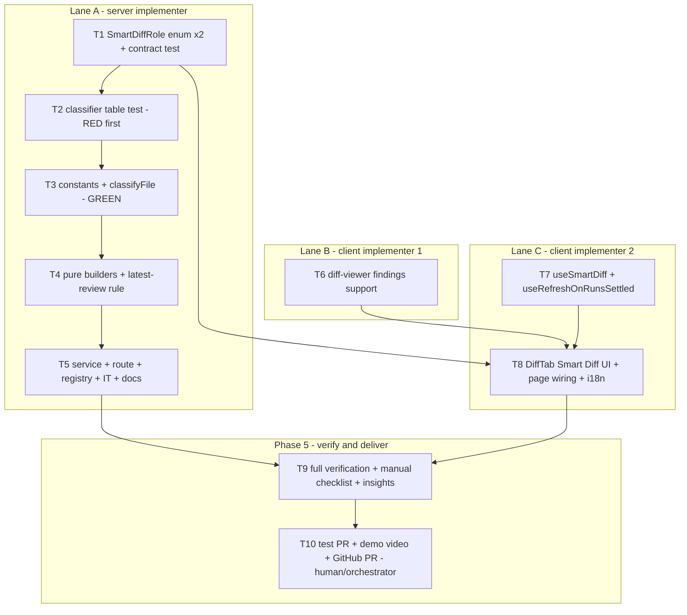

# Development Plan: Smart Diff (HW L03)

## Overview
Make the PR **Files changed** tab reviewer-ordered and review-aware. A pure, path-only classifier (`classifyFile(path) → SmartDiffRole`) puts every PR file into one of five roles. A new LLM-free route `GET /pulls/:id/smart-diff` returns the files grouped in the fixed order `core → tests → wiring → docs → boilerplate`, plus the lines that have findings in the latest review. The client draws collapsible, sticky role groups with "files with findings" counters, a red dot on file cards that have findings, and the existing Agent-runs `FindingCard` under the line it points to (with Accept/Dismiss). A **Smart order | Original order** toggle brings back the plain GitHub order. Scope: **every P1, P2 and P3 criterion** in the homework (`/home/ai/work/dev-digest-demo/hw3/task.md`). The visual target is `proto1..4.png` in the same folder.

## Requirements
P1 (blocking):
- R1: The Files changed tab of an open PR shows the role groups in the order `core → tests → wiring → docs → boilerplate`. Each group has a role label, a short description and "N files". All five appear when the PR touches all five roles.
- R2: Lock files are classified as `boilerplate`. The `docs` and `boilerplate` groups start collapsed.
- R3: After **Run review**, each group header shows "● N", where N = the number of files *in that group* that have ≥1 finding. Two files with five findings show `● 2`. The counter is hidden when N = 0.
- R4: A file card with findings shows a red dot next to its path, with no number. It sits apart from the existing GitHub comment counter (message icon).
- R5: In an expanded file, the finding card appears under the line `start_line` (RIGHT side) and shows severity, title and rationale.
- R6: The **Original order** toggle restores GitHub's order. Toggling back restores the smart order.
- R7: An open PR on the fork, with an implementation description and a 1–3 minute demo video.

P2:
- R8: Patterns and role order live in ONE constants file. A table-driven unit test of the classifier ("path → role") is written **before** the implementation and includes the 3 tricky cases.
- R9: The route response passes validation against the `SmartDiff` contract. The `SmartDiffRole` enum is extended in **both** `brief.ts` copies, which stay byte-identical.
- R10: Serving Smart Diff makes **no LLM call**, and grouping works before the first review.
- R11: A line with a finding has a colored left bar plus a right-hand severity label: `CRITICAL → blocker`, `WARNING → warning`, `SUGGESTION → suggestion`. Color and icon come from `SEV`.
- R12: Accept / Dismiss in the inline card work and change the finding's state (accepted/dismissed tag, muted card).
- R13: A finding whose line is not in the rendered patch appears in a separate block at the end of the file. It never disappears.
- R14: Finding cards can be hidden with the **same** toggle that hides GitHub comments.
- R15: The PR description lists the subagents used and what `plan-verifier` found.

P3:
- R16: Group headers stay pinned to the top while scrolling (sticky).
- R17: A finding card can be collapsed to its one-line header.
- R18: Before any review exists, an empty-state hint ("no review yet") replaces zero counters.
- R19: Counters, dots and inline cards update after Run review completes, **without a page reload**, whichever tab is open when the run settles.
- R20: All new UI strings come from i18n: `client/messages/en/prReview.json` → `smartDiff` (incl. `testsLabel`, `docsLabel`) and `shell.json` → `diffViewer` for diff-viewer internals. No hardcoded English in JSX.

## Key decisions (made by the planner — implementers follow them)

**D1 — "Findings of the latest review" = the newest `kind:'review'` review per agent.**
- Group reviews by `agent_id`; reviews with a null `agent_id` (seed/CI) form one bucket of their own. Keep only the newest review per bucket (by `created_at`; ties keep the API order, which is newest first). Then take the union of their findings.
- Why:
  - (a) A "Run review (all)" click writes **one review row per agent**, so taking only the single newest row would hide every other agent's findings.
  - (b) Re-running one agent replaces only *that* agent's previous pass, so the same line does not get duplicate cards from old runs. Taking all reviews would inflate the counters on every re-run.
  - (c) There is no batch id. `run_id` points to one agent's `agent_runs` row, so a "latest batch" would have to be guessed from `created_at` windows, which is fragile.
  - (d) Failed runs never insert a review (`run-executor.ts:346` writes only on success), so a failed re-run keeps the agent's last good findings.
  - `kind:'summary'` reviews are excluded.
- Accepted and dismissed findings **stay in the set**. They render with their state: FindingCard shows the accepted/dismissed tag and a muted style. They also count toward the dot and "● N", so the counters match what the reviewer sees when expanding.
- The rule is implemented twice, as pure functions with **mirrored fixture tables**: server `selectLatestReviewFindings` (T4) and client `selectLatestFindings` (T8).

**D2 — Live refresh (R19).**
- Inline indicators are derived on the client from `usePrReviews(prId)` (query key `["reviews", prId]`), following the task's suggested design. So "live" means: refresh `["reviews", prId]` when the PR's runs settle.
- Existing path: on the Agent runs tab, `RunStatus` → `onRunDone` → `refetchReviews()`. That path only fires while `FindingsTab` is mounted.
- New, page-level path that covers every tab: `useRefreshOnRunsSettled(prId, reviewRunning)` in `lib/hooks/reviews.ts`, called from `page.tsx`.
  - `reviewRunning` already comes from `usePrActiveRuns`, which polls every 4 s while any run is `running`.
  - When `reviewRunning` flips from true to false, the hook calls `invalidateQueries(["reviews", prId])` and `invalidateQueries(["pr-runs", prId])`.
  - Worst-case latency is about 4 s after the run ends.
- Smart-diff grouping depends only on the files, so `useSmartDiff` uses the key `["smart-diff", prId, headSha]`. It refetches by itself when the PR head moves, with no invalidation wiring.

**D3 — Visibility toggle (R14 vs R5).**
- One state drives GitHub threads **and** finding cards: `showOverride: boolean | null` (null = automatic).
- `showAnnotations = showOverride ?? (latestFindingsInDiff > 0)`.
  - With findings present, cards are visible by default (P1 video works without a click).
  - With GitHub comments only, the current default (hidden) is unchanged.
- The toggle button appears when `githubComments + findingsInDiff > 0`.
- When hidden, only the cards and threads hide. The line bar and label, the file dot and the group counter stay: they are navigation, not clutter.

**D4 — Classification deviations, fixed in the test table (R8):**
- `e2e/README.md → tests`. The task's default is kept: e2e docs describe the flows and are reviewed with them.
- `package.json → wiring`, not boilerplate as in the prototype. A dependency manifest (scripts, postinstall, new deps) needs a real look.
- `dist/**`, `build/**` and `e2e/**` are anchored at the repo root, as the globs literally say, so `src/build/plan.ts` stays `core`.
- `.claude/**` matches at any depth (nested package `.claude/` dirs exist).
- Only `index.ts` and `index.js` count as barrels: `index.tsx` stays `core`.
- `*.spec.ts` also accepts `.spec.tsx`.
- `src/config.ts → core`, because `*.config.*` needs a literal `.config.` in the name. This also keeps e2e flow `05-pr-diff` green: it waits for `src/config.ts` to be visible without any click, and `core` is expanded by default.

**D5 — Server returns only non-empty groups.**
- Groups are returned in fixed role order, which matches the prototype (empty roles are not drawn). Inside a group, files are sorted by path, so the response is deterministic.
- The client keeps **GitHub order inside a group**. It joins `pr.files` by `path` into a `path → role` map.
- Paths missing from the smart-diff response (for example during a `pr_files` refresh race) go to `core`, so no file is ever hidden.

**D6 — Finding card injection.**
- `components/diff-viewer` stays route-agnostic. It gets a `DiffFindingsApi` whose `Card` is a component type defined at module level.
- The DiffTab passes `DiffFindingCard`, a thin adapter over the existing Agent-runs `FindingCard` with `defaultExpanded`.
- FindingCard's own header toggle provides the "collapse to one line" behaviour (R17).
- No file moves, no React context.

## Affected modules & contracts
- **server**:
  - New module `server/src/modules/smart-diff/` containing: constants, the pure classifier, pure builders, service, routes, and the tests.
  - One registry line in `modules/index.ts`.
  - A row in `server/docs/api-contracts.md`.
  - No DB schema change and no migration. Data is read through the existing `container.reviewRepo` (`getPull`, `getPrFiles`, `reviewsForPull`).
- **client**:
  - Changes to diff-viewer: finding markers, inline cards, the unanchored block and the file dot.
  - New `useSmartDiff` and `useRefreshOnRunsSettled` hooks.
  - DiffTab rewritten: toolbar, role groups, order toggle, empty states.
  - `page.tsx`: wiring.
  - i18n keys in `prReview.json` and `shell.json`.
- **reviewer-core / e2e**: no changes (e2e flow 05 must stay green, see D4).
- **Contracts:**
  - **CHANGE to an existing shared contract (explicit callout):** `SmartDiffRole` in `server/src/vendor/shared/contracts/brief.ts` goes from `z.enum(['core','wiring','boilerplate'])` to `z.enum(['core','tests','wiring','docs','boilerplate'])`. Enum order = display order. The change is additive (widens the union).
    - It must be mirrored **byte-identically** in `client/src/vendor/shared/contracts/brief.ts`.
    - Verified consumers: only `server/test/contracts.test.ts` (uses `'core'`) and the type re-export in `client/src/lib/types.ts`. No exhaustive switch exists, and `reviewer-core` does not import it.
  - `SmartDiffResponse` (`review-api.ts`) is reused as-is. No new contract file.

## Architecture changes
- `server/src/modules/smart-diff/constants.ts` (domain-pure):
  - `ROLE_ORDER: readonly SmartDiffRole[]`, the display order.
  - `ROLE_RULES`, the ordered precedence `boilerplate → tests → wiring → docs`. Each rule is `{ role, rules: { glob: string; re: RegExp }[] }`; the `glob` text is kept for documentation.
  - `core` is the fallback.
  - No glob library: RegExp only, so no new dependency.
- `server/src/modules/smart-diff/classifier.ts` (domain-pure):
  - `classifyFile(path: string): SmartDiffRole` normalises `\` → `/` and strips a leading `./`, then returns the first matching rule's role, or `core`.
  - Imports only the `SmartDiffRole` type and `./constants.js`. No Fastify, Drizzle or container imports, so L08 can import it as a pre-prompt filter without HTTP.
- `server/src/modules/smart-diff/helpers.ts` (application-pure, structural types, no Drizzle row types):
  - `selectLatestReviewFindings(rows)` (D1).
  - `buildSmartDiff(files, findings): SmartDiff`: classify, group in `ROLE_ORDER` skipping empty groups, sort by path, compute `finding_lines` as the sorted unique `start_line` of findings whose `file === path`, and fill `split_suggestion` with `too_big:false`, `total_lines = Σ(additions+deletions)` and `proposed_splits:[]`.
- `server/src/modules/smart-diff/service.ts` (application):
  - `SmartDiffService(container, logger?)`.
  - `forPull(workspaceId, prId): Promise<SmartDiff>`:
    - Calls `container.reviewRepo.getPull`; throws `NotFoundError` if missing.
    - Calls `getPrFiles` and `reviewsForPull`, then `selectLatestReviewFindings`, then `buildSmartDiff`.
    - Logs one info line: `smart-diff: deterministic role grouping (no LLM call)` with `{ prId, files, groups, findingLines }`.
  - No `container.llm`, `github` or `git` access.
- `server/src/modules/smart-diff/routes.ts` (presentation):
  - `GET /pulls/:id/smart-diff` with `schema: { params: IdParams, response: { 200: SmartDiffResponse } }`. The app-level zod `serializerCompiler` validates the response against the contract (R9).
  - Handler: `getContext` → one service call → return.
- `server/src/modules/index.ts`: add `smartDiff` (one import and one key).
- `client/src/components/diff-viewer/` (shared, client component tree):
  - New `findings.ts`, containing the `DiffFindingsApi` and `DiffFindingCardProps` types, `partitionFindings` (key `RIGHT:${start_line}`, matched against the rendered `keysForLine` set), `topSeverity`, and the styles.
  - New `LineFindings/` and `UnanchoredFindings/` components.
  - `FileCard`, `CodeLine` and `DiffViewer` accept an optional `findings?: DiffFindingsApi`. This is backward compatible; `test/smoke.test.tsx` still renders `<DiffViewer files />`.
- `client/src/lib/hooks/smart-diff.ts`: `useSmartDiff(prId, headSha)`.
- `client/src/lib/hooks/reviews.ts`: `useRefreshOnRunsSettled(prId, running)`.
- `client/src/app/repos/[repoId]/pulls/[number]/_components/DiffTab/` (client components, colocated like `OverviewTab/IntentCard.tsx`):
  - `DiffTab.tsx` is the container: hooks plus derived state.
  - `SmartDiffToolbar.tsx`, `SmartDiffGroup.tsx` and `DiffFindingCard.tsx` are presentational.
  - `helpers.ts` holds the pure helpers, `constants.ts` holds `ROLE_META`, and `styles.ts` holds the styles.
- `page.tsx`:
  - Change the call to `<DiffTab prId={prId} pr={pr} reviewRunning={reviewRunning} />`.
  - Call `useRefreshOnRunsSettled(prId, reviewRunning)`.



Concurrency: at t=0, **T1, T6 and T7 run in parallel** (disjoint paths). Lane A continues T2→T5 while T8 waits for T1, T6 and T7. Implementers **must not** edit `*/insights/INSIGHTS.md` during the parallel phase. They put their insight candidates in their final report, and T9 appends them (single writer).

## Phased tasks

### Phase 1 — Contract

- **T1**
  - **Action:**
    - In `server/src/vendor/shared/contracts/brief.ts`, change line 81 to `export const SmartDiffRole = z.enum(['core', 'tests', 'wiring', 'docs', 'boilerplate']);`.
    - Apply the identical edit to `client/src/vendor/shared/contracts/brief.ts`.
    - In `server/test/contracts.test.ts`, extend the `SmartDiff (data.jsx DIFF)` case:
      - assert `SmartDiffRole.options` equals `['core','tests','wiring','docs','boilerplate']`;
      - assert a `SmartDiff` with one group per role (including `tests` and `docs`) parses;
      - assert an unknown role (`'misc'`) fails `safeParse`.
  - **Module:** server (+ client mirror)
  - **Type:** core
  - **Skills to use:** zod, typescript-expert, engineering-insights
  - **Owned paths:** `server/src/vendor/shared/contracts/brief.ts`, `client/src/vendor/shared/contracts/brief.ts`, `server/test/contracts.test.ts`
  - **Depends-on:** none
  - **Risk:** medium (shared contract edit — explicit callout)
  - **Known gotchas:**
    - The client resolves `@devdigest/shared` to its **own** copy (`client/tsconfig.json`), not the server one. `client/insights/gotchas.md` says otherwise and is wrong; `client/insights/INSIGHTS.md` 2026-06-17 is correct.
    - `brief.ts` has no relative imports, so there is no `.js` extension issue. The two copies must stay byte-identical.
    - Edit-tool curly-quote corruption (server INSIGHTS 2026-06-22): after editing, check for typographic quotes in both files.
    - The 9 `TS18048` errors in `run.repo.severity.test.ts` are the server typecheck baseline.
  - **Acceptance:**
    - `diff server/src/vendor/shared/contracts/brief.ts client/src/vendor/shared/contracts/brief.ts` prints nothing.
    - `grep -nP "[\x{2018}\x{2019}\x{201C}\x{201D}]" server/src/vendor/shared/contracts/brief.ts client/src/vendor/shared/contracts/brief.ts` prints nothing.
    - `cd server && npx -y pnpm@10 exec vitest run test/contracts.test.ts` passes.
    - `cd server && npx -y pnpm@10 typecheck` shows exactly the 9 baseline errors, all in `run.repo.severity.test.ts`.
    - `cd client && npx -y pnpm@10 typecheck` exits 0.

### Phase 2 — Classifier (test first)

- **T2**
  - **Action:** Create the table-driven test **before** any implementation.
    - `describe.each` / `it.each` over the table rows below, asserting `classifyFile(path) === role`.
    - One test asserting `ROLE_ORDER` deep-equals `SmartDiffRole.options`, so the constants cannot drift from the contract.
    - One test asserting first-match-wins precedence: a path matching both a boilerplate and a tests rule returns `boilerplate`.
    - Mark the three tricky cases with a `// TRICKY:` comment and the decision text.
  - Table (path → role), minimum:

    | path | role | note |
    |---|---|---|
    | `pnpm-lock.yaml` | boilerplate | lock |
    | `client/pnpm-lock.yaml` | boilerplate | nested lock (basename match) |
    | `package-lock.json` | boilerplate | |
    | `yarn.lock` | boilerplate | |
    | `Cargo.lock` | boilerplate | `*.lock` |
    | `dist/bundle.js` | boilerplate | root `dist/**` |
    | `build/output.css` | boilerplate | root `build/**` |
    | `src/components/__snapshots__/View.test.tsx.snap` | boilerplate | |
    | `__tests__/__snapshots__/x.snap` | boilerplate | **TRICKY 1**: snapshot rule above tests rule |
    | `server/src/__tests__/__snapshots__/x.snap` | boilerplate | TRICKY 1, nested |
    | `src/api.generated.ts` | boilerplate | `*.generated.*` |
    | `public/vendor/jquery.min.js` | boilerplate | `*.min.js` |
    | `server/src/modules/smart-diff/classifier.test.ts` | tests | |
    | `client/src/components/X/X.test.tsx` | tests | |
    | `server/test/reviews.it.test.ts` | tests | |
    | `src/foo.spec.ts` | tests | |
    | `src/foo.spec.tsx` | tests | D4 extension |
    | `server/test/helpers/pg.ts` | tests | `**/test/**` |
    | `src/__tests__/util.ts` | tests | `**/__tests__/**` |
    | `e2e/specs/05-pr-diff.flow.json` | tests | root `e2e/**` |
    | `e2e/README.md` | tests | **TRICKY 3**: decision, e2e docs travel with their flows |
    | `server/src/modules/index.ts` | wiring | barrel |
    | `client/src/components/diff-viewer/index.ts` | wiring | barrel |
    | `server/vitest.config.ts` | wiring | `*.config.*` |
    | `client/next.config.mjs` | wiring | |
    | `client/tsconfig.json` | wiring | `tsconfig*.json` |
    | `.eslintrc.cjs` | wiring | |
    | `.env.example` | wiring | `.env*` |
    | `docker-compose.yml` | wiring | |
    | `.github/workflows/ci.yml` | wiring | |
    | `.claude/skills/security/SKILL.md` | wiring | **TRICKY 2**: `.claude/**` above docs (markdown that drives agent behaviour) |
    | `package.json` | wiring | D4 deviation |
    | `server/package.json` | wiring | D4 deviation |
    | `README.md` | docs | |
    | `docs/plans/smart-diff.md` | docs | |
    | `server/docs/api-contracts.md` | docs | `**/*.md` |
    | `CHANGELOG.md` | docs | |
    | `LICENSE` | docs | |
    | `server/src/modules/smart-diff/classifier.ts` | core | |
    | `src/config.ts` | core | D4: no `.config.` segment; keeps e2e flow 05 green |
    | `src/build/plan.ts` | core | D4: `build/**` is root-anchored |
    | `src/index.tsx` | core | D4: barrel = `index.ts`/`index.js` only |
    | `./server/src/app.ts` | core | leading `./` normalised |

  - **Module:** server
  - **Type:** core
  - **Skills to use:** typescript-expert, zod (`SmartDiffRole.options`), engineering-insights
  - **Owned paths:** `server/src/modules/smart-diff/classifier.test.ts`
  - **Depends-on:** T1
  - **Risk:** low
  - **Known gotchas:**
    - Hermetic unit test: **no** `.it.test.ts` suffix. vitest already includes `src/**/*.test.ts`.
    - Server imports use `.js` extensions (`./classifier.js`, `./constants.js`).
  - **Acceptance:** `cd server && npx -y pnpm@10 exec vitest run src/modules/smart-diff/classifier.test.ts` **fails** (module not found or assertion failures) before T3. The implementer pastes this red output into its report as evidence that the test came first.

- **T3**
  - **Action:** Create `constants.ts` and `classifier.ts` as described in Architecture changes.
    - Rules in precedence order, each regex commented with the glob it implements:
      - **boilerplate:** `(^|/)[^/]+\.lock$`, `(^|/)pnpm-lock\.yaml$`, `(^|/)package-lock\.json$`, `^dist/`, `^build/`, `(^|/)__snapshots__/`, `\.snap$`, `(^|/)[^/]+\.generated\.[^/]+$`, `\.min\.js$`.
      - **tests:** `\.test\.tsx?$` (covers `.it.test.ts`), `\.spec\.tsx?$`, `(^|/)test/`, `(^|/)tests/`, `(^|/)__tests__/`, `^e2e/`.
      - **wiring:** `(^|/)index\.[jt]s$`, `(^|/)[^/]+\.config\.[^/]+$`, `(^|/)tsconfig[^/]*\.json$`, `(^|/)\.eslintrc[^/]*$`, `(^|/)\.env[^/]*$`, `(^|/)docker-compose[^/]*\.ya?ml$`, `^\.github/`, `(^|/)\.claude/`, `(^|/)package\.json$`.
      - **docs:** `\.mdx?$`, `^docs/`, `(^|/)README[^/]*$`, `(^|/)CHANGELOG[^/]*$`, `(^|/)LICENSE[^/]*$`.
    - `classifyFile` is a single loop over `ROLE_RULES` with a `core` fallback. Add a header JSDoc saying it is HTTP-free and reused on L08.
  - **Module:** server
  - **Type:** core
  - **Skills to use:** onion-architecture (domain-pure: imports only `@devdigest/shared` types), typescript-expert, security (pure string ops, no fs/path resolution)
  - **Owned paths:** `server/src/modules/smart-diff/constants.ts`, `server/src/modules/smart-diff/classifier.ts`
  - **Depends-on:** T2
  - **Risk:** low
  - **Known gotchas:**
    - Under strict TS, regex capture groups are `string | undefined` (INSIGHTS 2026-06-22). Use `.test()`, not captures.
    - Do not import from `../reviews/*`, Fastify or the container.
  - **Acceptance:**
    - `cd server && npx -y pnpm@10 exec vitest run src/modules/smart-diff/classifier.test.ts` passes (all rows, including the 3 TRICKY rows).
    - `grep -nE "from '(fastify|drizzle-orm)|container|\.\./reviews" server/src/modules/smart-diff/classifier.ts server/src/modules/smart-diff/constants.ts` prints nothing.

### Phase 3 — Server grouping, route (LLM-free)

- **T4**
  - **Action:** Create `helpers.ts`:
    - `selectLatestReviewFindings<F>(rows: { review: { agentId: string | null; kind: string; createdAt: Date }; findings: F[] }[]): F[]`, the D1 rule.
    - `buildSmartDiff(files: { path: string; additions: number; deletions: number }[], findings: { file: string; startLine: number }[]): SmartDiff`, as described in Architecture changes: non-empty groups in `ROLE_ORDER`, files sorted by path within a group, `finding_lines` sorted and unique, the minimal `split_suggestion`, and `pseudocode_summary` omitted.
    - Create `helpers.test.ts` with these cases:
      - (a) Five-role input → group roles equal `['core','tests','wiring','docs','boilerplate']` and every file appears exactly once.
      - (b) Missing roles → no empty groups.
      - (c) `finding_lines` are deduped and sorted, and a finding on a path not in `files` is ignored.
      - (d) `total_lines === Σ(additions+deletions)`, `too_big === false`, `proposed_splits` is `[]`.
      - (e) `SmartDiff.safeParse(result).success === true`.
      - (f) **Latest rule fixture table:**
        - agent A with two reviews → only the newest one's findings;
        - agents A and B → the union;
        - a null-agent bucket is kept separately;
        - a `kind:'summary'` review is excluded;
        - an empty input gives `[]`.
      - (g) No findings → all `finding_lines` are `[]`, and the groups are still produced (grouping before the first review).
  - **Module:** server
  - **Type:** backend
  - **Skills to use:** onion-architecture (pure application helper, structural input types; no Drizzle `$inferSelect` leakage), zod (contract parse in tests), typescript-expert
  - **Owned paths:** `server/src/modules/smart-diff/helpers.ts`, `server/src/modules/smart-diff/helpers.test.ts`
  - **Depends-on:** T3
  - **Risk:** low
  - **Known gotchas:**
    - Findings bind to `start_line` only. There is no `line` field, and `end_line` is ignored.
    - The fixture table in (f) must be mirrored **verbatim in meaning** by T8's client test. Copy the scenario names into a comment so the plan-verifier can diff them.
  - **Acceptance:** `cd server && npx -y pnpm@10 exec vitest run src/modules/smart-diff/helpers.test.ts` passes, with cases (a)–(g) present by name.

- **T5**
  - **Action:**
    - Create `service.ts` (`SmartDiffService`, see Architecture changes).
    - Create `service.test.ts`, a hermetic test using a fake container. Build it as a `Proxy` that exposes only `reviewRepo` (`getPull`/`getPrFiles`/`reviewsForPull` stubs) and **throws on access to any other property** (for example `llm`, `github`, `git`). Assert:
      - (a) A missing PR → `NotFoundError`.
      - (b) No reviews → groups are present and every `finding_lines` is `[]`.
      - (c) With two reviews of the same agent, only the newest one's lines appear.
      - (d) The proxy never threw, so no LLM, GitHub or git access happened (R10).
      - (e) The injected logger received exactly one `info` call whose message contains `no LLM call`.
    - Create `routes.ts` (`GET /pulls/:id/smart-diff`; the handler passes `req.log` as the logger).
    - Register `smartDiff` in `server/src/modules/index.ts` (one import and one key; touch nothing else).
    - Create `server/test/smart-diff.it.test.ts` (Testcontainers; copy the `setupRepoAndPr` pattern from `test/reviews.it.test.ts`). Insert `pr_files` for 5 roles (`server/src/modules/x/service.ts`, `server/test/x.test.ts`, `server/src/modules/index.ts`, `README.md`, `pnpm-lock.yaml`), then:
      - (a) Before any review: `GET` → 200, roles in order, all `finding_lines` are `[]`.
      - (b) Insert two reviews for one agent (old finding line 5, new finding line 10 on the core file) plus one `kind:'summary'` review: core `finding_lines` deep-equals `[10]`.
      - (c) `SmartDiffResponse.safeParse(res.json()).success === true`.
      - (d) The `MockLLMProvider` passed in overrides has `calls.length === 0` after the GETs.
      - (e) An unknown uuid → 404; a non-uuid id → 4xx validation error.
    - Add the route row to `server/docs/api-contracts.md` (Reviews & Runs table). One line saying "deterministic, no LLM".
  - **Module:** server
  - **Type:** backend
  - **Skills to use:** onion-architecture (thin route → one service call; service uses `container.reviewRepo`, no SQL), fastify-best-practices (`withTypeProvider<ZodTypeProvider>()`, declared `params` + `response` schemas, `app.inject` testing), zod, security (workspace-scoped `getPull`; no internal error leakage), typescript-expert
  - **Owned paths:** `server/src/modules/smart-diff/service.ts`, `server/src/modules/smart-diff/service.test.ts`, `server/src/modules/smart-diff/routes.ts`, `server/src/modules/index.ts`, `server/test/smart-diff.it.test.ts`, `server/docs/api-contracts.md`
  - **Depends-on:** T4
  - **Risk:** medium
  - **Known gotchas:**
    - Use `this.container.reviewRepo` (lazy getter, `platform/container.ts:117`). Do **not** `new ReviewRepository` and do not import `../reviews/repository.js`. INSIGHTS 2026-06-20 says cross-module data goes through Container properties; `intent/service.ts` is a precedent to avoid, not copy.
    - `getContext(container, req)` is the first call. `IdParams` comes from `../_shared/schemas.js`.
    - `Logger` type: `import type { Logger } from '../reviews/run-executor.js'`. It is pino-style `(obj, msg)`, which `req.log` satisfies. Do not confuse it with `RunLogger` (message-first).
    - Declaring a `response` schema makes the zod `serializerCompiler` (`app.ts:65`) reject a mismatched body with 500. That is the intended contract guard.
    - `GET /pulls/:id` deletes and re-inserts `pr_files` when a GitHub PAT exists (`pulls/routes.ts:218`), so a concurrent read can see a partial list. Out of scope to fix; the client tolerates it (D5).
    - **Do not edit `server/src/db/seed.ts`.** e2e flows assert on the seed.
    - The IT test needs Docker (available here: `docker info` OK). Keep the `.it.test.ts` suffix.
  - **Acceptance:**
    - `cd server && npx -y pnpm@10 exec vitest run src/modules/smart-diff/service.test.ts` passes (a)–(e).
    - `cd server && npx -y pnpm@10 exec vitest run test/smart-diff.it.test.ts` passes (a)–(e).
    - `grep -rnE "\.llm|completeStructured|container\.github|container\.git\b" server/src/modules/smart-diff/` prints nothing.
    - `grep -n "smartDiff" server/src/modules/index.ts` shows exactly 2 lines (import and key).
    - Server typecheck shows only the 9 baseline errors.

### Phase 2' — Client infrastructure (parallel with Lane A from t=0)

- **T6**
  - **Action:** Add findings support to the shared diff viewer. All new props are optional and backward compatible.
    - New `client/src/components/diff-viewer/findings.ts`:
      ```ts
      export interface DiffFindingCardProps { finding: FindingRecord; pending: boolean; onAction: (action: FindingActionKind) => void; }
      export interface DiffFindingsApi {
        byPath: ReadonlyMap<string, FindingRecord[]>; // caller-filtered (latest set), keyed by file path
        show: boolean;                                // same switch as GitHub comments (D3): hides cards only
        pending: boolean;
        onAction: (findingId: string, action: FindingActionKind) => void;
        Card: React.ComponentType<DiffFindingCardProps>; // module-level component injected by the route (D6)
      }
      export function partitionFindings(findings: FindingRecord[], renderedKeys: Set<string>): { matched: Map<string, FindingRecord[]>; unanchored: FindingRecord[] } // key = lineKey("RIGHT", f.start_line)
      export function topSeverity(findings: FindingRecord[]): Severity // CRITICAL > WARNING > SUGGESTION
      ```
      Also add styles: `bar(color)` (inset 3px left box-shadow), `label`, `dot`, `unanchoredWrap`, `unanchoredTitle`. Reuse the `cs.thread` indentation.
    - `FileCard.tsx`:
      - Add the optional `findings?: DiffFindingsApi` prop.
      - Compute `renderedKeys` once from `lines` via `keysForLine`. Today it is built only inside the comments memo; hoist it so comments and findings share it.
      - Call `partitionFindings(byPath.get(file.path) ?? [], renderedKeys)`.
      - **Header:** when the file has ≥1 finding, show a red dot `<span role="img" aria-label={t("diffViewer.fileHasFindings")} title=…>` right after the path (`var(--crit)`, 7px). It is placed before the stat and is separate from the existing `MessageSquare` GitHub counter.
      - **Body:** pass the per-line matched findings to `CodeLine`. At the end of the body, render `<UnanchoredFindings>` when `findings.show && unanchored.length > 0`.
    - `CodeLine.tsx`:
      - Add the optional `findings?: FindingRecord[]` and `findingsApi?: DiffFindingsApi` props.
      - When `findings.length > 0`, the row gets a left bar in `SEV[top].c`, and a right-aligned label: `Icon[SEV[top].icon]` plus `t("diffViewer.findingLabel." + top)`. These are **always** shown (D3).
      - Below the GitHub threads, render `<LineFindings>` (the `findingsApi.Card` per finding) only when `findingsApi.show`.
    - New `LineFindings/LineFindings.tsx` (+ `index.ts`) and `UnanchoredFindings/UnanchoredFindings.tsx` (+ `index.ts`). The unanchored block title is `t("diffViewer.unanchoredFindingsTitle", { count })`.
    - `DiffViewer.tsx`: thread `findings` through, and change `key={i}` to `key={f.path}`.
    - `index.ts`: export the types `DiffFindingsApi` and `DiffFindingCardProps`.
    - `client/messages/en/shell.json` → `diffViewer`, add:
      - `fileHasFindings` ("Has review findings");
      - `findingLabel` `{ "CRITICAL": "blocker", "WARNING": "warning", "SUGGESTION": "suggestion" }`;
      - `unanchoredFindingsTitle` ("{count} finding(s) outside the visible diff").
    - Tests:
      - `findings.test.ts` (pure):
        - `partitionFindings`: a match on an add line and on a ctx line; `start_line` absent from the patch → unanchored; `patch: null` → everything unanchored;
        - `topSeverity` ordering.
      - `FileCard/FileCard.test.tsx` (RTL + `NextIntlClientProvider` with real `shell.json` + a stub `Card` that renders `finding.title`). Patch with a `+` line 12, finding at 12 and one at 999. Assert:
        - (a) the dot is present (`getByRole("img", { name: "Has review findings" })`);
        - (b) the stub card for line 12 is rendered and the label `blocker` is visible;
        - (c) the line-999 finding is under the "outside the visible diff" heading;
        - (d) `show:false` hides both cards but keeps the `blocker` label and the dot;
        - (e) without `findings` the FileCard renders exactly as before (no dot);
        - (f) the GitHub comment count and the dot coexist as different elements.
  - **Module:** client
  - **Type:** ui
  - **Skills to use:** frontend-architecture (shared component stays route-agnostic; injection over cross-feature import), react-best-practices (derive don't store; module-level helpers; no index keys; aria-label on icon-only marks; `count > 0 &&`), react-testing-library, typescript-expert
  - **Owned paths:** `client/src/components/diff-viewer/findings.ts`, `client/src/components/diff-viewer/findings.test.ts`, `client/src/components/diff-viewer/LineFindings/LineFindings.tsx`, `client/src/components/diff-viewer/LineFindings/index.ts`, `client/src/components/diff-viewer/UnanchoredFindings/UnanchoredFindings.tsx`, `client/src/components/diff-viewer/UnanchoredFindings/index.ts`, `client/src/components/diff-viewer/FileCard/FileCard.tsx`, `client/src/components/diff-viewer/FileCard/FileCard.test.tsx`, `client/src/components/diff-viewer/CodeLine/CodeLine.tsx`, `client/src/components/diff-viewer/DiffViewer/DiffViewer.tsx`, `client/src/components/diff-viewer/styles.ts`, `client/src/components/diff-viewer/index.ts`, `client/messages/en/shell.json`
  - **Depends-on:** none (uses existing `FindingRecord`/`FindingActionKind` types)
  - **Risk:** medium
  - **Known gotchas:**
    - `SEV` comes from `@devdigest/ui`, and `SEV[x].c` is a **CSS var** (`var(--crit)`). Never append hex alpha to it; use `SEV[x].bg` for tints. Client INSIGHTS 2026-06-17 says "hex", which is outdated for `tokens.ts:10`.
    - Only use icon names that exist (`AlertOctagon`, `AlertTriangle`, `Lightbulb` come from `SEV`). Never guess (`Icon.AlertCircle` crashes).
    - next-intl renders missing keys as the key string. Tests must load the real `shell.json`.
    - `fetch` is globally mocked in vitest.
    - Use the `@/` alias for imports 3+ levels up.
    - `test/smoke.test.tsx` must still pass unchanged.
    - After editing `shell.json`, run `node -e "JSON.parse(require('fs').readFileSync('client/messages/en/shell.json','utf8'))"` and grep for curly quotes (Edit-tool corruption risk).
  - **Acceptance:**
    - `cd client && npx -y pnpm@10 exec vitest run src/components/diff-viewer src/test/smoke.test.tsx` passes, with FileCard (a)–(f) and the findings.ts cases.
    - `cd client && npx -y pnpm@10 typecheck` exits 0.
    - `grep -rn "app/repos" client/src/components/diff-viewer/` prints nothing (no route import).

- **T7**
  - **Action:**
    - New `client/src/lib/hooks/smart-diff.ts`: `useSmartDiff(prId: string | null | undefined, headSha: string | null | undefined)` built as `useQuery({ queryKey: ["smart-diff", prId, headSha], queryFn: () => api.get<SmartDiffResponse>(\`/pulls/${prId}/smart-diff\`), enabled: !!prId })`. Export it from `client/src/lib/hooks/index.ts`.
    - In `client/src/lib/hooks/reviews.ts`, add `useRefreshOnRunsSettled(prId, running: boolean)`. It keeps the previous value in a `useRef`. In an effect on `[running, prId]`, when it sees true → false and `prId` is set, it calls `qc.invalidateQueries({ queryKey: ["reviews", prId] })` and `qc.invalidateQueries({ queryKey: ["pr-runs", prId] })`. The JSDoc states the external system being synced (server run state → query cache).
    - New `client/src/lib/hooks/reviews.settled.test.tsx`: `renderHook` inside a `QueryClientProvider` with a spied `invalidateQueries`. Assert:
      - (a) initial `false` → no call;
      - (b) `true → false` → called with `["reviews","p1"]` and `["pr-runs","p1"]`;
      - (c) `false → false` and `true → true` → no call;
      - (d) `prId` null → no call.
  - **Module:** client
  - **Type:** ui
  - **Skills to use:** react-best-practices (data fetching in hooks; useEffect only for external sync), frontend-architecture (hooks in `lib/hooks/`), react-testing-library (renderHook), typescript-expert
  - **Owned paths:** `client/src/lib/hooks/smart-diff.ts`, `client/src/lib/hooks/index.ts`, `client/src/lib/hooks/reviews.ts`, `client/src/lib/hooks/reviews.settled.test.tsx`
  - **Depends-on:** none (`SmartDiffResponse` type already exists; T1 only widens the enum)
  - **Risk:** low
  - **Known gotchas:**
    - `reviews.ts` imports `notify` from `../contexts/toast` (keep it).
    - The global `QueryClient` has `refetchOnWindowFocus:false` and `staleTime:30s`, and `usePrReviews` has `staleTime: 2min`. That is why an explicit invalidation is required.
    - `usePrActiveRuns` polls every 4 s only while data is non-empty. `onRunsStarted` already invalidates it after a run starts.
  - **Acceptance:**
    - `cd client && npx -y pnpm@10 exec vitest run src/lib/hooks/reviews.settled.test.tsx` passes (a)–(d).
    - `cd client && npx -y pnpm@10 typecheck` exits 0.
    - `grep -n "smart-diff" client/src/lib/hooks/index.ts` shows 1 line.

### Phase 4 — Smart Diff UI

- **T8**
  - **Action:** Rebuild the Files changed tab. All files go under `client/src/app/repos/[repoId]/pulls/[number]/_components/DiffTab/` except where noted.
    - `constants.ts`:
      - `ROLE_META: Record<SmartDiffRole, { labelKey; descKey; color; defaultCollapsed }>` with these colours: core `var(--accent)`, tests `var(--ok)`, wiring `var(--warn)`, docs `var(--info)`, boilerplate `var(--text-muted)`. `defaultCollapsed` is true for `docs` and `boilerplate`.
      - `type DiffOrder = "smart" | "original"`.
    - `helpers.ts` (pure):
      - `selectLatestFindings(reviews?: ReviewRecord[]): FindingRecord[]`, the D1 mirror;
      - `groupFindingsByPath(findings, paths: Set<string>): Map<string, FindingRecord[]>`, sorted by `start_line`, keeping only paths present in the PR;
      - `buildRoleGroups(smart: SmartDiffResponse, files: PrFile[]): { role: SmartDiffRole; files: PrFile[] }[]`, implementing D5: a `path → role` map, GitHub order within each role, unmatched paths go to `core`, empty roles skipped, role order taken from `smart.groups`;
      - `countFilesWithFindings(files, byPath): number`;
      - `diffReviewState(reviews, running, findingsInDiff): "running" | "none" | "clean" | "has"`.
    - `helpers.test.ts`:
      - the **same D1 scenario table as T4(f)**, with the same scenario names;
      - `buildRoleGroups` order, GitHub order inside a group, an unmatched path landing in core, no empty groups;
      - `countFilesWithFindings`: 2 files with 5 findings → `2`;
      - `diffReviewState`: all 4 branches.
    - `DiffFindingCard.tsx`: a module-level adapter, `({ finding, pending, onAction }) => <FindingCard f={finding} defaultExpanded pending={pending} onAction={onAction} />`. It imports `FindingCard` from `../FindingCard`.
    - `SmartDiffGroup.tsx`:
      - The header is a `<button aria-expanded>`, sticky (`position:"sticky", top:0, zIndex:2, background:"var(--bg-primary)"`).
      - Header contents, left to right: chevron, a 9px role-coloured square, the bold `t(labelKey)`, the muted `t(descKey)`, then on the right `● N` (red, `title=t("smartDiff.filesWithFindings",{count})`, rendered only when `N > 0`) and `t("smartDiff.filesCount",{count: files.length})`.
      - `useState(!defaultCollapsed)`.
      - Body when open: `<DiffViewer files={group.files} commenting={commenting} findings={findings} />`.
    - `SmartDiffToolbar.tsx`:
      - A `SectionLabel icon="Code"` with `t("smartDiff.toolbarTitle")`.
      - A row: `t("smartDiff.filesSummary",{count})` · `+a` · `−d`.
      - A segmented control of two `Button kind="ghost" size="sm"` with `active` and `aria-pressed` (`smartOrder` / `originalOrder`, group `aria-label=t("smartDiff.orderToggleLabel")`).
      - The annotations toggle (`Eye`/`EyeOff`, `t(showAnnotations|hideAnnotations,{count})`), shown only when `count > 0`.
      - Smart order is disabled when the smart-diff query errored.
    - `DiffTab.tsx` (container):
      - Props `{ prId: string | null; pr: PrDetail; reviewRunning: boolean }`. Keep under 200 lines.
      - Hooks: `usePrComments`, `useCreatePrComment` (existing behaviour kept), `usePrReviews(prId)`, `useFindingAction()`, `useSmartDiff(prId, pr.head_sha)`.
      - State: `order` (default `"smart"`) and `showOverride: boolean | null`.
      - Derived values: `latest`, `byPath`, `findingsInDiff`, `showAnnotations` (D3), `commenting` (with `showComments: showAnnotations`) and `findingsApi`:
        - `findingsApi = { byPath, show: showAnnotations, pending: action.isPending, onAction: (id, a) => action.mutate({ findingId: id, action: a, prId }), Card: DiffFindingCard }`.
      - Render: the toolbar, then a status hint from `diffReviewState`:
        - `none` → `t("smartDiff.emptyNoReview")`;
        - `running` → `t("smartDiff.reviewRunning")`;
        - `clean` → `t("smartDiff.noFindings")`;
        - `has` → nothing.
      - Then:
        - `order==="smart"` and data loaded → `buildRoleGroups(...)` mapped to `<SmartDiffGroup key={role}/>`;
        - smart-diff loading → `Skeleton`;
        - error → `t("smartDiff.smartUnavailable")` and the original list;
        - `order==="original"` → `<DiffViewer files={pr.files} …/>`.
      - `canComment = pr.status === "open"`.
      - The old hardcoded strings ("Files changed · N files", "Show/Hide comments") are replaced by i18n.
    - `styles.ts`: styles for the group header, square, counter, toolbar and segmented control.
    - `DiffTab.test.tsx` (RTL; `QueryClientProvider` plus `NextIntlClientProvider` with real `prReview.json` + `shell.json`; `vi.mocked(fetch)` routed by URL for `/smart-diff`, `/reviews`, `/comments`, `/findings/f1/accept`). Assert:
      - (a) **R1:** the 5 group headers appear in DOM order Core logic → Tests → Wiring → Docs → Boilerplate, each with "N files".
      - (b) **R2:** Docs and Boilerplate are `aria-expanded="false"` and their file paths are not in the DOM. Clicking Boilerplate reveals `pnpm-lock.yaml`.
      - (c) **R3:** with 5 findings across 2 core files, the core header shows `2` (not 5) and other headers show no counter.
      - (d) **R18:** with reviews `[]`, the "No review yet" hint appears and no header shows a counter.
      - (e) **R6:** clicking Original order renders the files in `pr.files` order with no group headers; Smart order brings the groups back.
      - (f) **R5/R14:** a finding card title is visible under its file by default; clicking Hide comments removes it; Show comments brings it back.
      - (g) **R12:** clicking Accept POSTs `/findings/f1/accept`.
      - (h) **R17:** clicking the card header hides its rationale (collapsed to header).
      - (i) **R16:** the group header has inline style `position: sticky`.
    - `client/messages/en/prReview.json` → `smartDiff`:
      - change `coreLabel` to "Core logic" (no other consumer; verified by grep);
      - add `testsLabel` "Tests", `docsLabel` "Docs";
      - add `coreDesc` "The substance of the change — review closely", `testsDesc` "Proves the change works — check what is covered", `wiringDesc` "Hooks the core into the app", `docsDesc` "Explains the change — skim for accuracy", `boilerplateDesc` "Generated / mechanical — skim";
      - add `toolbarTitle` "Reviewer-ordered diff", `filesSummary` "{count} files", `smartOrder` "Smart order", `originalOrder` "Original order", `orderToggleLabel` "Diff order", `filesWithFindings` "{count} files with findings", `showAnnotations` "Show comments ({count})", `hideAnnotations` "Hide comments ({count})";
      - add `emptyNoReview` "No review yet — run a review to see findings in the diff.", `reviewRunning` "Review in progress — findings will appear here when it finishes.", `noFindings` "The latest review found no issues in these files.", `smartUnavailable` "Smart order is unavailable — showing the original order.";
      - keep the existing keys.
    - `client/src/app/repos/[repoId]/pulls/[number]/page.tsx`:
      - import `useRefreshOnRunsSettled` and call it next to `usePrActiveRuns` as `useRefreshOnRunsSettled(prId, reviewRunning)`;
      - render `<DiffTab prId={prId} pr={pr} reviewRunning={reviewRunning} />`.
      - Nothing else on the page changes. The Agent runs tab stays as is.
  - **Module:** client
  - **Type:** ui
  - **Skills to use:** frontend-architecture (route-colocated subcomponents; container vs presentational; pure helpers outside components), react-best-practices (derive don't store; no render factories; `count > 0 &&`; aria-expanded/aria-pressed; components ≤200 lines, ≤7 props), next-best-practices (`"use client"` only on these interactive components), react-testing-library (scenario test with fetch mocks, `findBy`, `within`), typescript-expert
  - **Owned paths:** `client/src/app/repos/[repoId]/pulls/[number]/_components/DiffTab/DiffTab.tsx`, `client/src/app/repos/[repoId]/pulls/[number]/_components/DiffTab/SmartDiffToolbar.tsx`, `client/src/app/repos/[repoId]/pulls/[number]/_components/DiffTab/SmartDiffGroup.tsx`, `client/src/app/repos/[repoId]/pulls/[number]/_components/DiffTab/DiffFindingCard.tsx`, `client/src/app/repos/[repoId]/pulls/[number]/_components/DiffTab/helpers.ts`, `client/src/app/repos/[repoId]/pulls/[number]/_components/DiffTab/helpers.test.ts`, `client/src/app/repos/[repoId]/pulls/[number]/_components/DiffTab/constants.ts`, `client/src/app/repos/[repoId]/pulls/[number]/_components/DiffTab/styles.ts`, `client/src/app/repos/[repoId]/pulls/[number]/_components/DiffTab/DiffTab.test.tsx`, `client/src/app/repos/[repoId]/pulls/[number]/_components/DiffTab/index.ts`, `client/messages/en/prReview.json`, `client/src/app/repos/[repoId]/pulls/[number]/page.tsx`
  - **Depends-on:** T1, T6, T7 (runtime check also needs T5)
  - **Risk:** high (largest UI surface; dual "latest" rule)
  - **Known gotchas:**
    - Quote bracketed paths in shell commands (`"client/src/app/repos/[repoId]/…"`, zsh glob).
    - The tests must load real message JSON: missing keys render as the key, not as an error.
    - Do not reorder or alter `FindingsTab`/`RunStatus` wiring (`onRunDone` stays).
    - `DiffFindingCard` must be module-level. A component defined inside `DiffTab` would remount every card on each render.
    - `PrDetail.files` may be truncated by GitHub for huge PRs. Counts come from the rendered `files`.
    - The `prReview.json` edits include `—`/`·`: validate the JSON with `node -e` and grep for curly quotes afterwards.
    - Do not hardcode role order on the client. Take it from the response (`smart.groups`), while `ROLE_META` stays typed by `SmartDiffRole` so that a missing role fails typecheck.
  - **Acceptance:**
    - `cd client && npx -y pnpm@10 exec vitest run "src/app/repos/[repoId]/pulls/[number]/_components/DiffTab"` passes `helpers.test.ts` and `DiffTab.test.tsx` (a)–(i).
    - `cd client && npx -y pnpm@10 typecheck && npx -y pnpm@10 test` passes: the baseline is 11 files / 32 tests, now plus the new files, with 0 failures.
    - `node -e "JSON.parse(require('fs').readFileSync('client/messages/en/prReview.json','utf8'))"` exits 0.
    - `grep -nE "\"(Files changed|Show comments|Hide comments)" "client/src/app/repos/[repoId]/pulls/[number]/_components/DiffTab/"*.tsx` prints nothing.

### Phase 5 — Verification & delivery

- **T9**
  - **Action:** This is the orchestrator's or plan-verifier's job after T5 and T8.
    - Run the full command set in *Testing strategy*.
    - Run the **manual browser checklist** below against the running stack (`/home/ai/work/dev-digest-demo/hw3/start-stack.sh`, DB `devdigest_hw3`).
    - Confirm the API log line: `grep "smart-diff: deterministic" /home/ai/work/dev-digest-demo/hw3/logs/api.log`. It must appear once per Files-changed load, with no LLM/provider log lines around it.
    - Diff the T4(f) and T8 helpers.test scenario names to confirm the D1 tables match.
    - Append the implementers' insight candidates to the module insights files, append-only, following the `engineering-insights` format:
      - server: classifier location and reuse on L08, `container.reviewRepo` over direct repo import, the response-schema guard;
      - client: the `DiffFindingsApi` injection, the `useRefreshOnRunsSettled` rationale, the `SEV.c` CSS-var correction.
  - **Module:** server + client
  - **Type:** backend + ui
  - **Skills to use:** engineering-insights, security (sanity pass: no new input reaches SQL/LLM; workspace scoping)
  - **Owned paths:** `server/insights/INSIGHTS.md`, `client/insights/INSIGHTS.md`
  - **Depends-on:** T5, T8
  - **Risk:** low
  - **Known gotchas:** e2e (`./scripts/e2e.sh`) needs the `agent-browser` CLI, which is absent on this host. Run flow `05-pr-diff` only if available (`E2E_PG_PORT=5441`). Otherwise list it as manual item M10.
  - **Acceptance:** every command in *Testing strategy* meets its stated result, every item M1–M10 is checked, and each INSIGHTS file gains ≥1 entry with a `ref: path:line` anchor.

- **T10** (human/orchestrator — no repo files)
  - **Action:**
    - **(1)** Create the **test PR** on the fork (`stasexx/dev-digest`). The branch adds one dependency (`package.json` + `pnpm-lock.yaml`), a small logic change in `server/src` or `client/src`, a test for it, a config or barrel file, **and a `.md` doc change**, so that all five groups render (D5).
    - **(2)** Load the PR into DevDigest. With no GitHub PAT in the app, use the HW-2 method: `gh api` data plus `git fetch` in `server/clones/stasexx/dev-digest`, as in the vault note `10-Projects/dev-digest.md`.
    - **(3)** Set the reviewing agent to a strong model (e.g. `anthropic/claude-sonnet-4-6`) and make sure ≥1 finding lands in a `core` file.
    - **(4)** Record the 1–3 minute video following M1–M8 (Playwright recording works headless; see the vault note).
    - **(5)** Open the GitHub PR `hw-3/smart-diff` → fork base. The description covers: what changed, the D1–D6 decisions, how it was tested, which subagent did what (planner → implementers (lanes A/B/C) → architecture-reviewer ∥ plan-verifier), and **what plan-verifier found**. Attach the video.
  - **Module:** — | **Type:** — | **Skills to use:** — | **Owned paths:** none | **Depends-on:** T9 | **Risk:** medium (needs operator's keys)
  - **Known gotchas:** never push to `main`; push only the feature branch.
  - **Acceptance:** `gh pr view <n> --repo stasexx/dev-digest --json body,url` shows a body containing the sections "Subagents" and "plan-verifier", with a video link or attachment present.

## Testing strategy
- **server, hermetic:**
  - `cd server && npx -y pnpm@10 exec vitest run --exclude '**/*.it.test.ts'` passes. The baseline is 18 files / 107 tests, plus `classifier.test.ts`, `helpers.test.ts` and `service.test.ts`, with 0 failures.
- **server, integration (Docker):**
  - `cd server && npx -y pnpm@10 exec vitest run test/smart-diff.it.test.ts` passes.
  - Optional regression: `npx -y pnpm@10 exec vitest run test/reviews.it.test.ts`.
- **server, typecheck:** `cd server && npx -y pnpm@10 typecheck 2>&1 | grep -c "error TS"` → `9`, all `TS18048` in `run.repo.severity.test.ts`. That is the pre-existing baseline, and any other error fails the check.
- **client:** `cd client && npx -y pnpm@10 typecheck && npx -y pnpm@10 test`. Typecheck exits 0. Tests pass: the baseline is 11 files / 32 tests, plus `findings.test.ts`, `FileCard.test.tsx`, `reviews.settled.test.tsx`, `DiffTab/helpers.test.ts` and `DiffTab.test.tsx`.
- **contract mirror:** `diff server/src/vendor/shared/contracts/brief.ts client/src/vendor/shared/contracts/brief.ts` prints nothing.
- **corruption guard:** `grep -nP "[\x{2018}\x{2019}\x{201C}\x{201D}]"` over every touched `.ts`/`.tsx`/`.json` file prints nothing. Both message JSON files parse with `node -e`.
- **live API:** `curl -s localhost:3001/pulls/<prUuid>/smart-diff | jq '[.groups[].role], .split_suggestion'` shows the ordered non-empty roles and `too_big:false`.
- **Manual browser checklist** (mirrors the task's "Як перевірити" video script; run on the test PR from T10, plus the seeded PR #482 for M6):
  - **M1:** Open the test PR → Files changed. The toolbar shows "Reviewer-ordered diff", "N files · +a −d" and Smart order active. Five groups appear: Core logic → Tests → Wiring → Docs → Boilerplate, each with a description and "N files". Docs and Boilerplate are collapsed. The "No review yet" hint is shown and there are no counters (R1, R2, R18).
  - **M2:** Expand Boilerplate: `pnpm-lock.yaml` (and `package-lock.json` if present) is inside (R2).
  - **M3:** Click Run review (the page jumps to Agent runs), wait for completion, return to Files changed. A red "● N" appears on group headers (N = files with findings, not the number of findings), and red dots appear on those file cards next to the path, separate from the GitHub 💬 counter (R3, R4).
  - **M4:** Run review again, then switch to Files changed **while it runs**. The "Review in progress" hint shows, and within ≈4 s of completion the counters, dots and cards refresh with no page reload (R19).
  - **M5:** Expand a file with a finding. Under the right line there is a coloured left bar, a right-side `blocker`/`warning`/`suggestion` label and the full FindingCard (severity, title, confidence, rationale, suggested fix, Accept/Dismiss) (R5, R11). Click Accept → the "accepted" tag appears and the card is muted (R12). Click the card header → it collapses to the one-line header (R17).
  - **M6:** On the seeded PR #482 (files have no patch), the seeded findings appear in "N finding(s) outside the visible diff" at the end of the expanded file (R13).
  - **M7:** Click "Hide comments (N)" → finding cards and GitHub threads disappear while the bars, labels and dots stay. "Show comments" restores them (R14).
  - **M8:** Scroll through a long group: its header stays pinned to the top (R16). Click Original order → a flat list in GitHub order, still with dots and inline findings. Click Smart order → the groups return (R6).
  - **M9:** `grep "smart-diff: deterministic" /home/ai/work/dev-digest-demo/hw3/logs/api.log` shows the line for each load and no LLM call. Say on camera: *"Grouping is a deterministic path-pattern classifier (`classifyFile`) over the PR's file list plus a DB read of already-persisted findings — the route never touches an LLM provider, so it works before the first review and costs nothing."* (R10)
  - **M10:** Seeded PR #482 → Files changed: `src/config.ts` is visible without clicks (it is in core, expanded). This is the e2e flow `05-pr-diff` invariant.

## Risks & mitigations
- **Server and client "latest review" rules drift apart** (D1 is implemented twice). → Both are pure functions with the same named fixture table (T4(f) ↔ T8 helpers.test). T9 diffs the scenario names. The JSDoc on both functions links this plan's D1.
- **Shared contract change** (`SmartDiffRole`) ripples across packages. → The change is additive only. The mirror copy is byte-identical and checked with `diff`. The contract test asserts the enum order. `ROLE_META: Record<SmartDiffRole, …>` makes a missing role a compile error.
- **`pr_files` delete+insert race in `GET /pulls/:id`** when a GitHub PAT is configured: smart-diff may read a partial file list. → The client joins by path and sends unmatched files to `core` (D5). The query key includes `headSha`. Fixing the pulls route transaction is out of scope; flag it in the PR.
- **Default visibility change** (D3): when findings exist, GitHub threads are now visible by default too, because one toggle governs both. → This is intentional to satisfy R5 + R14 together and is documented in the PR. The manual toggle still works, and GitHub-only PRs keep the old default.
- **Finding card "one line" collapse** reuses FindingCard's header (title row + file:line/confidence meta). → It is accepted as the one-line summary. If the mentor wants a literal single row, a `compact` variant of FindingCard is a follow-up (out of scope here).
- **Sticky header inside `main {overflow:auto}`** (`vendor/ui/shell/AppFrame.tsx:29`). → `top:0` on the group header works because no ancestor between it and `main` has `overflow:hidden` (FileCard's `overflow:hidden` sits *below* the header). Verified in M8.
- **Large lock-file patches:** `FileCard` parses `patch` on mount. → Boilerplate is collapsed by default, so its FileCards are not mounted at all, which is a performance gain.
- **Edit-tool curly-quote corruption** in TS and JSON with `—`/`·` text. → Grep and `JSON.parse` checks are listed in T1, T6 and T8 acceptance.
- **Live runs need the operator's keys and the test PR import** (no GitHub PAT in the app). → T10 follows the HW-2 import procedure. The automated tests cover the logic without keys.
- **Out-of-scope discoveries:**
  - `client/insights/gotchas.md` says `@devdigest/shared` resolves to the server copy (wrong).
  - Client INSIGHTS says `SEV.c` is hex (wrong).
  - `intent/service.ts` constructs `ReviewRepository` directly instead of using `container.reviewRepo`.
  - Hardcoded English remains in `page.tsx`, `FindingsTab.tsx` and `PrDetailHeader.tsx`.
  - These are noted for T9 insights or the PR, not fixed here.

## Out of scope
- `pseudocode_summary` / "What this does" file summaries and the "summary" chip from proto3. They would need an LLM, which contradicts R10.
- A split-suggestion UI and real `proposed_splits` (`too_big` is always false). The existing `largeTitle`/`largeBody` keys stay unused.
- Persisting smart diffs (the `smart_diffs` stub table), a DB migration, or caching on the server.
- The L08 pre-prompt filter integration. Only the import-ready `classifyFile` is delivered.
- Changes to the Agent runs tab, FindingCard internals, `seed.ts`, or reviewer-core.
- New e2e JSON flows. A transaction fix for `GET /pulls/:id` `pr_files` refresh.
- Persisting the order toggle in the URL or localStorage. Keyboard navigation between findings in the diff.

## Red-flags check
- [x] **Every requirement maps to a task.** R1→T1,T3,T5,T8(a) · R2→T2/T3 table + T8(b) · R3→T8(c) · R4→T6(a) · R5→T6(b)+T8(f) · R6→T8(e) · R7→T10 · R8→T2+T3 · R9→T1+T5 (response schema, IT (c)) · R10→T5 (proxy test (d), IT (d), grep, log line) + T4(g) + T8(d) · R11→T6(b) · R12→T8(g)+M5 · R13→T6(c)+M6 · R14→T6(d)+T8(f) · R15→T10 · R16→T8(i)+M8 · R17→T8(h)+M5 · R18→T8(d)+M1 · R19→T7+T8 page wiring+M4 · R20→T6 (`shell.json`) + T8 (`prReview.json`, hardcoded-string grep).
- [x] **Dependencies form a DAG.** T1→T2→T3→T4→T5; {T1,T6,T7}→T8; {T5,T8}→T9→T10; no cycles (see the Mermaid graph).
- [x] **Concurrent tasks have non-overlapping Owned paths.**
  - T1 (both `brief.ts` + contracts test), T6 (`diff-viewer/*` + `shell.json`) and T7 (`lib/hooks/*`) are disjoint at t=0.
  - T2–T5 are sequential in Lane A, and each owns distinct `smart-diff/*` files; `modules/index.ts` belongs to T5 only.
  - T8 owns `DiffTab/*`, `prReview.json` and `page.tsx`, none of them claimed elsewhere.
  - The INSIGHTS files belong to T9 only.
- [x] **Every Acceptance is measurable.** Each one is a named test file and case, a command with its expected output, or a grep/diff result.
- [x] **Shared-contract edit called out explicitly.** `SmartDiffRole` enum widened in both `brief.ts` copies (T1, Affected modules & contracts, Risks). `SmartDiffResponse` reused unchanged. No other contract touched.
